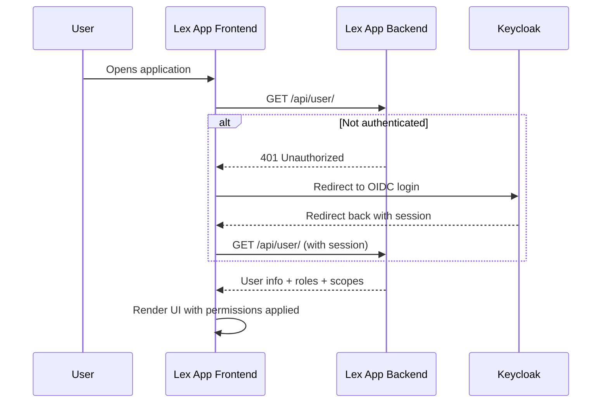

Lex App provides fine-grained access control through permission methods defined directly on your models. You can control which fields a user can view, edit, or export, which records they can see, and which actions they can perform — all integrated with [Keycloak](https://www.keycloak.org/documentation).

## The UserContext Object

All permission methods receive a `UserContext` dataclass with clean user information:

```python
@dataclass(frozen=True)
class UserContext:
    user: Any              # Django User object
    email: str             # User's email address
    is_authenticated: bool # Is user logged in?
    is_superuser: bool     # Is user a superuser?
    groups: Set[str]       # Group names, e.g. {'admin', 'finance'}
    keycloak_scopes: Set[str]  # Keycloak permission scopes
    user_permissions: tuple    # Keycloak UMA permissions of this request
    client_roles: FrozenSet[str]  # Roles on the app's Keycloak client, e.g. {'admin'}
```

`client_roles` come from the access token of the user's sign-in. A role granted or revoked in Keycloak shows up here
within one access-token lifetime (5 minutes), without signing in again. See
[[access-and-dashboards/sign-in and sessions#Roles and permission changes|Roles and permission changes]].

### Callers with an API key

A script that sends an [[access-and-dashboards/sign-in and sessions#API keys|API key]] instead of signing in gets a
`UserContext` of its own: `client_roles` is exactly `{"api_key"}`, `groups` is empty, `is_superuser` is `False`,
`email` is empty, and `user` is a stand-in named after the key, not a Django user. `keycloak_scopes` holds all six
[scopes](#access-scopes) when one record is asked about — a create, an edit, a delete, a record read by its id — but
is empty when a list judges its rows: there each row's scopes come from the caller's Keycloak UMA permissions, and a
key has none. So:

- the default methods let a key create, edit, delete and read a record it names, but a list of a model that keeps the
  default `permission_read` comes back empty for it, and so does everything built on that list —
  [[reference/REST API#API keys|REST API]] has which;
- a method that grants by group, by superuser or by email grants a key nothing;
- a create or a single delete that a method refuses answers a key `401 not_authenticated`, not `403`: a key is not a
  signed-in user.

To let keys list a model, or to treat them differently anywhere, test the role:

```python
def permission_read(self, user_context: UserContext) -> PermissionResult:
    if user_context.client_roles == {"api_key"}:
        return PermissionResult.allow_all()
    return self.keycloak_fallback(user_context, "read")
```

An overridden `permission_read` is asked row by row, where the default filters the list in the database, so keep it
cheap.

## Basic Example

```python title="MyModel.py"
from lex.core.models.LexModel import LexModel, UserContext, PermissionResult
from django.db import models


class MyModel(LexModel):
    name = models.CharField(max_length=100)
    sensitive_field = models.CharField(max_length=100)
    owner_email = models.EmailField()

    def permission_read(self, user_context: UserContext) -> PermissionResult:
        if user_context.is_superuser or 'admin' in user_context.groups:
            return PermissionResult.allow_all()
        return PermissionResult.allow_all_except({'sensitive_field'})

    def permission_delete(self, user_context: UserContext) -> bool:
        return user_context.is_superuser or self.owner_email == user_context.email
```

## Permission Methods

### Field-Level (return `PermissionResult`)

| Method                            | Purpose                          |
| --------------------------------- | -------------------------------- |
| `permission_read(user_context)`   | Which fields the user can view   |
| `permission_edit(user_context)`   | Which fields the user can modify |
| `permission_export(user_context)` | Which fields the user can export |

### Action-Level (return `bool`)

| Method                            | Purpose                                     |
| --------------------------------- | ------------------------------------------- |
| `permission_create(user_context)` | Can this user create new instances?         |
| `permission_delete(user_context)` | Can this user delete this instance?         |
| `permission_list(user_context)`   | Can this user list instances of this model? |

> [!note]
> When `permission_create` returns `False`, the API responds with **401 Unauthorized** for unauthenticated requests and **403 Forbidden** for authenticated-but-denied requests — not a generic 400. A 401 means "sign in" (`{"error": "not_authenticated" | "session_expired"}`), a 403 means "not allowed" (`{"code": "permission_denied"}`) and never ends the sign-in, and a 503 `auth_unavailable` means Keycloak could not be reached: retry. See [[access-and-dashboards/sign-in and sessions#For frontends and API clients|For frontends and API clients]].

### `PermissionResult` Factory Methods

| Method                                      | Behavior                          |
| ------------------------------------------- | --------------------------------- |
| `PermissionResult.allow_all()`              | Allow access to all fields        |
| `PermissionResult.allow_fields({'a', 'b'})` | Allow only specific fields        |
| `PermissionResult.allow_all_except({'x'})`  | Allow all except specified fields |
| `PermissionResult.deny()`                   | Deny access entirely              |
| `PermissionResult.deny_all(reason=None)`    | Deny access entirely with an optional reason string for logging |

### Built-in Helpers

For common patterns, `LexModel` provides ready-made helpers you can call directly from a permission method instead of building a `PermissionResult` by hand. Each takes the `user_context` first and — all but `keycloak_fallback` — an optional `reason=`:

| Helper | What it returns |
| --- | --- |
| `allow_all_if_superuser(user_context)` | `allow_all()` for a superuser, else `None` |
| `allow_all_if_in_groups(user_context, groups)` | `allow_all()` when the user is in any of `groups` (one name or a set), else `None` |
| `allow_fields_if_owner(user_context, owner_field="owner", fields=None, excluded_fields=None)` | For the record's owner: `allow_fields(fields)` when `fields` is given, else `allow_all_except(excluded_fields)` when that is, else `allow_all()`. `None` for anyone else |
| `keycloak_fallback(user_context, scope)` | `allow_all()` when `scope` is in `user_context.keycloak_scopes`, else `deny()` — a [Keycloak](https://www.keycloak.org/documentation) scope check |
| `allow_all_except_sensitive(user_context, sensitive_fields=None)` | `allow_all_except(sensitive_fields)`; left out, `{"password", "social_security", "ssn", "credit_card", "bank_account"}` |
| `allow_public_fields(user_context)` | `allow_fields({"id", "name", "title", "description", "created_at", "edited_at", "updated_at"})` |
| `allow_basic_fields(user_context)` | `allow_fields({"id", "name", "email", "created_at"})` |

The first three answer `None` when they do not apply, so chain them with `or` and end on one that always answers:

```python
def permission_read(self, user_context: UserContext) -> PermissionResult:
    return (
        self.allow_all_if_superuser(user_context)
        or self.allow_fields_if_owner(user_context, fields={"name", "amount", "status"})
        or self.keycloak_fallback(user_context, "read")
    )
```

The last three never look at the user: they choose the fields, and grant them to whoever is asking.

`allow_fields_if_owner` compares the owner field with `user_context.user`, the signed-in Django user, so the field has
to be a foreign key to the user model: `owner = models.ForeignKey(settings.AUTH_USER_MODEL, …)`, which is the name it
looks for unless you pass `owner_field=`. `created_by` will not do: Lex App fills it with the user's name as text,
which never equals a user, so the helper never grants. An API-key caller owns nothing.

See [[reference/LexModel Internals]] for the full signatures and parameter lists.

## Which record a method sees

`self` is not always a saved row. Questions about the model as a whole are asked on a blank record, `Model()`, whose
fields hold their defaults and whose foreign keys are empty:

| Method | Asked on |
| --- | --- |
| `permission_read`, `permission_edit`, `permission_export`, `permission_delete` | The record in question |
| `permission_create` | A blank record first: may this caller create one at all? Then, before anything is saved, the record filled from the request — foreign keys set, many-to-many not, `pre_validation` not run yet |
| `permission_list` | A blank record |
| `permission_read`, for the fields a list may be filtered or ordered by | A blank record: fields it withholds there cannot be filtered on; a denial there limits nothing |

The second `permission_create` is the `CREATE` security switch, on by default like all of them. A refusal at either
check answers 401 or 403, as above, and nothing is stored. The interface asks the blank-record questions too: whether
it offers **Create** comes from `permission_create` on a blank record, and whether it offers bulk delete from
`permission_delete`.

So a `permission_create` that reads field values sees empty ones first. One that refuses on an empty value refuses
everyone — **Create** is greyed out and every create is refused — before any value arrives. Let the blank record
through and decide on the filled one:

```python
def permission_create(self, user_context: UserContext) -> bool:
    if self.fund_id is None:  # the blank record: may this user create any?
        return "create" in user_context.keycloak_scopes
    return self.fund.manager_email == user_context.email  # the filled one: for this fund?
```

## Real-World Examples

### HR Salary Visibility

Only HR managers can see the salary field:

```python title="EmployeeContract.py"
class EmployeeContract(LexModel):
    name = models.CharField(max_length=100)
    role = models.CharField(max_length=100)
    salary = models.DecimalField(max_digits=10, decimal_places=2)

    def permission_read(self, user_context: UserContext) -> PermissionResult:
        if 'hr_manager' in user_context.groups or user_context.is_superuser:
            return PermissionResult.allow_all()
        return PermissionResult.allow_all_except({'salary'})
```

### Expense Reports — Record Ownership

Finance sees all reports, employees only see their own:

```python title="ExpenseReport.py"
class ExpenseReport(LexModel):
    employee_email = models.EmailField()
    amount = models.DecimalField(max_digits=10, decimal_places=2)

    def permission_read(self, user_context: UserContext) -> PermissionResult:
        if 'finance_manager' in user_context.groups:
            return PermissionResult.allow_all()
        if self.employee_email == user_context.email:
            return PermissionResult.allow_all()
        return PermissionResult.deny()  # row hidden
```

`deny()` is what hides a row: the list leaves it out, and asking for it by id answers `404`.
`allow_fields(set())` looks similar and is not — it admits the row with no fields. The row is still counted in the
table's row count, but its empty entry is dropped from the page (so a page can come up a row short) and the value
lists skip it; its detail answers `200 {}`.

## Keycloak Integration

By default, permission methods fall back to Keycloak scopes. After running `lex init`, your project models are synced to Keycloak as Resources and your permission methods are registered as Scopes. Manage permissions at [Excellence Cloud](https://excellence-cloud.de).

Only models defined in your project are synced — Django built-ins (`auth`, `admin`, etc.), Lex framework models, and any third-party package models are automatically excluded.

Lex App also ignores Keycloak's built-in client-management roles during this sync. If an older version created policies for those roles, rerun `lex init` after upgrading and it will clean up the stale policies for you.

You can also use Keycloak scopes directly in your custom logic:

```python
def permission_read(self, user_context: UserContext) -> PermissionResult:
    if 'read' in user_context.keycloak_scopes:
        return PermissionResult.allow_all()
    return PermissionResult.deny("No read permission in Keycloak")
```

> [!note]- Migrating from V1?
> If you're coming from `ModificationRestriction`:
>
> | Aspect      | V1 (Old)                                 | Current                          |
> | ----------- | ---------------------------------------- | -------------------------------- |
> | Approach    | Separate `ModificationRestriction` class | Permission methods on your model |
> | User info   | Raw `user` object + `violations` list    | Clean `UserContext` dataclass    |
> | Granularity | Model-level only                         | Field-level and row-level        |
> | Keycloak    | Manual integration                       | Built-in scope resolution        |
>
> Remove `ModificationRestriction` class definitions, remove `modification_restriction = MyRestriction()`, and add `permission_*` methods directly to your model. Run `lex init` to sync to Keycloak.

## Authentication Architecture

Lex App uses [Keycloak](https://www.keycloak.org/documentation) as its identity provider. Users authenticate once via OIDC (OpenID Connect), and the session is shared across the entire application — including embedded [[access-and-dashboards/streamlit/index|Streamlit dashboards]]. How long a sign-in lasts, and what ends it, is on [[access-and-dashboards/sign-in and sessions|Sign-in & Sessions]].

The frontend authentication flow:



The `SessionAuthGate` component handles this transparently — including redirect-loop protection, automatic retries, and a clear unauthorized page for users without assigned roles.

For non-browser clients (for example scripts, integrations, or dashboards calling the API directly), you can authenticate with an `Authorization: Bearer <access token>` header. Lex App will resolve roles and scopes from that token even when there is no browser session. Only access tokens are accepted; an ID token is refused. A script with no Keycloak user of its own can send an [[access-and-dashboards/sign-in and sessions#API keys|API key]] instead; how permission methods see it is under [Callers with an API key](#callers-with-an-api-key).

For the embedded Quackback feedback widget, Lex App exposes `POST /api/quackback-widget-token` for logged-in users. It returns a short-lived (5-minute) `ssoToken` carrying the user's id, email, and name, signed with `QUACKBACK_WIDGET_SECRET`, so the widget can identify the user without a second login. The frontend wires this up automatically — you only need to set the secret.

### Access Scopes

Permissions are enforced across 6 scopes:

| Scope      | What It Controls                          |
| ---------- | ----------------------------------------- |
| **read**   | Which fields a user can view              |
| **edit**   | Which fields a user can modify            |
| **export** | Which fields appear in exports            |
| **create** | Whether a user can create new records     |
| **delete** | Whether a user can delete records         |
| **list**   | Whether a user can view the model's table |

These scopes are synced to Keycloak when you run `lex init`, enabling centralized policy management.

## In the Frontend

Permissions are enforced at every layer:

- **Grid cells** — fields the user can't read are hidden; fields they can't edit are read-only
- **Action buttons** — **Create**, and each row's **Edit** and **Delete**, stay on screen but are greyed out when the user may not use them; hovering **Create** says why. Bulk delete of selected rows is offered only to users who may delete
- **Inline editing** — attempting to edit a restricted field shows it as disabled
- **Exports** — restricted fields are excluded from exported files

See [[using-the-app/the-grid/index|The Grid]] for how permissions appear in the user interface.
