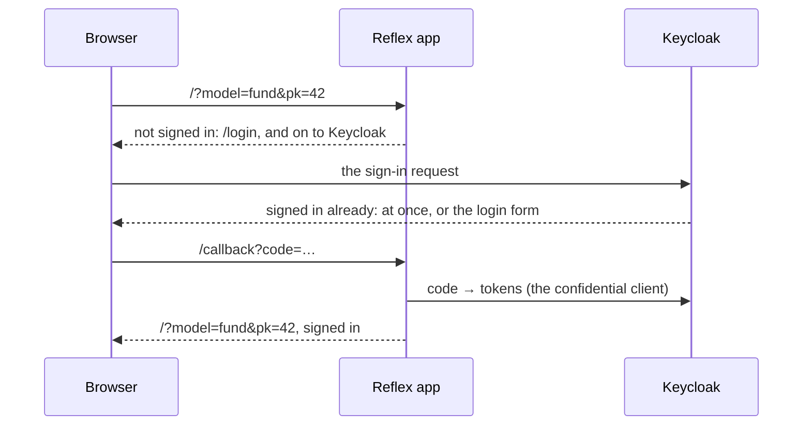

A Reflex dashboard runs as the person looking at it, and it signs them in itself. There is no proxy in front of it, as there is for [[access-and-dashboards/streamlit/sessions and authentication|Streamlit]]: [Reflex Enterprise](https://reflex.dev/docs/enterprise/auth/overview/)'s `AuthPlugin` runs the sign-in inside the app, and Lex App points it at the project's own Keycloak. This page is what happens, and the two things Keycloak needs before it works.

## Every page requires sign-in

Every page, event handler and state var requires a signed-in user unless it says otherwise. A visitor who is not signed in is sent to `/login`, which sends them straight on to Keycloak — there is nothing to click — and Keycloak sends them back through `/callback` to the page they asked for, query string included, so `?model=fund&pk=42` survives the round trip. Someone already signed in to Keycloak — to Lex App, for instance — sees no form at all: Keycloak answers at once, and the dashboard opens signed in.



`/login` is Lex App's page, not Reflex Enterprise's: the plugin's own is a row of buttons, one per sign-in provider, that waits for a click even when there is only one. Lex App's shows **Login with Keycloak** only when a sign-in it started did not complete — a visitor who leaves Keycloak's form with the browser's back button gets the button rather than being sent straight back, and so does one whose sign-in could not start because Keycloak did not answer.

Something that must be public says so with `auth=False` — `@rxe.page(route="/status", auth=False)`, `@rxe.event(auth=False)`, `rxe.var(auth=False)`. On a dashboard that is rarely right.

## Inside Lex App's frame

Framed by Lex App — the **Reflex** entry in the sidebar — the dashboard behaves the same with two differences:

- **Signing in happens without showing Keycloak.** Keycloak's login page refuses to render inside a frame, so the framed dashboard asks Keycloak whether the user is signed in without a page of its own (`prompt=none`). Signed in to Lex App, they are, and the dashboard opens signed in with nothing to click. When Keycloak cannot tell from inside the frame, `/login` shows **Login with Keycloak**: one click opens a small popup, which finishes by itself and closes for someone signed in already, and shows Keycloak's form to anyone else.
- **The dashboard's own header is left out.** Lex App opens it with `lex_embed=1`, and the page then draws neither the signed-in user nor a **Sign out** button: Lex App's header shows both. Your components can do the same — see [[access-and-dashboards/reflex/standalone dashboards#Framed by Lex App|Framed by Lex App]].

Keycloak cannot tell from inside the frame when there is no Keycloak session, and when the browser keeps Keycloak's cookies from frames on another site — Safari and Firefox do by default, and so does any browser set to block third-party cookies. Serving Keycloak and the dashboards on the same site as Lex App — `auth.example.com` and `dashboards.example.com` beside `app.example.com` — makes the frame's sign-in silent in all of them.

Either way the click is needed at most once per browser. A frame on the same site as Lex App — `localhost` in development — shares the dashboard's own cookies, so once the dashboard has signed in there, in a tab or through the popup, the frame is signed in from them without asking Keycloak at all.

A dashboard served over HTTP from anywhere but `localhost` cannot keep anyone signed in, framed or not — the sign-in cookies are `Secure`, and browsers drop them on plain HTTP. The symptom is a sign-in that never sticks: back on `/login` after every one. Serve it over HTTPS.

## What to configure

### Nothing new in `.env`

The dashboard signs in with the settings the project already has for Keycloak — the realm, and the confidential client Django signs users in through:

| The plugin needs | Lex App reads | Overrides, strongest first |
|---|---|---|
| The issuer | `KEYCLOAK_URL` and `KEYCLOAK_REALM` | `LEX_KEYCLOAK_ISSUER_URI`<br>`OIDC_ISSUER_URI` |
| The client ID | `OIDC_RP_CLIENT_ID` | `LEX_KEYCLOAK_CLIENT_ID`<br>`OIDC_CLIENT_ID` |
| The client secret | `OIDC_RP_CLIENT_SECRET` | `LEX_KEYCLOAK_CLIENT_SECRET`<br>`OIDC_CLIENT_SECRET` |

The issuer is the realm's URL, `<KEYCLOAK_URL>/realms/<KEYCLOAK_REALM>`. The overrides are Reflex Enterprise's own variables, and a set one always wins. `KEYCLOAK_CLIENT_ID` is never used: in Lex App it names the client handed to the browser, which is not the one a dashboard signs in through.

Two of the proxy's settings apply here too, with the same meaning: `OIDC_ISSUER`, when the tokens carry a different issuer from the URL the server reaches Keycloak on, and `OIDC_VERIFY_SSL=false`, for a local Keycloak with a self-signed certificate. The proxy's session settings — `SESSION_SECRET`, `TOKEN_REDIS_URL`, `LEX_PROXY_REPLICAS` — do not. What the sign-in keeps on the server it keeps in the instance's own Redis, the one Celery uses, which needs nothing new either — see [Staying signed in](#staying-signed-in).

### Keycloak: two lists of URLs

Keycloak only sends a user back to a URL it knows. In the confidential client's settings — the client `OIDC_RP_CLIENT_ID` names — add the dashboard's origin to two lists:

| Keycloak setting | Add, for development and for production |
|---|---|
| **Valid redirect URIs** | `http://localhost:8502/callback`<br>`https://dashboards.example.com/callback` |
| **Valid post logout redirect URIs** | `http://localhost:8502/*`<br>`https://dashboards.example.com/*` |

The callback is built from the address in the browser, so every origin people actually use needs an entry — and behind a reverse proxy, the app must see the public scheme and host, or it builds an `http://` callback that matches nothing. A missing entry shows up as Keycloak's *Invalid parameter: redirect_uri* instead of the login form.

### Options of the sign-in

The sign-in is Reflex Enterprise's `AuthPlugin`, built by `lex_auth_plugin()` from `lex.lex_app.reflex.config`; `lex_config()` puts it in the app's plugin list. `lex_auth_plugin(**options)` passes on any option `AuthPlugin` takes — `auth=` for an app-wide authorization check, `extra_scopes` for more claims, builders for the plugin's own pages, an audit hook; Reflex Enterprise's [authentication documentation](https://reflex.dev/docs/enterprise/auth/overview/) lists them. Two are set for you: `auth_providers`, Lex App's Keycloak provider, and `login_page`, the `/login` described above. Pass either only to replace it.

The options go where `rxconfig.py` builds the plugin list, and a list you pass replaces lex-app's whole one. Keep `lex_auth_plugin()` in it — without it the dashboards stop requiring sign-in — and `rx.plugins.RadixThemesPlugin()` beside it; the example is under [[access-and-dashboards/reflex/running and deploying#What the first run does|Running & Deploying]].

## Staying signed in

Access tokens are short-lived, and the dashboard renews its own before it expires — in the background, coordinated across the tabs a user has open, without reloading the page. The tokens live in HTTP-only cookies, which the page's JavaScript never sees. The Reflex backend holds them too, with each user's page state, and reads them back from the cookies whenever it has none. (That page state is why more than one backend replica needs a shared Redis — see [[access-and-dashboards/reflex/running and deploying|Running & Deploying]].)

A dashboard session is bound to the user's **Keycloak session**, exactly like a Lex App or Streamlit session, and lasts as long as Keycloak keeps it: the sign-in cookies live 30 days and are renewed with every token renewal. Only Keycloak saying the session is over signs the dashboard out — signing out of Lex App, an administrator ending the session, or the realm's maximum session lifetime. Signing out of Lex App reaches the dashboard through Keycloak's back-channel logout: it is signed out at its next token check, within minutes; without a shared Redis, at its next renewal.

Nothing else signs it out:

- **Keycloak unreachable, or answering with an error.** The user is not signed out, and the dashboard keeps trying to renew the tokens — about once a minute, with a growing pause between the attempts that reach Keycloak. Until the access token expires, the dashboard works as before and the page keeps the profile of the user it belongs to. Once the access token has expired and Keycloak still cannot renew it, the dashboard serves no one: no user, no permissions, no token for the Lex App API, and `/login` shows "Sign-in is temporarily unavailable. Retrying…" instead of a sign-in. The first renewal that succeeds restores the session — the same user, without signing in again — and `/login` returns to the page that was asked for.
- **Keycloak rejecting the dashboard's client** (a wrong client secret, say). The user is not signed out, and the log says why at ERROR, once per attempt (every 5 minutes), so the misconfiguration is found rather than felt. Once the access token has expired, nothing is served until it is fixed, as above.
- **Keycloak's clock a few seconds off, or its signing keys rotated.** Neither signs anyone out: the dashboard allows 30 seconds of clock difference, and fetches Keycloak's keys again when a token is signed with a new one. Tokens it still cannot verify are not taken; the previous ones are kept, and the log says why at ERROR, naming the clock.
- **Several tabs.** One tab renews the tokens and the others take its result — across Reflex replicas too, when they share the instance's Redis. A second renewal within 30 seconds is skipped, not treated as a failure.

What tabs and replicas have to agree on is kept in the instance's Redis — the Celery broker's: `REDIS_HOST`, with `REDIS_USERNAME` and `REDIS_PASSWORD`, on a deployed instance, `127.0.0.1:6379` locally. It holds a lock for each renewal, the token set a renewal obtained — encrypted, for two minutes — for the other tabs to take instead of asking Keycloak, and a mark for each Keycloak session back-channel logout ended, which is how signing out of Lex App reaches the dashboard at its next token check. No token is stored there in clear. Without Redis, or while it does not answer, each Reflex process keeps the same in its own memory and logs a warning: tabs served by one process still share one renewal, and a sign-out reaches the dashboard at its next renewal.

### Across restarts and new tabs

A new tab, and a restart of the Reflex server — `lex reflex` run again, or a deployment — find the user signed in, from the cookies.

That holds for large tokens too. Browsers refuse a cookie over 4096 bytes without an error, and a Keycloak access token carries every role the user holds in the realm while its client allows full scope — Keycloak's default, and in a realm shared by many clients easily more than 4096 bytes. Such a token is stored compressed, and the dashboard's log says so, once:

```text
The Keycloak access token makes cookie _oidc_lex_keycloak_access_token_data_partitioned 8896 bytes, more than browsers keep (4096); it is stored compressed, in 2665.
```

Compressed, a Keycloak token shrinks to between a fifth and two-fifths of its size, so tokens up to about 13 KB fit. A larger one cannot be kept: a restart or a new tab has to sign the user in again, and one tab's sign-in signs the others out, because the tabs keep in step through the cookies. The log then warns instead:

```text
The Keycloak token in cookie _oidc_lex_keycloak_access_token_data_partitioned is 5321 bytes even compressed, and browsers drop cookies over 4096 bytes: …
```

In the browser's developer tools that shows as the `_oidc_lex_keycloak_id_token_partitioned` cookie without its `_oidc_lex_keycloak_access_token_data_partitioned` companion. The fix is in Keycloak, on the confidential client: **Clients** → the client → **Client scopes** → its dedicated scope → **Scope**. Turn **Full scope allowed** off, and assign there the roles its tokens must still carry — those your Keycloak permissions' role policies check. Lex App signs users in with the same client, so check Lex App's permissions afterwards.

> [!note] Why the dashboard does not ask for `offline_access`
> Reflex's own documentation adds the `offline_access` scope to obtain a refresh token. Keycloak issues one without it — the Streamlit proxy has always renewed with exactly that — and with it the refresh token becomes an *offline* token that outlives the Keycloak session. A dashboard would then stay signed in after the user signed out of Lex App. It is left out on purpose.

## Who is signed in

In a component, the user is a set of vars:

| Var | Holds |
|---|---|
| `LexUser.display_name` | the name, else the username, else the email |
| `LexUser.username` | Keycloak's `preferred_username` |
| `User.name`, `User.email` | the `name` and `email` claims |
| `User.sub` | Keycloak's stable user ID |

```python
import reflex as rx
from reflex_enterprise.auth import User

from lex.lex_app.reflex import LexUser


def greeting() -> rx.Component:
    return rx.text("Signed in as ", LexUser.display_name, " (", User.email, ")")
```

All are empty until sign-in. In an event handler, `await User.current()` returns the signed-in user's claims, or `None`.

`User.logout` is the event that signs out — `rx.button("Sign out", on_click=User.logout)`. It ends the user's Keycloak session, which is the same one Lex App signs in with.

## What they may see

The ORM reads as the dashboard, **not** as the user. Lex App's [[access-and-dashboards/permissions|permission methods]] — `permission_read` and the rest — guard the API and the grid; a query in a handler returns whatever it asks for. Decide what a user may see with their Keycloak permissions:

**`current_permissions(self)`** returns the user's Keycloak UMA permissions — the list a Streamlit dashboard reads from `st.session_state.permissions`, one `{"rsname": …, "scopes": […]}` entry per resource:

```python
import reflex as rx

from lex.lex_app.reflex import current_permissions


class Overview(rx.State):
    resources: list[str] = []

    @rx.event
    async def load(self):
        permissions = await current_permissions(self)
        self.resources = sorted({p["rsname"] for p in permissions})
```

It asks Keycloak once per access token, and again after each renewal, so a changed role takes effect within minutes. If Keycloak cannot answer, the user keeps what they were last granted while the access token is valid; someone Keycloak never answered for gets nothing, and so does everyone whose access token has expired and cannot be renewed.

**`has_permission(target, scope)`** turns one of them into an `auth=` check — for an event handler (`rxe.event`), a state field (`rxe.field`) or a computed var (`rxe.var`):

```python
import reflex as rx
import reflex_enterprise as rxe

from Input.Fund import Fund
from lex.lex_app.reflex import has_permission, run_orm


def _fund_count() -> str:
    return str(Fund.objects.count())


def _round_budgets() -> None:
    for fund in Fund.objects.all():
        fund.budget = round(fund.budget)
        fund.save()


class FundActions(rx.State):
    fund_count: str = rxe.field("", auth=has_permission(Fund, "read"))

    @rxe.event(auth=has_permission(Fund, "read"))
    async def load(self):
        self.fund_count = await run_orm(_fund_count)

    @rxe.event(auth=has_permission(Fund, "edit"))
    async def round_budgets(self):
        await run_orm(_round_budgets)
```

`target` is a model — resolved to the Keycloak resource Lex App registers for it, `<app_label>.<ModelName>` — or a resource name as a string. `scope` is one of the scopes Lex App registers: `list`, `read`, `create`, `edit`, `delete`, `export`; `read` when left out. Only a **model-wide** grant counts: a grant scoped to single records does not open a check on the whole model, the same rule the API's default read check follows. A denied event is refused with a notice; a denied var is not sent to the browser at all.

A page's own `auth=` is on or off, not a check. For a page only some users may open, put the check on the vars and handlers that carry its data.

## Calling the Lex App API as the user

`current_access_token(self)` returns the signed-in user's Keycloak access token. Sent as a bearer token, it calls the Lex App API as that user, so their permissions apply exactly as they do in the grid:

```python
import httpx
import reflex as rx

from lex.lex_app.reflex import current_access_token


class Funds(rx.State):
    rows: list[dict] = []

    @rx.event
    async def load(self):
        token = await current_access_token(self)
        async with httpx.AsyncClient(base_url="http://localhost:8000") as client:
            response = await client.get(
                "/api/model_entries/fund/list",
                params={"perPage": -1},
                headers={"Authorization": f"Bearer {token}"},
            )
        self.rows = response.json()["results"]
```

`http://localhost:8000` is `lex start` locally; in production it is wherever the dashboard reaches the Lex App backend. The token never reaches the browser, and it is always a current one: the dashboard renews it before it expires. While it has expired and Keycloak cannot renew it, `current_access_token` returns `""` — treat that as not signed in.

The list is paged only when the request sends `perPage`: then it answers `{"count", "next", "previous", "results"}`, and `-1` puts every row in that one page. Without `perPage` it answers a plain array of every row — read `response.json()` itself then. See [[reference/REST API#The list endpoint|The list endpoint]].

## Related

- [[access-and-dashboards/permissions|Permissions]] — the scopes and resources `has_permission` checks
- [[access-and-dashboards/reflex/running and deploying|Running & Deploying]] — HTTPS, public URLs and the rest of production
- [[reference/Environment Variables|Environment Variables]] — every setting named on this page
