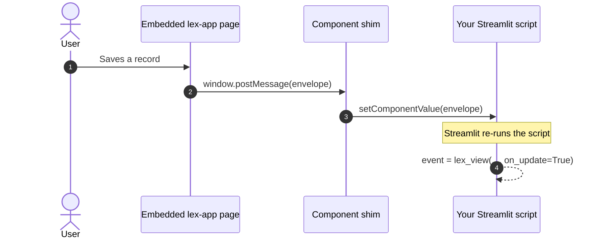

`lex_view()` puts a real Lex App page — a table, a form, a record — inside a [Streamlit](https://docs.streamlit.io/) script.

**Three pages of [Northwind Analytics](https://github.com/ExcellenceCloudGmbH/DemoNorthwindAnalytics) run `lex_view` against real data:** _The table_, _A narrower view_ — `serializer=` with the toolbar and actions hidden — and _Reacting to the table_, which shows the event `lex_view` returns. Flows have no page there; the examples below show them.


That is the application's grid, not a copy of it: the same saved views, the same filters, the same export, living inside a Streamlit page.

There are three levels to this, and you can stop after the first:

| Level     | What you write                         | What you get                                      |
| --------- | -------------------------------------- | ------------------------------------------------- |
| **Embed** | `lex_view("investor")`                 | A plain iframe. Returns `None`.                   |
| **React** | `lex_view("investor", on_select=True)` | The user's actions come back to Python as events. |
| **Chain** | `lex_view("investor", flow=…)`         | The user is routed from one form to the next.     |

```python
from lex.lex_app.streamlit import lex_view
```

Call it without callback flags or `filters` and it behaves exactly as a plain embed always has — nothing about existing call sites changes. Turn on one or more `on_*` flags when you want Python to react to what the user does, and pass `filters` when Python should decide what the table shows — see [Filtering the embedded table](#filtering-the-embedded-table).

## Basic usage

```python
import streamlit as st
from lex.lex_app.streamlit import lex_view

event = lex_view("investor", on_select=True)

if event and event["type"] == "select":
    st.write("Selected row IDs:", event["payload"]["ids"])
```

When at least one callback flag is set — or `filters` is passed — `lex_view()` switches from a plain iframe to a bidirectional component and returns the latest **event envelope** (or `None` until the first event arrives). Each time the user acts in the embedded page, Streamlit re-runs your script with the new event as the return value.

## Callback flags

Turn on only what you need:

| Flag           | `type`       | `payload`                                          | Fires when…                                                                                    |
| -------------- | ------------ | -------------------------------------------------- | ---------------------------------------------------------------------------------------------- |
| `on_create`    | `"create"`   | `resource`, `id`, `data`                           | A create form saves                                                                            |
| `on_update`    | `"update"`   | `resource`, `id`, `data`                           | An edit form saves                                                                             |
| `on_delete`    | `"delete"`   | `resource`, `id`                                   | A record is deleted from the edit toolbar                                                      |
| `on_select`    | `"select"`   | `resource`, `ids`                                  | The grid selection changes (debounced 150 ms)                                                  |
| `on_navigate`  | `"navigate"` | `from`, `to`                                       | The embedded app routes somewhere else                                                         |
| `on_filter`    | `"filter"`   | `resource`, `filters`, `filter_model`, `row_count` | The table's filters change — see [Filtering the embedded table](#filtering-the-embedded-table) |
| `on_flow_step` | —            | —                                                  | Nothing is emitted for this type — see below                                                   |

`data` on a create or update is the **whole saved record** as the API returned it, not just the id.

`on_select` is opt-in for a reason: it drives a Streamlit re-run on _every_ grid selection change, which is expensive. The framework only wires the grid's selection callback when you explicitly ask for it.

> [!warning] `on_flow_step` does not deliver an event today
> The flag is accepted and forwarded as `?emit_flow_step=true`, and the
> embedded app maps it — but nothing emits a `flow_step` event, so a handler
> guarded on `event["type"] == "flow_step"` never runs.
>
> Flows themselves work: the routing happens inside the embedded app and needs
> no event to reach Python. Setting `on_flow_step=True` does have one real
> effect, which is switching `lex_view` into bidirectional mode — but any
> `on_*` flag does that. **To follow a flow's progress, use `on_create` and
> `on_update`**, which fire at each step that saves.

## How an event reaches your script

There is no polling and no backend round-trip. The embedded page posts a message
to its parent, a small shim hands it to Streamlit, and Streamlit re-runs your
script — so the event arrives as the return value of the same `lex_view(...)`
call that drew the frame.



Because the script re-runs, everything below the `lex_view(...)` call is
evaluated again with the event in hand. The envelope carries an `id` so a re-run
does not deliver the same event twice.

### Keep the call's `key` stable

Streamlit keeps the latest event under the call's `key`. Leave it out and the key
is built from the embed's full URL — the path, the serializer, the flow, every
option the page receives — so an option that changes between re-runs starts a
new component, and the return value goes back to `None`. A serializer chosen in a
select box is the usual culprit. Fix the key when any of them can change:

```python
choice = st.selectbox("View", ["default", "summary"])
event = lex_view("investor", serializer=choice, on_select=True, key="investors")
```

`filters` is the exception: it travels beside the URL rather than in it, so
changing it never starts a new component.

Two calls that build the same URL — the same table with the same options — build
the same key, and Streamlit refuses the second with a duplicate-key error; give
each its own `key`. A plain embed, with no `on_*` flag and no `filters`, ignores
`key` altogether.


The panel on the right is `st.json(event)` and nothing else — five rows ticked
in the embedded table, and the envelope that came back for them.

## The event envelope

Every event the embedded page sends back is a dict with a stable shape:

| Key       | Meaning                                                                                                                                                 |
| --------- | ------------------------------------------------------------------------------------------------------------------------------------------------------- |
| `type`    | The event kind — `"create"`, `"update"`, `"delete"`, `"select"`, `"navigate"` or `"filter"`                                                             |
| `payload` | Type-specific data; the table under [[access-and-dashboards/streamlit/embedding app pages#Callback flags\|Callback flags]] gives the keys for each type |
| `id`      | A unique event ID, used to de-duplicate re-runs so your handler doesn't fire twice for the same event                                                   |
| `ts`      | Milliseconds since the epoch, set in the browser when the event was raised                                                                              |
| `source`  | Always `"lex-app"`                                                                                                                                      |
| `version` | The bridge protocol version                                                                                                                             |

A create event, in full:

```python
{
    "source": "lex-app",
    "version": 1,
    "type": "create",
    "id": "01J8ZQ…",
    "ts": 1758723041123,
    "payload": {
        "resource": "investor",
        "id": 42,
        "data": {"id": 42, "name": "Acme Holdings", "currency": "EUR", ...},
    },
}
```

Guard your handler on `event and event["type"] == "..."` — `event` is `None` on the first render before anything has happened. The type check matters for a second reason: every event type shares one component value, so a handler that reads `event["payload"]["ids"]` without checking the type will raise the moment a different event arrives.

## Redirect flows (`flow=`)

For multi-step workflows, pass a routing table with `flow=`. Each key is `"<resource>/<operation>"` (operation is `create` or `update`); each value is the route to open next. Targets support the `{resource}` and `{id}` template tokens.

```python
event = lex_view(
    "investor",
    on_create=True,
    flow={
        "investor/create": "/cashflow/{id}/edit",
        "cashflow/update": "/investor",
    },
)
```

You can also build the table declaratively with `Flow()`, which reads a little better for longer chains:

```python
from lex.lex_app.streamlit import Flow

flow = (
    Flow()
    .after_create("investor", "/cashflow/{id}/edit")
    .after_update("cashflow", "/investor")
)

lex_view("investor", on_create=True, flow=flow)
```

### Staying put after a save

For repeated entry — enter a record, clear the form, enter the next — route to `STAY`
instead of a path:

```python
from lex.lex_app.streamlit import STAY, Flow

flow = Flow().after_update("cashflow", STAY)
```

`STAY` means _don't navigate; stay on this form and clear it_. It exists as a constant
rather than a bare string so a typo is an error where you wrote it, instead of a redirect
that quietly never happens.

> [!note] Only `create` and `update` can be routed
> Writing a `delete` rule into a `Flow` raises `FlowError` immediately. The app does
> emit a record-deleted event, but it has no delete-redirect resolver — so such a rule
> would be accepted, serialised, shipped, and then ignored. Rejecting it at the call
> site turns a silent no-op into a message you can act on.
>
> That check, and the others [below](#what-flow-rejects), belong to `Flow`. A plain
> dict like the first example is passed on as it is, and so is anything merged into a
> `Flow` with `|=` — a delete rule written either way ships and is ignored.

For the simpler single-hop case you don't need a flow table at all — `redirect_after`, `redirect_after_create`, and `redirect_after_update` each take a single route (with the same `{resource}` / `{id}` tokens), or `STAY`.

When more than one applies to a save, a `flow` rule wins over `redirect_after_create` and `redirect_after_update`, and those win over `redirect_after`. With none of them, a save returns to the saved model's table.

### When the order matters

Everything above is a **mapping**: a rule fires whenever its operation happens,
wherever the user is. That answers "after any investor is created, go here" — and
it cannot answer three questions, because a mapping has no position in it:

- **Order.** `create t1 → create t2 → create t1` needs the same key twice.
- **Repetition.** `STAY` repeats one form; it cannot cycle a pair.
- **References.** `{id}` always means the record just saved, so a step cannot
  say "edit the record step 1 made".

For those, build the flow as a **sequence** instead. The same `Flow` object, a
different set of methods — each call appends a step, and the flow advances one
position per save:

```python
from lex.lex_app.streamlit import Flow, ref

flow = (
    Flow()
    .create("investor", as_="inv")   # name it, to come back to it later
    .create("vehicle")               # no id needed — follows the step before
    .update("investor", id=ref("inv"))
    .table("investor")               # the ending
)

lex_view("investor", on_create=True, flow=flow)
```

| Method                                    |        | What it opens                                    |
| ----------------------------------------- | ------ | ------------------------------------------------ |
| `.create(resource, *, as_=None)`          | step   | the create form                                  |
| `.update(resource, id=None, *, as_=None)` | step   | the edit form for one record                     |
| `.goto(path)`                             | step   | any route; `{id}` and `{resource}` interpolate   |
| `.table(resource=None)`                   | ending | the table — defaults to the last step's resource |
| `.show(resource=None, id=None)`           | ending | one record's detail page                         |
| `.end_goto(path)`                         | ending | any route                                        |
| `.loop()`                                 | ending | start again from the first step                  |
| `.loop_last()`                            | ending | repeat the final step                            |

#### Which record a step edits

`update` takes an id three ways, and choosing between them is the point of the
step:

```python
.update("cashflow")                  # the record the PREVIOUS step produced
.update("cashflow", id=3)            # a literal you knew when writing the flow
.update("cashflow", id=ref("inv"))   # a step you named with as_
```

References point **backwards only** — `ref("inv")` for a step not yet written
raises `FlowError` where you wrote it, rather than failing at run time. Names
must be unique for the same reason: two steps sharing one name would give
`ref()` two answers and silently take the later.

An implicit id needs a previous step that actually saves something. After a
`.goto()` — which saves nothing — the next step must name its record.

#### Repeating

```python
Flow().create("investor").loop_last()                # one form, over and over
Flow().create("investor").create("vehicle").loop()   # cycle the pair forever
```

`loop_last()` is `STAY` with a cursor that does not move: the form clears in
place. `loop()` restarts from step one and **clears the bindings** on each pass,
so a `ref` cannot reach back into the previous lap — an iteration is a fresh run.

#### At run time

- A sequence with no ending ends as `.table()` does: on the table of the last step
  that names a resource.
- A save that matches no step — the user opened another form inside the frame and
  saved it — is not routed by the flow. It goes where it would without one:
  `redirect_after…` if you set it, else the saved model's table.
- Once its ending has been reached, a flow stays finished for the rest of the browser
  tab's session, reloads included: a later save that matches a step does not start
  it again. A flow with different steps is a new flow and starts fresh.

> [!warning] The two forms cannot be mixed
> Adding a step to a flow that already holds mapping rules raises `FlowError`,
> and so does adding anything after an ending. A step fires at its position and a
> mapping rule fires whenever its operation happens; a flow holding both has no
> single answer. Pick one.

Existing flows are unaffected — a mapping serialises to exactly the bytes it
always did, and `after_create` / `after_update` / `after_save` / `STAY` keep
working unchanged.

### What `Flow` rejects

Every one of these raises `FlowError` on the line that wrote it, not when a user
reaches the step:

| Mistake                                                                                                              | Example                                                 |
| -------------------------------------------------------------------------------------------------------------------- | ------------------------------------------------------- |
| A rule key that is not `"<resource>/<operation>"`, or has no resource before the `/`                                 | `"investor"`, `"/create"`                               |
| An operation other than `create` or `update`                                                                         | `"investor/archive"`, `"investor/delete"`               |
| An empty target                                                                                                      | `Flow().after_create("investor", "")`                   |
| A step resource that is empty, or looks like a rule key                                                              | `.create("investor/create")`                            |
| An `as_` name that is empty or already used                                                                          | two steps with `as_="inv"`                              |
| An `update` or `show` with no id, where no record was saved just before it — it comes first, or right after a `goto` | `Flow().update("investor")`                             |
| An id that is blank, or not a string, an integer or `ref(...)`                                                       | `id=True`, `id=" "`                                     |
| A `ref(...)` to a name no earlier step declared                                                                      | `ref("inv")` written before the step with `as_="inv"`   |
| A `goto` or `end_goto` with an empty path                                                                            | `.goto("")`                                             |
| An ending with no step before it, or no resource to fall back on                                                     | `Flow().table("investor")`, `Flow().goto("/x").table()` |
| Anything added after an ending, or the two forms mixed                                                               | see the warning above                                   |

## Choosing a serializer

Use `serializer=` when the embedded view should shape its data with a specific DRF serializer registered on the model:

```python
lex_view("investor", serializer="InvestorWithFundSerializer")
```

If the name isn't a serializer registered for that model, the embedded request returns HTTP `400` with a validation error rather than silently falling back.

## Filtering the embedded table

An embedded table can open already filtered and tell Python when its filters change:

```python
from lex.lex_app.streamlit import lex_view

event = lex_view(
    "invoice",
    filters={"status": ["open", "overdue"], "region": 3},
    on_filter=True,
    key="invoices",
)
```

| Argument | Default | What it does |
|---|---|---|
| `filters` | `None` | Picks values in the table's value lists — [Setting the filters](#setting-the-filters) |
| `on_filter` | `False` | Sends a `"filter"` event when the table's filters change — [Hearing filter changes](#hearing-filter-changes) |

`filters` works on the table's value-list columns — the ones whose filter lists their
values with a row count, described in
[[using-the-app/the-grid/filtering and sorting#Value Lists|Filtering & Sorting]].
Inside the frame, users filter the table the way they do in the app: in its column
filters and the **Filters** tab. `on_filter`, and any change to `filters` after the
table's first load, also need one setting on the Lex App side: see
[Allowed sites](#allowed-sites).

> [!note] `filters` and `on_filter` need interface 2.3.0
> Both take effect with lex-app-frontend 2.3.0 and later, the interface lex-app 2.5
> installs. With an older interface the table opens without your filters, no
> `filter` event arrives, and nothing raises in Python.

### Setting the filters

`filters` maps a column name to the values to pick:

| You pass | It means |
|---|---|
| A list — `["open", "overdue"]` | Pick these values |
| One value — `3` | Pick just this one |
| `None`, or an empty list | Clear all of the column's values |

Pass stored values, not the labels the grid shows: a related record's id, `True` or
`False`, a date as a `date` or as `"2026-03-31"`, a choice's stored value. `None`
inside a list picks *(Blank)*. Strings, numbers, booleans, dates, `Decimal` and `UUID`
are accepted, alone or in a list, tuple or set; anything else raises `TypeError` at the
call, and so does a `filters` that isn't a dict of column names.

How the table takes them:

- **On top of what it has.** The picked values of the columns you name are replaced,
  whatever the saved view or the user had picked. A condition typed in a column's
  filter stays, and so does every other column's filter.
- **On the table showing.** The first filters go to the table the embed opened with,
  never to another table the user reaches inside the frame. A change you pass later
  goes to whichever table is showing when it arrives.
- **On value-list columns only.** A name that isn't one is ignored, with a warning in
  the browser console.
- **Without a reload.** Pass different filters on a later rerun and they are sent into
  the frame; the table refilters in place.
- **Without overriding the user.** Passing the same filters again sends nothing, so an
  ordinary rerun doesn't undo what the user changed inside the frame. Only filters
  that differ from the ones the frame last received are sent — and if the frame
  reloads, say after a sign-in, it receives your current ones again.

> [!note] Keep passing a dict
> Without an `on_*` flag, `filters` is what switches `lex_view` to the bidirectional
> component. A call that alternates between a dict and `filters=None` swaps the
> component for a plain iframe and back, reloading the table each time. To clear a
> column's values, keep the dict and give that column `None`: `filters={"region": None}`.

The first filters travel in the frame's address. A long list — a few hundred ids — is
kept out of it once the encoded filters pass 2,000 characters, and sent into the frame
when the frame has loaded instead, so it needs [Allowed sites](#allowed-sites) just
like a later change.

### Hearing filter changes

With `on_filter=True`, the table sends a `"filter"` event each time its filters change
— whether the user changed them or your `filters` did — once it has reloaded with
them:

| Payload key | What it holds |
|---|---|
| `resource` | The table's model, e.g. `"invoice"` |
| `filters` | The value-list selections: column name to the picked keys, e.g. `{"status": ["open", "overdue"]}` |
| `filter_model` | The table's whole filter state, conditions included, in AG Grid's filter-model format |
| `row_count` | How many rows the table has with these filters, or `None` if it couldn't tell. On a table grouped by a column it counts the top-level groups, not the rows |

The keys in `filters` are strings — a related record's id arrives as `"42"`, a yes/no
value as `"true"` — and `None` stands for *(Blank)*. They can go straight into another
call's `filters=`.

```python
event = lex_view("invoice", on_filter=True, key="invoices")
if event and event["type"] == "filter":
    st.metric("Invoices shown", event["payload"]["row_count"])
```

The event arrives about 300 ms after the table has reloaded; a reload that fails sends
none. A value list applies on every pick, so with `on_filter=True` the script reruns
once per pick, not once per Apply.

Pass a table's filters on to a *different* table — see
[Linking two tables](#linking-two-tables) below. Don't echo them back into the same
table's `filters=`: the frame already keeps its own picks across re-runs, and an echo
that reaches Python one re-run late can land after the user's next pick and undo it.

### Linking two tables

Pick orders in one table and show their lines in the other:

```python
picked = lex_view("order", on_select=True, key="orders")
ids = picked["payload"]["ids"] if picked and picked["type"] == "select" else None
lex_view("order_line", filters={"order": ids}, key="lines")
```

Each selection reruns the script, and the second call passes the new ids: the lines
table refilters in place, without reloading. With nothing selected, `ids` is `None` or
`[]`, and either clears the filter, so the lines table shows every line. The same
pattern works with `on_filter`: read one table's `filters` and pass them to another
table that has the same column.

Each selection reaches the lines table as a filter change sent into the frame, so
this needs [Allowed sites](#allowed-sites).

### Allowed sites

Three things only work for a dashboard whose address Lex App has been given:

- the `filter` event (`on_filter`);
- a change to `filters` after the table's first load — every rerun that passes
  different filters;
- a first-load filter list too long for the frame's address.

Without it the table still opens with its first filters, but later changes are
ignored and no `filter` event arrives; the browser console of the embedded page says
why.

Name the dashboard's own address in the Lex App deployment's
`LEX_EMBED_ALLOWED_ORIGINS`: the origin the dashboard is served from — scheme, host,
and the port if it isn't the default. On a Lex App deployment that is the origin of
the dashboard proxy's public address, `STREAMLIT_URL` (or `BASE_URL`). It is not Lex
App's own address, even when users open the dashboard inside Lex App.

```bash
LEX_EMBED_ALLOWED_ORIGINS=https://dashboards.example.com
```

Locally that is usually `http://localhost:8501`, where `lex streamlit` serves the
dashboard. Write the host exactly as the browser does: `localhost` and `127.0.0.1` are
different origins. If your dashboards share Lex App's own address, list that address.

An instance with a [[ship-and-operate/custom domains|custom domain]] serves its
dashboard on more than one hostname — `streamlit.app.customer.com` beside its
canonical one, as `LEX_STREAMLIT_HOSTS` lists them. Lex App uses
`LEX_EMBED_ALLOWED_ORIGINS` exactly as written and adds none of those hosts for you,
so list the origin of every hostname users open the dashboard on:

```bash
LEX_EMBED_ALLOWED_ORIGINS=https://dashboards.example.com,https://streamlit.app.customer.com
```

A dashboard on a hostname left out can no longer frame `lex_view` or the controls,
and gets no `filter` event.

The setting does more than open this channel. Once it is set, browsers show Lex App's
pages in a frame only inside Lex App itself and on the sites it lists — so list every
site that embeds Lex App. For your dashboards, their one address covers `lex_view` and
the [[access-and-dashboards/streamlit/embedding app controls|app controls]] alike.
Entries that aren't valid origins are dropped, and if none is left, only Lex App itself
may show its pages in a frame. The accepted forms are listed under
[[reference/Environment Variables#Embedding|Environment Variables]].

## Existing embed options still work

All the layout and routing options you already use remain available alongside the callbacks: `hide_toolbar`, `hide_actions`, `redirect_after` / `redirect_after_create` / `redirect_after_update`, `height`, `width`, `scrolling`, `extra_params`, and `base_url`. (In bidirectional mode `width` and `scrolling` are ignored — the component is always full width.)

### Hiding the toolbar and the row actions

| Option              | What it hides                                                                                              |
| ------------------- | ---------------------------------------------------------------------------------------------------------- |
| `hide_toolbar=True` | The whole toolbar above the grid: saved views, history, export, table settings — and the **Create** button |
| `hide_actions=True` | Each row's Actions column: Show, Edit and Delete, plus Calculate on a calculation model                    |

Use both for a frame that should offer the data and nothing else. If the
dashboard creates records its own way — through a [flow](#redirect-flows-flow),
say — it is `hide_toolbar` that removes the app's Create button; `hide_actions`
leaves it alone.

Neither makes the grid read-only. Whether a cell can be edited in place is
decided by the user's permissions, and both options leave that untouched. Nor
does either hide the column filters or the **Filters** tab, which belong to the
grid, not the toolbar.

> [!note] `hide_actions` needs interface 2.3.0
> It takes effect with lex-app-frontend 2.3.0 and later, the interface lex-app 2.5
> installs. With an older interface the parameter reaches the page and the Actions
> column stays.

### `extra_params`

Extra query parameters for the embedded page's URL, for anything `lex_view` has
no argument for. They are applied **last**, after every parameter `lex_view`
sets itself, so a key that matches one of those replaces it — `serializer`,
`theme`, `hide_toolbar` — and a `theme` set this way gets past the check the
argument has. Values are sent through `str()`, so pass `"true"`, not `True`: the
embedded app compares against the string `true`, and `"True"` reads as off.

```python
lex_view("investor", extra_params={"my_flag": "true"})
```

### Where the frame points

The frame's address starts from `base_url` when you pass one. Otherwise it is the
first of these:

1. **The Lex App the dashboard was opened from.** With `LEX_STREAMLIT_AUTH` at
   `handoff` or `dual`, Lex App puts its own origin in the address of a dashboard it
   frames, as `lex_app_origin`. The dashboard keeps it for the session if it is one of
   the instance's app origins — a host in `LEX_INSTANCE_HOSTS` (or `DOMAIN_HOSTED`),
   `REACT_APP_URL` or `LEX_FRONTEND_URL`, or a local address on an instance that is
   not deployed — and ignores any other value, with a warning in the log.
2. The `REACT_APP_URL` environment variable, then `LEX_FRONTEND_URL`.
3. The application's own hostname.
4. `http://localhost:8000`.

`lex_widgets` and the flat controls frame the same address, and take no `base_url`.

The first step is the user's own Lex App, so the frame is on the site they are
signed in on. The third is what a deployed dashboard otherwise uses, and
it is not simply `DOMAIN_HOSTED`: it is the application hostname on the **same
registrable domain as the dashboard you are in**. A dashboard served at
`streamlit.app.customer.com` frames `app.customer.com`, not the platform
hostname — a frame whose origin is on a different registrable domain from the
page around it is a third-party context, and the browser withholds its cookies,
so the framed page cannot stay signed in. See
[[ship-and-operate/custom domains|Custom domains]].

Set `REACT_APP_URL` or `LEX_FRONTEND_URL` only when the shell is on neither
host. Give a full origin with its scheme — `https://app.example.com` — because a
bare host ends up as a relative address.

With an `on_*` flag, that same origin is the only one whose messages are let
through. If the frame is actually served from another — `http` against
`https`, a different port, `localhost` against `127.0.0.1` — the page loads and
works, and no event ever reaches Python: `lex_view` keeps returning `None`.
Neither mistake raises anything in Python.

## Light and dark

You don't need to pass anything. An embedded table, form or record follows Lex App's
own light/dark choice — the one the user last made in Lex App — and stays in step
when it changes in another Lex App tab, without a reload; it does not take the mode
of the Streamlit page around it. Only the
[[access-and-dashboards/streamlit/embedding app controls|app controls]] of
`lex_widgets` follow the host page. See [[using-the-app/themes|Themes]].

> [!warning] Don't pass `theme`
> The embedded app never reads it — it follows Lex App's own choice instead. But
> `lex_view()` still checks it, so it is not harmless: anything other than
> `"light"` or `"dark"` raises `ValueError`, and that includes `None`, `"auto"` and
> `"Dark"`. Code that forwards a computed theme should leave the argument out —
> Streamlit's own `st.context.theme.type` can be `None`. With an `on_*` flag the
> value is also part of the default key, so a theme that changes between re-runs
> resets the return value (see [Keep the call's key stable](#keep-the-calls-key-stable)).

## Related

- [[access-and-dashboards/streamlit/embedding app controls|Embedding App Controls]] — the same idea for a single control rather than a whole page
- [[model-your-data/serializers|Serializers]] — what `serializer=` selects, and how to register one
- [[using-the-app/the-grid/filtering and sorting|Filtering & Sorting]] — value lists, as users see them
- [[reference/Environment Variables|Environment Variables]] — `LEX_EMBED_ALLOWED_ORIGINS` and the dashboard settings
- [[access-and-dashboards/streamlit/standalone dashboards|Standalone Dashboards]] — the page these calls usually live on
