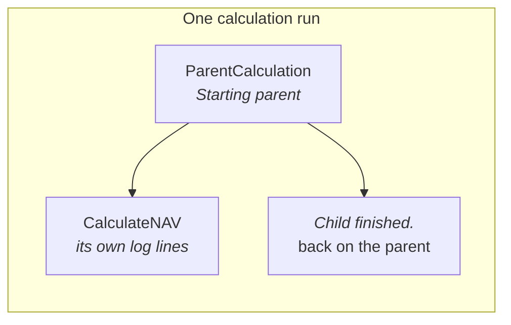

Lex App provides `LexLogger`, a builder-pattern logging API that produces rich, Markdown-formatted log entries. It supports text, headings, tables, DataFrames, code blocks, and more — all stored in the database and displayed in the frontend.

LexLogger is context-aware: it automatically links log entries to the correct calculation, model instance, and parent/child hierarchy without any manual ID passing.

## Basic Usage

Chain builder methods together, then call `.log()` to save:

```python
from lex.audit_logging.handlers.LexLogger import LexLogger

def calculate(self):
    LexLogger().add_text("Processing started").log()

    # Rich formatting with heading
    LexLogger().add_heading("Invoice Summary", level=2) \
               .add_text("Processing completed successfully.") \
               .log()
```

> [!warning]
> Always call `.log()` at the end of your chain. Without it, nothing is written to the database.

## Tables and DataFrames

```python
# Markdown table
headers = ["Invoice ID", "Amount", "Status"]
rows = [
    ["INV-001", "500.00", "Paid"],
    ["INV-002", "1200.00", "Pending"],
]

LexLogger().add_heading("Invoice Summary") \
           .add_table(headers, rows) \
           .log()
```

```python
# Pandas DataFrame
import pandas as pd

df = pd.DataFrame({
    'Quarter': ['Q1', 'Q2', 'Q3', 'Q4'],
    'Revenue': [100000, 120000, 115000, 130000]
})

LexLogger().add_text("Quarterly Revenue Report:") \
           .add_dataframe(df) \
           .log()
```

## Code and JSON

```python
import json

config = {"tax_rate": 0.19, "currency": "EUR"}

LexLogger().add_text("Current Configuration:") \
           .add_code(json.dumps(config, indent=2), language="json") \
           .log()
```

## Context-Aware Logging

LexLogger automatically resolves the current execution context. You don't need to pass IDs manually — it figures out which calculation is running and which model instance is executing.

## Nested Calculations

When a parent calculation starts a child, the child's log nests under the
parent on its own. You don't wrap anything:

```python
class ParentCalculation(CalculationModel):
    def calculate(self):
        LexLogger().add_text("Starting parent").log()

        child = CalculateNAV.objects.filter(quarter=self.quarter).first()
        child.is_calculated = "IN_PROGRESS"
        child.save()

        LexLogger().add_text("Child finished.").log()
```

The child's log lines go into a node of its own, under the parent's node in the
execution tree. That holds for every way a child runs:

| The child | Where its log goes |
|---|---|
| A `CalculationModel` saved as `IN_PROGRESS`, run in-process | Its own node, under the calculation that saved it |
| The same model run on a Celery worker, with or without `@lex_shared_task` | The same node as in-process. What it saves on the worker nests under it in turn |
| A row generated by `create()` on a [[calculations/batch calculations\|batch model]] | Its own node, under the calculation that called `create()`. This holds on every route: streaming, materialising, Celery, and the synchronous retry after a failed task. On a re-run the log is filed under the stored row |

A new row logs before it has a primary key. Its node is created with its first
log line and linked to the row once the row is saved.

While a child runs, the framework puts it on top of the context, and takes it
off again when it finishes. A log call always attaches to whatever is on top,
and remembers the one beneath it — which is what produces the tree rather than
a flat list:



Nesting is not limited to one level: a child that starts a calculation of its
own sits under it in the same way. Nothing is passed by hand — no calculation id, no
instance — which is the point. An id threaded through every call site is an id
that eventually gets threaded wrongly.

> [!note] Wrapping a child in `model_logging_context` is no longer needed
> Before lex-app 2.5.0 these docs told you to wrap a child's save in
> `with model_logging_context(child):`. Without the wrap, the child's lines
> were appended to its caller's node. A child that finished or failed could
> also be taken for the root run and clear the run's live log. Generated rows
> of `create()` were filed under the root whatever you did.
>
> All of this now works without the wrap, so you can remove it. Leaving it in
> does no harm: a model that is already on top of the context is not pushed a
> second time.

## Grouping logs into sections

A long calculation is easier to follow when its log reads like a document — with a
title for each phase of the work. Pass a plain **string** to `model_logging_context`
and everything logged inside that block is grouped under a titled section, no backing
model required:

```python
from lex.audit_logging.utils.ModelContext import model_logging_context

def calculate(self):
    with model_logging_context("Data collection"):
        LexLogger().add_text("Loaded 1,240 investor positions.").log()

        with model_logging_context("Validation"):
            LexLogger().add_list(["Schemas OK", "No missing funds"]).log()

    with model_logging_context("Aggregation"):
        LexLogger().add_text("Rolled positions up to the fund level.").log()
```

Each title becomes its own node in the execution tree, and sections nest freely — inside
one another and around child calculations. The result is a table of contents for the run:

```
Investor Track Record
├─ Data collection
│  └─ Validation
└─ Aggregation
```

A few things worth knowing:

- **Sections that never log anything are skipped.** If a block produces no output, it
  simply doesn't appear in the tree — so you can wrap optional work in a section without
  cluttering the log when it does nothing.
- **Re-entering the same title continues the same section.** Opening
  `model_logging_context("Validation")` twice under the same parent appends to one node
  rather than creating a duplicate.
- **Headings only shape the tree.** They don't change which record a log belongs to, so
  live streaming and the calculation's status are unaffected — a section is purely a way
  to organise what you write.

> [!tip]
> Reach for a **string** context to structure *one* calculation's own log into phases.
> Child calculations nest under their parent on their own (above). They compose: a
> child's node can contain string sections, and a string section can contain children.

For the complete method list, see the [[reference/LexLogger API|LexLogger API reference]].

> [!note]- Migrating from V1?
> If you're coming from `CalculationLog.create()`:
>
> | Aspect | V1 (Old) | Current |
> |---|---|---|
> | API | `CalculationLog.create(...)` | `LexLogger()` builder pattern |
> | Formatting | Plain text only | Rich Markdown |
> | Context | Manual — pass IDs yourself | Automatic |
> | Nested calculations | Not supported | Built-in parent/child hierarchy |
>
> Replace all `CalculationLog.create(...)` calls with `LexLogger()`, remove manual context/ID passing, and always end chains with `.log()`.

## In the Frontend

LexLogger output is rendered in the frontend in real-time:

- **Calculation Log Panel** — a slide-out drawer during calculation showing live Markdown-rendered output as the calculation progresses, including background calculations after an initial HTTP `202` response
- **Execution tree** — the left pane lists every node — model instances *and* the string sections above — so you can click straight to the part of the log you care about
- **Collapsible sections** — in the consolidated log, any section can be folded away; collapsing a heading hides its whole sub-tree, so you can focus on one phase of a long run at a time
- **PDF Export** — the calculation log can be exported as a PDF that renders just like the on-screen view: headings, tables, fenced code blocks and even strikethrough survive the export, which makes it usable as compliance evidence. You choose how much goes into it — one step, a step and everything under it, or the whole calculation (see [[#Downloading the log as PDF]] below)
- **Rich Rendering** — headings, tables, DataFrames, and code blocks are all rendered with proper formatting and syntax highlighting

### Downloading the log as PDF

The download icon in the log tree's header and the **Download PDF** button on the
**Details** tab open the same menu, with three choices:

| Menu entry | What the PDF contains | File name |
|---|---|---|
| **This step** | The log of the selected node only | `document_<pk>.pdf` |
| **This step and everything under it** | The selected log followed by all of its nested child logs and sections | `document_<pk>_full.pdf` |
| **Whole calculation** | Every log of the calculation the selected log belongs to — the whole execution tree, whichever node you started from | `document_<pk>_calculation.pdf` |

Behind the menu is one endpoint, `GET api/download-pdf/<pk>/`, where `<pk>` is the
log you start from. The `scope` query parameter picks how much it exports:

- `?scope=node` — the default; the one log, exactly as before.
- `?scope=subtree` — the log and everything under it. `?include_descendants=true`
  is the older spelling of the same thing and still works.
- `?scope=calculation` — the whole calculation. When a calculation has several
  top-level logs, each one gets its own title in the document.

Any other value for `scope` is rejected with `400 Bad Request` rather than quietly
falling back to a single log.

> [!note]
> A combined PDF stops at **500 sections**. A calculation larger than that is still
> exported, and the document ends with a visible note saying it was cut short — open
> the log tree in the app to read the rest.

See the [[using-the-app/record-detail/index|Record Detail]] page for how logs appear in context.
