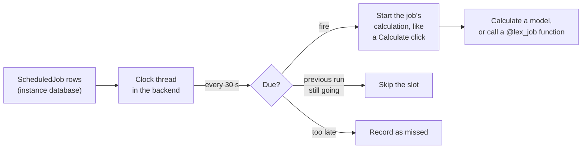

From lex-app 2.5, an instance can run a calculation or a function on a schedule: a cron expression in a time zone, or once at a set time. Schedules are rows in the instance's own database, and the backend runs them. There is no extra process to deploy, no Celery beat, and no infrastructure change.

> [!tip]
> Browse the source on [GitHub](https://github.com/ExcellenceCloudGmbH/lex-app/tree/lex-app-v2/lex/scheduling).

## How it works



A schedule is a `ScheduledJob` record. `ScheduledJob` is itself a [[calculations/calculation models|calculation model]], so a run is an ordinary calculation. When a job fires, the framework starts its calculation the same way the ▶ Calculate button does. That gives every schedule a "run now" button, a last-run status, a live log, an audit entry and cancel. When `CELERY_ACTIVE` is on, the run goes to a Celery worker, as any calculation does.

A schedule never runs code typed into the app. It runs one of two things:

- **a calculation**: one record of a calculation model, or every record of it;
- **a function** that a developer registered with `@lex_job`.

## Adding a schedule in the app

**Scheduled jobs** appear in the sidebar, next to the audit and calculation logs. Create one like any other record:

| Field | What to enter |
|---|---|
| Name | A unique name. |
| Enabled | Switched off, the schedule keeps its settings and never runs. |
| Cron expression | When to run, in the schedule's time zone. Leave empty for a one-off. |
| Run at | For a one-off: the time to run once. Give either this or a cron expression, not both. It must lie in the future. |
| Time zone | An IANA name, such as `Europe/Berlin` or `UTC`. Defaults to the instance's zone (`LEX_TIME_ZONE`, default `Europe/Berlin`). |
| What to run | `Calculation` or `Registered function`. |
| Calculation model | For a calculation: the model, as `app_label.ModelName`. A bare `ModelName` is accepted when it is unique, and stored as the full label. |
| Record id | For a calculation: the record to calculate. Leave empty to calculate every record of the model. |
| Function | For a function: the name it was registered under with `@lex_job`. |
| Arguments | For a function: keyword arguments, as a JSON object, e.g. `{"days": 30}`. |

A save that cannot work answers 400 and names the field: an invalid cron expression, an unknown time zone, a model that is not a calculation model, a record that does not exist, a function that is not registered. A switched-off schedule is not checked, so you can always switch off a job whose model or function has gone. It is checked again when you switch it back on.

Pressing ▶ on a schedule runs it now. That does not use up its next slot.

Schedules have no history table: every run rewrites the row. Changes to a schedule are in the [[history-and-audit/audit logs|audit log]].

## Cron expressions

Five fields, as in classic cron: `minute hour day-of-month month day-of-week`.

| Expression | Runs |
|---|---|
| `0 6 * * 1-5` | 06:00 on weekdays |
| `*/15 * * * *` | Every 15 minutes |
| `30 2 1 * *` | 02:30 on the first of each month |
| `0 7 * * MON` | 07:00 on Mondays |
| `@daily` | Midnight |

- `*`, lists (`1,15`), ranges (`1-5`) and steps (`*/15`, `1-10/2`, `5/10`) work.
- Month and weekday names work, in any case: `JAN`–`DEC`, `SUN`–`SAT`. `0` and `7` are both Sunday.
- Macros: `@yearly`, `@annually`, `@monthly`, `@weekly`, `@daily`, `@midnight`, `@hourly`. `@reboot` is refused.
- When both day fields are restricted, a day matches if **either** matches. A field counts as unrestricted when it starts with `*`.
- Six fields (with seconds) are refused. Schedules run at minute precision.
- An expression that never matches a date (`0 0 30 2 *`) is refused.

## Registering a function: `@lex_job`

```python
from lex.scheduling import lex_job


@lex_job("send_daily_digest")
def send_daily_digest(recipients=()):
    ...
```

Once registered, a user can create a schedule in the app that runs `send_daily_digest`. The name is what schedules refer to; it defaults to the function's name. Each name belongs to one function: registering a second function under the same name raises `ImproperlyConfigured` when its module is imported.

Registration happens when the module is imported. The framework imports every module of the project at startup, so a decorated function anywhere in the project is found.

The function is called with the schedule's arguments as keyword arguments. An exception ends the run in error. Use `LexLogger` inside it (see [[calculations/logging|Logging]]); the output lands in the run's log.

### Shipping the schedule with the code

```python
@lex_job("purge_old_exports", schedule="0 3 * * *", timezone="UTC", kwargs={"days": 30})
def purge_old_exports(days=30):
    ...
```

| Argument | Meaning |
|---|---|
| `name` | The name schedules refer to. Default: the function's name. |
| `schedule` | A cron expression. With it, the framework creates and maintains the schedule. |
| `timezone` | The zone of `schedule`. Default: the instance's zone. |
| `kwargs` | Keyword arguments the declared schedule passes to the function. |
| `description` | Shown in logs. |

An invalid `schedule` or `timezone` raises `ImproperlyConfigured` when the module is imported.

When the clock starts, and on every `lex run_scheduler`, the declared schedules are synced with the database:

- **missing** → created and enabled;
- **changed in code** (schedule, time zone, arguments) → updated. If a user switched it off, it stays off;
- **removed from the code** → switched off, with the message "Switched off: its @lex_job declaration was removed from the code." Declaring it again switches it back on;
- **the name is already used by a schedule created in the app** → the app's schedule is kept, and the backend logs a warning.

In the app, a schedule declared in code can only be switched on or off. Changing anything else answers 400 and points at the decorator.

## What a run does

- **One record:** the record's calculation runs inside the job, as a parent starting a child (see [[calculations/celery and async calculations#The Dispatch Flow|the dispatch flow]]). If it fails, the job ends in error with the record's error.
- **Every record:** each record is calculated in turn, in primary-key order. A failing record does not stop the others or roll back their results. The job then ends in error, listing the failed records (the first ten). [[calculations/calculation models#Closing a Record|Closed records]] are left alone and do not count as failures.
- **A function:** `function(**arguments)`. An exception ends the job in error.

The run's log starts with a heading `Scheduled job: <name>` and the schedule in words.

There are no automatic retries and no failure notifications. A failed run shows in the job's status and error message until the next run starts.

## Guarantees

**Exactly once.** Each due schedule is claimed in one database transaction (`SELECT … FOR UPDATE SKIP LOCKED`), and its next slot is moved in that same transaction. Two clocks never run the same slot. Extra clocks are safe: several backend workers, or a `lex run_scheduler` next to the backend.

**No stacking.** If a slot comes due while the previous run is still in progress, the slot is skipped. The job's status message says "Skipped the run due at …: the previous run was still in progress." Editing a schedule during a run does not reset its status, so a running job always stays visible to this check.

**Late and missed slots.** The clock checks every `LEX_SCHEDULER_TICK_SECONDS` (30 s), so a run can start up to that much after its slot. When the backend was down, the missed slots of a schedule collapse into one decision, made on the earliest missed slot:

- at most `LEX_SCHEDULER_MISFIRE_GRACE_SECONDS` (1 hour) late → it runs **once**;
- later than that → nothing runs. The status message says which slot was missed and why.

Either way, the next slot is the first one after the moment the clock catches up. Switching a schedule on works the same: its first slot is the next one after now, and older slots are not replayed.

**One-off.** A schedule with *Run at* runs once, under the same grace rule. It has no next run afterwards, until you set a new time.

**Daylight saving time.** The cron expression is read in the schedule's time zone; times are stored in UTC. A schedule runs at most once per wall-clock time:

- A time that does not exist because clocks jumped forward runs once, at the jump. `30 2 * * *` in `Europe/Berlin` runs at 03:00 CEST on the last Sunday of March.
- A time that occurs twice because clocks went back runs only the first time.

## Who a run acts as

Keycloak permissions only exist inside a request, so they cannot be checked when a job fires. They are checked when the schedule is **saved** instead:

- Only users with access to the `ScheduledJob` model can create or change schedules. It has the framework's default permissions; grant it like any other model.
- Saving a schedule that calculates a model answers 400 unless the person saving may calculate that target: the same checks the Calculate button passes, for one record and for "every record" alike.
- A run acts as the user who **last saved** the schedule. Every change saved in the app, switching it on or off included, makes the person saving the run-as user. Their rights are checked again whenever the saved schedule is switched on.
- A schedule declared in code has no run-as user. Its runs act as `Scheduler`, until someone switches it on or off in the app; from then on it acts as that person.

> [!warning]
> Function targets are trusted code. Anyone allowed to create schedules can schedule any registered function, with any arguments. Register only functions that are safe for those users to run.

Rights are not checked again at run time. If a user's rights are reduced, schedules they saved keep running as them until someone saves the schedule again.

## Where runs show up

| Where | What you see |
|---|---|
| The schedule's row | The last run's status (the ▶ column), its error message, the last run's start time, the next run, and the status message: why the last slot did not run. |
| The log drawer | The run's live log, as for any calculation. See [[calculations/logging\|Logging]]. |
| The [[history-and-audit/audit logs\|audit log]] | One entry per run, by the run-as user or `Scheduler`. Its payload has `trigger: {by: "schedule", job, schedule}`, so you can tell it from a click. It ends as success or failure. |
| The backend log | a `Scheduler started` line at start, and one line per tick that fired, skipped or missed something. Skipped and missed slots are logged at WARNING. |

> [!tip]
> An enabled schedule whose next run lies in the past means no clock is running. Check that the backend is up and that `LEX_SCHEDULER_ENABLED` is not off.

## Running the scheduler

The clock is a thread in the **backend**, the process `lex start` serves the app from. Every instance has one, so nothing extra needs deploying. The clock starts only when:

- the backend is started with `lex start`, and `lex_app.asgi:application` is the **last** argument (put `--host`, `--port` and other flags before it);
- `LEX_SCHEDULER_ENABLED` is `true` (the default).

The `--reload` watcher, Celery workers and management commands do not start a clock. With `LEX_SCHEDULER_ENABLED=false` the backend logs a WARNING that no scheduled job will run.

If the backend is scaled to zero or paused, nothing runs until it starts again. Slots missed meanwhile follow the misfire rule above.

### `lex run_scheduler`

Runs the clock from a command, for when the backend is not the right place: a one-shot run from cron or a Kubernetes CronJob, or a development setup without `lex start`.

```bash
lex run_scheduler --once         # sync declared schedules, start what is due, wait for it, exit
lex run_scheduler                # run the clock in the foreground until SIGTERM / Ctrl-C
lex run_scheduler --interval 10  # the same, checking every 10 seconds
```

| Flag | Meaning |
|---|---|
| `--once` | Run one tick, wait for the runs it started, and exit. Prints `fired=… skipped=… missed=… failed_to_start=…`. |
| `--interval N` | Seconds between ticks. Default: `LEX_SCHEDULER_TICK_SECONDS`. |
| `--no-sync` | Do not create or update the schedules declared with `@lex_job(schedule=...)`. |

Running it next to the backend is safe: each slot is still run once. The command does not read `LEX_SCHEDULER_ENABLED`; it runs whenever you start it. Runs it starts belong to its own process, so stopping the command stops them too.

## Configuration

| Variable | Default | Purpose |
|---|---|---|
| `LEX_SCHEDULER_ENABLED` | `true` | Whether the backend starts the clock. Only `true` (any case) turns it on; any other value, `1` and `yes` included, turns it off. |
| `LEX_SCHEDULER_TICK_SECONDS` | `30` | Seconds between checks for due jobs. Minimum 1. |
| `LEX_SCHEDULER_MISFIRE_GRACE_SECONDS` | `3600` | How late a slot may be and still run. |

Runs share the calculation pool, sized by `LEX_CALCULATION_THREADS`. See [[reference/Environment Variables#Scheduled jobs|Environment Variables]].

## Upgrading

The `ScheduledJob` table comes with migration `scheduling.0001_initial`, which `lex init` applies on the next start. Run `lex init` (or your usual migration step) so the new model is also registered with Keycloak, then grant access to `ScheduledJob` to the users who should manage schedules.

`CalculationModel` gains a class attribute in the same release: `reset_calculation_on_edit` (default `True`). Set it to `False` on a model whose status is not a result of its fields; an edit in the app then keeps the status instead of resetting it. `ScheduledJob` uses it. Existing models are unaffected.

## Related

- [[calculations/calculation models|Calculation Models]] — what a run starts
- [[calculations/celery and async calculations|Celery & Async Calculations]] — where a run executes when Celery is on
- [[ship-and-operate/deploying|Deploying]] — the backend process that runs the clock
- [[reference/CLI Commands|CLI Commands]] — `lex run_scheduler`
