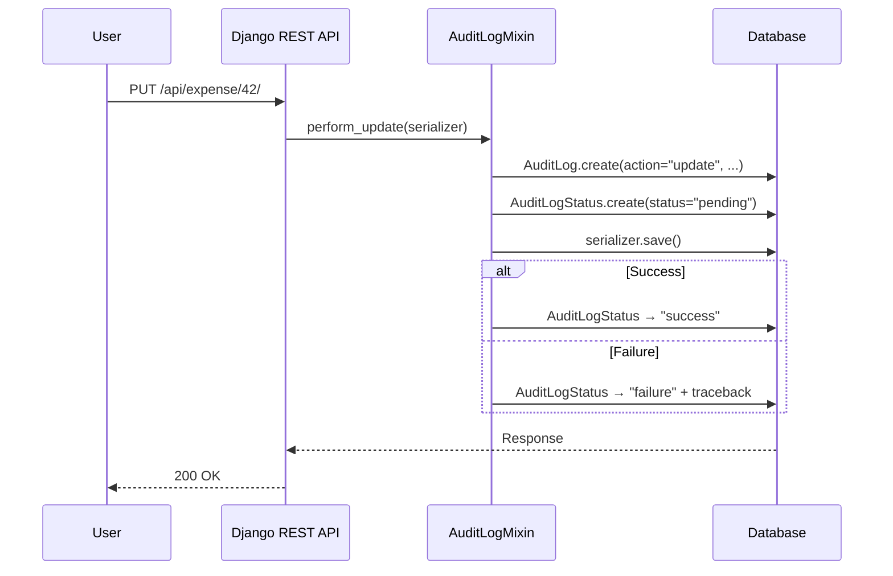

Every API operation in Lex App — create, update, delete, export, download — is automatically recorded in an `AuditLog` table. This happens transparently via `AuditLogMixin` for the operations that change data and `FileOperationAuditMixin` for the ones that hand it out, both hooking into the [Django REST Framework](https://www.django-rest-framework.org/) view layer. The framework records some of its own work in the same table: loading initial data, the outcome of every calculation, and the reset of calculations a restart interrupted. You don't need to configure or enable anything — audit logging is always active.

## What Gets Recorded

Every time a user creates, updates, deletes, exports, or downloads through the API, an `AuditLog` entry is created with:

| Field | Description |
|---|---|
| `date` | Timestamp of the operation |
| `author` | The user who performed the action (an API-key caller is recorded as `Technical User`) |
| `resource` | The model name (e.g., `expense`, `team`) |
| `action` | `create`, `update`, `delete`, `export`, or `download` |
| `payload` | The full serialized data at the time of the operation — for exports and downloads, what was asked for and what was served |
| `content_type` + `object_id` | A [generic relation](https://docs.djangoproject.com/en/stable/ref/contrib/contenttypes/) linking back to the affected record |

### Entries the framework writes

Not every entry comes from a request:

| Source | Entry |
|---|---|
| Loading [[model-your-data/initial data\|initial data]] | One `create`, `update` or `delete` entry per action, with the author `system (initial_data_upload)`. `INITIAL_DATA_AUDIT_LOGGING=false` turns these off |
| A calculation finishing | The run's outcome is written to the entry of the request that started it — or to a new `update` entry when there is none — with a snapshot of the record as the payload. Only the outermost calculation of a run gets one |
| A restart | A calculation the startup finds still `IN_PROGRESS`, with no recovery owning it, is set to `ABORTED` — and its entry to `aborted`, when the startup can still tell which run it was |

## How It Works

The key insight: the audit log is created **before** the actual operation, with a `pending` status. For normal synchronous requests, the status is updated to `success` right away when the operation finishes. For calculations accepted with HTTP `202`, the status stays `pending` until the background calculation completes, then moves to its outcome. If an operation fails immediately, the status becomes `failure` and the error traceback is stored. This means even failed operations are recorded — critical for security auditing.

| Status | Meaning |
|---|---|
| `pending` | The operation has begun — for a calculation, it is still running |
| `success` | It completed |
| `failure` | It failed. The status row keeps the traceback in `error_traceback` |
| `cancelled` | A calculation someone cancelled |
| `aborted` | A calculation that was still running when the instance restarted, and that the startup gave up on |

Only `failure` keeps a traceback: a `cancelled` or `aborted` status row has none.

## Audit Log vs. Bitemporal History

These two systems serve different but complementary purposes:

| Aspect | Audit Logs | [[history-and-audit/bitemporal history\|Bitemporal History]] |
|---|---|---|
| **What it tracks** | Who did what, when | What the data looked like over time |
| **Granularity** | Operation-level (create/update/delete) | Field-level (every value change) |
| **Scope** | API operations, plus initial data, calculation outcomes and startup resets | All changes made through `save()` and `delete()` (API, hooks, calculations) |
| **Time dimensions** | One (system time) | Two (valid time + system time) |
| **Primary use** | Security auditing, compliance | Time-travel queries, corrections |
| **Failure tracking** | Yes (`pending` → `success`, `failure`, `cancelled`, `aborted`) | No (only successful changes) |

Together, they provide a complete audit trail: bitemporal history tells you *what changed*, audit logs tell you *who requested the change and whether it succeeded*.

## Exports and Downloads

Create, update and delete change what the system holds; export and download take
data out of it. Both are recorded, through the same table and the same
`pending` → `success` / `failure` lifecycle, so a compliance question like *who
took this file last quarter* has one place to look.

Five endpoints produce these entries:

| Endpoint | Action | What the payload says |
|---|---|---|
| `POST api/<model>/export` | `export` | `format: "xlsx"`, `delivery: "stream"`, `mode` (`ag_grid` / `filtered` / `legacy`), `selected_row_count`, `as_of`, `timezone`; in `ag_grid` mode also the AG Grid `filter_model`, `row_group_cols`, `pivot_mode` and `selected_group_count`; then the `export_path` that wrote the file, `rows`, `columns`, and `size_bytes` (streamed exports) or `sheet_name` (the others) |
| `GET api/<model>/file-download` | `download` | `pk`, `field`, `storage` (`LOCAL` / `GCS` / `SHAREPOINT`), `filename`, `size_bytes`, `delivery` — `"stream"`, or `"url"` on GCS, where the answer is a link to the file |
| `GET api/<model>/sharepoint-file-download` | `download` | the same, with `delivery: "stream"` |
| `GET api/<model>/sharepoint-file-share-link` / `…-preview-link` | `download` | `delivery: "share_link"` / `"preview_link"` and the SharePoint document id |
| `GET api/download-pdf/<pk>/` | `download` | `format: "pdf"`, `delivery: "stream"`, `scope` (`node` / `subtree` / `calculation`), `include_descendants`; for a subtree or a whole calculation `section_count` and `truncated`; then `filename`, `size_bytes` |

Two details are worth knowing:

- **A selection is recorded as a count, not a list.** Exporting ten thousand
  hand-picked rows writes one bounded audit entry, not ten thousand identifiers
  inside a payload.
- **A link counts as a download.** A SharePoint share or preview link hands out
  access to the file without streaming a byte; the payload's `delivery` field is
  what tells the two apart.

A download of a single record's file points its generic relation at that record,
so it appears on the record's [[using-the-app/record-detail/audit log tab|Audit Log Tab]].
A model-wide export belongs to no single record: it keeps the model's content
type and leaves `object_id` unset.

Requests the endpoint refuses — an export with no rows, a download of a file the
caller may not read — are recorded too, with status `failure` and the refusing
status code. Requests rejected before the view runs at all (no session, no API
key) are not: nothing was served and no operation began.

### Who sees an export or download entry

An export or download payload describes the request — file name, size, rows,
filter — not field values of a record. So these entries are not judged by a
record rebuilt from the payload, as create, update and delete entries are:

- **A download** is visible to whoever may read the record it names
  (`permission_read` of that record). If the record no longer exists, the
  payload check applies as before.
- **A model-wide export** is visible to whoever may export the model: its
  `permission_list` does not refuse the caller and its `permission_export`
  allows a blank record.
- **A superuser** sees every entry.
- **The payload** comes back whole to whoever may see the entry. Create,
  update and delete payloads keep their field-level pruning.
- **Status rows** (`api/model_entries/auditlogstatus/list`) are as visible as
  their entry, and an entry fetched by id follows the same rule as the list.
- **Tracebacks** of failed operations (`error_traceback`) follow their entry:
  whoever may see the entry sees why it failed, on both `auditlog` and
  `auditlogstatus`. This applies to every entry, including a failed calculation
  run, so a record's Audit Log tab shows the traceback to the people who may
  read the record — which is what makes the audit log a usable diagnostic after
  an API-triggered run fails.

This is part of the `READ_SURFACES` hardening (on by default);
`LEX_SEC_READ_SURFACES=false` restores the earlier payload-based check.

## Bulk Operations

Bulk updates and deletes are also tracked via `BulkAuditLogMixin`. Each individual record in a bulk operation gets its own audit log entry — so a bulk update of 100 records creates 100 audit log entries.

## Resilience

The audit system includes built-in resilience:

- **Deadlock retries** — database operations are automatically retried on transient errors (deadlocks, serialization failures)
- **ContentType cache healing** — if Django's ContentType cache goes stale (e.g., after a migration), the system detects and auto-corrects it
- **Error preservation** — failed operations store the full traceback for debugging
- **Exports never fail on their audit** — the entry is opened before the export runs, so an export that cannot be recorded does not run; once the data has been served, a problem finalising the entry is logged rather than turned into a broken download

> [!note]
> Audit logs are effectively read-only. They are designed to be an immutable record of operations — only administrators should modify or delete them.

## In the Frontend

Audit logs aren't just a database table — they're surfaced directly in the interface:

- **[[using-the-app/record-detail/audit log tab|Audit Log Tab]]** — every record detail page includes an Audit Log tab showing all operations that affected that specific record
- **AuditLog** in the sidebar — a [[model-your-data/model structure#Built-In Groups|built-in group]] listing the entries the user may see, across all records

See [[using-the-app/record-detail/index|Record Detail]] for the full user-facing documentation.
