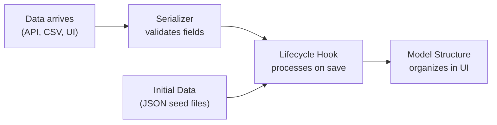

Every piece of data in a Lex App application passes through a pipeline: it enters the system, gets validated, and is organized for consumption. The building blocks in this section control how that flow works.

## Building Blocks

### [[model-your-data/initial data|Initial Data Upload]]
Seed your database from structured JSON files on server start. Define create, update, and delete actions with foreign key references — the framework loads them automatically when all referenced models are empty.

### [[model-your-data/serializers|Serializers]]
Custom [Django REST Framework](https://www.django-rest-framework.org/) serializers that validate incoming data at the API layer. Define field-level rules, cross-field constraints, and multiple views of the same model.

### [[model-your-data/lifecycle hooks|Lifecycle Hooks]]
React to model events — creation, update, deletion — with explicit [django-lifecycle](https://rsinger86.github.io/django-lifecycle/) decorators. Process uploaded files, trigger side effects, and enforce validation rules.

### [[model-your-data/model structure|Model Structure]]
Control how models appear in the frontend sidebar. Group models into categories of your own instead of by folder, rename groups and models, and leave models out of the sidebar — once you define the tree, only the models it lists get an entry.

### [[model-your-data/HTML reports|HTML Reports]]
Add a sidebar entry that shows HTML your code builds, instead of a table of records — a summary page, or a frame around something hosted elsewhere.
