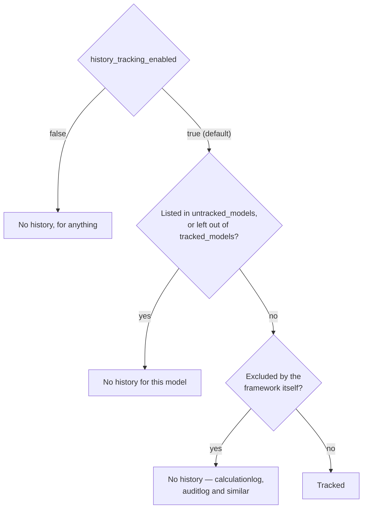

Without any configuration, the frontend sidebar groups your models by the folders their files are in. To organize them into groups of your own — and to control display names and history tracking — create a `model_structure.yaml` file in your project root.

## The Sections

The file has five top-level keys, all optional. Two shape the sidebar; three
decide what gets history:

```yaml title="model_structure.yaml"
# ┌─────────────────────────────────────────────
# │ 1. model_structure — sidebar navigation tree
# │    Keys are group names; values are either
# │    model names (lowercase, value: null) or
# │    nested sub-groups (value: another dict).
# │    Only the models listed here get an entry.
# └─────────────────────────────────────────────
model_structure:
  Fund Management:
    fund: null
    quarter: null
    Investments:                # ← nested sub-group
      investment: null
      investmentrelationship: null
  Reporting:
    calculatenav: null
    calculatebalancesheet: null
  Uploads:
    uploadbalancesheet: null
    uploadinvestmentrelationships: null

# ┌─────────────────────────────────────────────
# │ 2. model_styling — display names
# │    Keys are group names or model names.
# │    The only supported key is "name".
# └─────────────────────────────────────────────
model_styling:
  Fund Management:
    name: "🏦 Fund Management"
  Reporting:
    name: "📊 Reporting"
  Uploads:
    name: "📥 Uploads"

# ┌─────────────────────────────────────────────
# │ 3. untracked_models — skip history tracking
# │    Models listed here won't generate
# │    django-simple-history tables. They still
# │    appear in the sidebar if listed above.
# └─────────────────────────────────────────────
untracked_models:
  uploadbalancesheet: null
  uploadinvestmentrelationships: null
```

| Section | Purpose |
|---|---|
| `model_structure` | Defines the sidebar navigation tree. Group names are dict keys; model names (lowercase class name) are leaves with value `null`. Supports arbitrary nesting depth for sub-groups. Once it is defined, it is the whole tree: a model it does not list gets no sidebar entry. |
| `model_styling` | Display names for groups and models, keyed by the group name or the model name. The only supported property is `name`. |
| `untracked_models` | Excludes models from [django-simple-history](https://django-simple-history.readthedocs.io/) tracking — no `Historical*` or `MetaHistorical*` tables are created. Useful for transient data like uploads to save storage. |
| `tracked_models` | The opposite list: only the models named here get history. It cannot be combined with `untracked_models`. |
| `history_tracking_enabled` | The project-wide switch for history, `true` by default. |

> [!tip]
> `model_structure.yaml` is optional. Without it, every model gets a sidebar entry, grouped by folder — see [[#When No Structure Is Defined|below]]. Add the file when your project grows beyond a handful of models, and list every model you want to see in it: once `model_structure` is defined, a model it leaves out has no entry.

## Format Rules

- **Model names must be lowercase** — they match the lowercased Python class name (e.g., `CalculateNAV` → `calculatenav`)
- **Leaf nodes** (models) always have value `null`
- **Non-leaf nodes** (groups) are dicts containing more nodes
- **Nesting is unlimited** — you can nest sub-groups inside groups, sub-sub-groups inside sub-groups, etc.
- **List every model you want in the sidebar** — a model `model_structure` does not name gets no entry at all. The model is still registered and its REST API still answers; only the sidebar leaves it out

## Nested Sub-Groups

For large projects, use nested groups to keep the sidebar manageable. Here's a production example with reports organized by category:

```yaml title="model_structure.yaml"
model_structure:
  AdditionalReports:
    NAV:
      navoverview: null
      calculatenav: null
      investornav: null
    CapitalAccounts:
      capitalaccountreport: null
      capaccountdeltareport: null
    InvestorReporting:
      investorreportinput: null
      investorreport: null
```

Each level becomes a collapsible folder in the sidebar.

## When No Structure Is Defined

If neither `model_structure.yaml` nor a [[#Structure Modules|structure module]] defines `model_structure`, the sidebar is built from where your models live:

- the [[#Built-In Groups|built-in groups]] are there, as always;
- every other model of your project is placed by the folders between the project root and its file: a model in `Input/Team.py` lands in a group named `Input`, one in `Reports/Summaries/NavSummary.py` in `Reports` › `Summaries`, and one in a file at the project root sits at the top level, in no group. [[model-your-data/HTML reports|HTML reports]] are placed the same way;
- tables registered from a legacy freeze manifest appear in a **Legacy Generic App (Archive)** group — see [[migrating-from-v1/migrating the database|Migrating the Database]].

The folder names are shown as they are; `model_styling` can rename them.

## Structure Modules

The sidebar settings can also come from Python. Any file whose name ends in `_structure.py`, anywhere in the project, is imported at startup and asked for up to three functions. `_reflex_structure.py` is the one exception: it belongs to the [[access-and-dashboards/reflex/standalone dashboards|Reflex app]].

```python title="nav_structure.py"
def get_model_structure():
    return {
        "Fund Management": {"fund": None, "quarter": None},
        "Logs": {"auditlog": None, "calculationlog": None},
    }


def get_model_styling():
    return {"Fund Management": {"name": "🏦 Fund Management"}}
```

| Function | What it provides |
|---|---|
| `get_model_structure()` | The sidebar tree, in the shape of `model_structure`. It replaces the whole tree, built-in groups included: list `auditlog`, `calculationlog`, `scheduledjob`, `streamlit` or `reflex` yourself to keep them. |
| `get_model_styling()` | Display names, in the shape of `model_styling`. |
| `get_widget_structure()` | What the `api/widget_structure` endpoint returns, as `{"widget_structure": …}` — `{"widget_structure": []}` when nothing provides it. |

Each function is optional. A structure module is never scanned for models: a model or HTML report defined in it is not registered. `untracked_models`, `tracked_models` and `history_tracking_enabled` exist only in the YAML file. If one of the functions raises, a warning is logged and that setting stays as it was; a module that fails to import stops the startup.

> [!warning] Keep the tree in one place
> Use `model_structure.yaml` or a structure module for the tree, not both. The startup reads them in the order it finds them and the last one wins — a `model_structure.yaml` read after a module replaces the module's tree even when the YAML has no `model_structure` of its own.

> [!note]
> `_streamlit_structure.py` ends in `_structure.py` too, so Django imports it at startup to look for these functions. Keep its top level free of Streamlit calls; the dashboard belongs in `main()`.

## Group and Model Names

The `model_styling` section sets the name the sidebar shows for a group or a model. Key an entry by the group's name or by the model's lowercase name. The only supported property is `name`:

```yaml
model_styling:
  Teams & People:
    name: "👥 Teams & People"
  Expenses:
    name: "💶 Expenses"
  budgetsummary:
    name: "📊 Budget overview"
```

Without styling, a group shows its key from `model_structure` — or its folder name — and a model its `verbose_name`, title-cased.

## Untracked Models

Models listed under `untracked_models` are excluded from [django-simple-history](https://django-simple-history.readthedocs.io/) registration. This means:

- No `Historical*` table is created for the model
- No bitemporal history is recorded for changes
- The [[using-the-app/record-detail/history tab|History tab]] and [[using-the-app/record-detail/timeline tab|Timeline tab]] won't have data for these models

> [!important]
> Untracked models **still appear in the sidebar** if listed under `model_structure`. This setting only controls history tracking, not visibility.

We recommend untracking upload models and other transient data to save database storage:

```yaml
untracked_models:
  teamupload: null
  employeeupload: null
  expenseupload: null
```

The framework also automatically untracks internal models like `calculationlog`, `auditlog`, `auditlogstatus` and `scheduledjob` — every run of a scheduled job rewrites its row, so its history would grow without bound.

### Tracking only some models

`tracked_models` turns the list around: only the models it names get history, and every other model of your project is untracked.

```yaml
tracked_models:
  - employee
  - expense
```

Both lists accept a YAML list, the `name: null` form shown above, or a single name. A file that sets both stops the startup with `model_structure.yaml cannot define both 'untracked_models' and 'tracked_models'.`

### Turning history off for the whole project

`history_tracking_enabled` is the project-wide switch. It defaults to `true`,
and setting it to `false` stops every model being registered for history —
`untracked_models` and `tracked_models` then have nothing left to decide:

```yaml
history_tracking_enabled: false
```

Three settings decide whether a given model gets a `Historical*` table, and they
are checked in this order:



It must be a boolean. A string — `"false"` — is rejected at load with a message
naming the key, rather than being read as truthy and silently leaving history on.

## Built-In Groups

Lex App adds these groups to the sidebar — you don't need to define them:

| Group | Contents |
|---|---|
| **AuditLog** | `auditlog` — the [[history-and-audit/audit logs\|audit log]] |
| **CalculationLog** | `calculationlog` |
| **Streamlit** | `streamlit` — the project's [[access-and-dashboards/streamlit/index\|Streamlit app]], framed in the page. Unlike Reflex, it is added whether or not `IS_STREAMLIT_ENABLED` is set |
| **ScheduledJob** | `scheduledjob` — the schedules of [[calculations/scheduled jobs\|scheduled jobs]] |
| **Reflex** | `reflex` (if `IS_REFLEX_ENABLED=true`) — the project's [[access-and-dashboards/reflex/index\|Reflex dashboards]] |

In `model_structure.yaml`, a built-in entry you list in a group of your own moves there, and a built-in group left empty disappears. A `get_model_structure()` replaces the tree entirely, built-in groups included.
