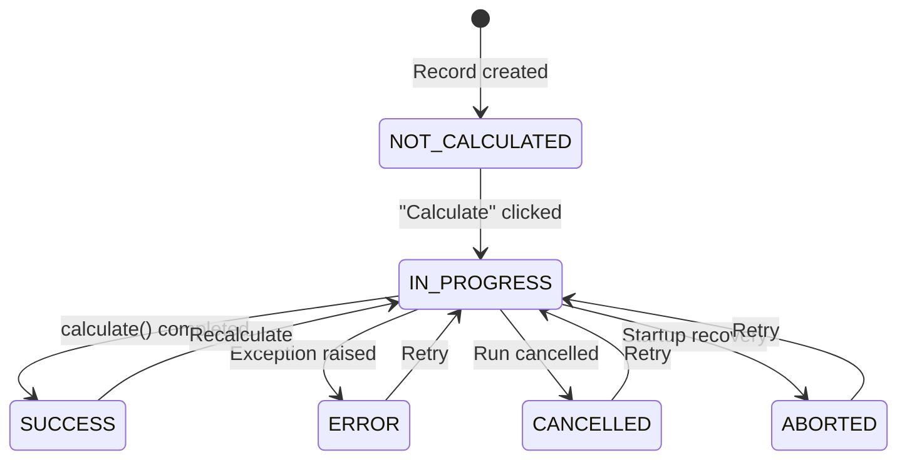

`CalculationModel` extends [[reference/LexModel Internals|LexModel]] with a built-in state machine and a `calculate()` hook. It's the base class for any model that performs on-demand computation — upload processing, report generation, data transformations, etc.

> [!tip]
> Browse the full source on [GitHub](https://github.com/ExcellenceCloudGmbH/lex-app/blob/lex-app-v2/lex/core/models/CalculationModel.py).

```python
from lex.core.models.CalculationModel import CalculationModel
```

## The State Machine

Every `CalculationModel` has an `is_calculated` field that transitions through six states:



| State | Constant | Meaning |
|---|---|---|
| `NOT_CALCULATED` | `CalculationModel.NOT_CALCULATED` | Default — record exists but hasn't been processed |
| `IN_PROGRESS` | `CalculationModel.IN_PROGRESS` | Calculation is running (triggers `calculate()` via lifecycle hook) |
| `SUCCESS` | `CalculationModel.SUCCESS` | Calculation completed without error |
| `ERROR` | `CalculationModel.ERROR` | An exception was raised — error details are stored on the record |
| `CANCELLED` | `CalculationModel.CANCELLED` | The run was cancelled — see [[#Cancelling a Running Calculation]] |
| `ABORTED` | `CalculationModel.ABORTED` | The framework recovered a calculation that was left stuck in progress |

The `is_calculated` field is **not editable** in the UI — it's managed entirely by the framework. When a user clicks **Calculate ▶️** in the frontend, the framework sets `is_calculated = IN_PROGRESS`, which triggers the `calculate_hook`. Over REST the same click is a `PATCH`; see [[#Calculating and Cancelling over REST]].

## `calculate()` Method

Override this method with your business logic. The framework handles everything else:

```python
class BudgetSummary(CalculationModel):
    team = models.ForeignKey(Team, on_delete=models.CASCADE)
    total_expenses = models.DecimalField(max_digits=12, decimal_places=2, default=0)

    def calculate(self):
        expenses = Expense.objects.filter(employee__team=self.team)
        self.total_expenses = expenses.aggregate(
            total=models.Sum("amount")
        )["total"] or 0
```

**What you don't need to write:**

| Concern | Handled By |
|---|---|
| `self.save()` | Framework saves the record after `calculate()` returns (without bumping `edited_by` / `edited_at`) — except a `@lex_shared_task` `calculate()` on Celery. See [[#Saving the Result]] |
| Error handling | Framework catches exceptions, sets `ERROR`, and writes the error to the record's `calculation_error_message` or `error_message` field if it declares one — with both, in-process runs fill `calculation_error_message`, Celery runs and the recovery sweep `error_message` |
| State transitions | Lifecycle hooks manage the `IN_PROGRESS → terminal state` flow |
| Logging context | [[reference/LexLogger API|LexLogger]] automatically links to the current calculation |
| Transactions | In-process, `calculate()` runs inside `transaction.atomic()` unless `is_atomic = False`; on Celery it runs without one. See [[#Atomic vs Non-Atomic]] |
| `edited_by` / `edited_at` on child saves | Any records you save inside `calculate()` are treated as system-triggered — their `edited_by` / `edited_at` are not stamped with the user who clicked Calculate |

> [!note]
> The legacy method name `update()` is also supported — if you override `update()` instead of `calculate()`, the framework will call it. We recommend using `calculate()` for new code.

## Saving the Result

Who saves the record after `calculate()` returns depends on where the run executes: [[#Celery Integration|on Celery]] when `CELERY_ACTIVE` is on, in-process otherwise.

| Route | The record is saved by | Lifecycle hooks on that save |
|---|---|---|
| In-process | The framework: `save(skip_hooks=True)` | None |
| Celery, plain `calculate()` | The generic Celery task: `save()` | All of them |
| Celery, `@lex_shared_task` `calculate()` | Nobody. The success callback writes the status fields only | — |

Two things follow:

- **A `@lex_shared_task` `calculate()` must save its own result.** On Celery, values it assigns to `self` are lost unless it calls `self.save()`, so end it with one. In-process the framework saves the record again afterwards.
- **`pre_validation()` and `post_validation()` don't see the result in-process.** The final save there skips hooks; only on Celery does the save after `calculate()` run them. Check a calculation's output inside `calculate()` and raise there, so the check holds on every route.

## Atomic vs Non-Atomic

In-process, `calculate()` runs inside a [Django](https://docs.djangoproject.com/) `transaction.atomic()` block by default. If it raises, what it wrote to the database is rolled back. The record itself is then saved as `ERROR` from the instance in memory, so values `calculate()` had already assigned to `self` are stored with the error. To opt out of the transaction (for long-running calculations that should commit incrementally), set:

```python
class LargeImport(CalculationModel):
    is_atomic = False

    def calculate(self):
        # Commits happen as you go — no rollback on failure
        ...
```

On Celery there is no such block, whatever `is_atomic` says: neither the generic task nor a `@lex_shared_task` method opens a transaction around `calculate()`. When the run fails, the rows `calculate()` wrote stay. The record itself is saved as `ERROR` by the process that dispatched the run, from the copy it held when the run started, so changes `calculate()` saved on the record are overwritten with the values from before the run. To make a Celery run all-or-nothing, wrap the body of `calculate()` in `transaction.atomic()` yourself.

After a failure, the record's `calculation_error_message` (or `error_message`) field holds:

- **In-process:** the error message, then the traceback.
- **On Celery:** the error message alone (`str(exc)`), written by the worker, with no traceback. The dispatching process's save of its earlier copy can land after that write and put back the field's previous value.

The [[history-and-audit/audit logs|audit log]] entry of a failed run keeps its traceback on both routes.

## Calculating on Create

Set `calculate_on_create = True` to have records created through the app start
their calculation straight away, in the background, as if **Calculate** had been
clicked. Records created in code are not affected. It is read from the instance,
so it can be a property that decides per record. See
[[calculations/calculation models#Calculating New Records Automatically|Calculating New Records Automatically]].

## Keeping the Status Through Edits

An edit of an open record through the app (a `PATCH` without `calculate`) resets its status to `NOT_CALCULATED`: the stored result no longer matches the edited inputs. Set `reset_calculation_on_edit = False` (default `True`) on a model whose status is not a result of its fields. An edit then keeps the status, and a run in progress stays visibly in progress while the record is edited. `ScheduledJob` does this: its status is the outcome of its last run (see [[calculations/scheduled jobs|Scheduled Jobs]]). Saves made in code never reset the status, whatever the setting.

## Celery Integration

In production, calculations can be dispatched to [Celery](https://docs.celeryq.dev/) workers for background/parallel processing. The framework checks two things automatically:

1. Is the `CELERY_ACTIVE` environment variable set to `true`?
2. Can the `celery` package be imported? (lex-app does not check that the broker answers: with the broker down, the run is still sent to Celery and fails there.)

If both are true, the calculation is dispatched to a Celery worker — decorated methods are dispatched directly, undecorated methods are wrapped automatically. Otherwise, it runs in-process on the app server. Either way, the record is first saved in `IN_PROGRESS` and then updated again when the calculation finishes.

If you want the method itself to behave like a Celery task, decorate it with `@lex_shared_task`:

```python
from lex.lex_app.celery_tasks import lex_shared_task

class HeavyReport(CalculationModel):
    @lex_shared_task
    def calculate(self):
        ...
```

`@lex_shared_task` wraps your method with context-aware dispatch, automatic status callbacks, and audit logging context propagation to worker processes. For root `CalculationModel` runs, the decorator is optional — the framework will still dispatch to Celery when it's available. A decorated `calculate()` is not saved for you on Celery: end it with `self.save()` (see [[#Saving the Result]]).

> [!note]
> Set `CELERY_ACTIVE=true` in your project's `.env` file to enable Celery dispatch. You also need a running Redis instance (or [Memurai](https://www.memurai.com/get-memurai) on Windows) as the message broker.

See [[calculations/celery and async calculations]] for the full setup guide — environment variables, running workers, and the `WaitForTasks` / `FireAndForget` context managers.

## Cancelling a Running Calculation

Use `CalculationModel.cancel(instance, *, recursive=True, reason="")` — `recursive` and `reason` are keyword-only — to stop an in-progress calculation that is currently running on Celery. The framework revokes the worker task, persists `CANCELLED` — writing `reason` (default "Calculation cancelled by user") to the record's error message field if it has one — and cancels active descendants in the same calculation tree as well. The interface has no cancel control: call `cancel()` from code, or send the cancel request over REST (see [[#Calculating and Cancelling over REST]]).

For batch fan-outs whose tasks are spread across multiple worker pods, `cancel()` also consults a **Redis cluster cancel index**: each task registers its ID under the calculation's tree, so `cancel()` discovers and revokes descendant tasks it didn't directly dispatch. It additionally writes a cooperative cancel marker that an unstarted or between-models task checks and self-aborts on. This cascade is gated by `LEX_CLUSTER_CANCEL_ENABLED` and is inert without a reachable Redis.

`cancel()` returns a report. When it cancels, the report has `cancelled: true`, the persisted `status`, the `revoked_tasks`, and the number of `descendants_cancelled`. If the record is not in progress — or it's running synchronously with no worker task to revoke — it changes nothing and says why: `cancelled` and `cancellable` are `false`, and `reason` is `not_in_progress` or `sync_calculation_not_cancellable`.

To stop a run from inside, raise `CalculationCancelled` in `calculate()`:

```python
from lex.core.models.CalculationModel import CalculationCancelled

def calculate(self):
    if not self.source_file:
        raise CalculationCancelled("No source file to process")
    ...
```

The run then ends `CANCELLED` instead of `ERROR`, and the reason goes where an error message would. In-process its writes are rolled back as a failure's are. A nested run that ends this way raises `CalculationModelException` into its parent, as a failed one does (see [[#When a Nested Calculation Fails]]).

The framework also takes these Celery exceptions for a cancellation and ends the run `CANCELLED`, not `ERROR`: `TaskRevokedError` and `Terminated` (what `cancel()` causes), `SoftTimeLimitExceeded` (a task's soft time limit ran out), and `WorkerLostError`.

## Calculating and Cancelling over REST

Both are a `PATCH` of the record, and both need the caller's permission to edit it:

| Body | Answer |
|---|---|
| `{"calculate": true}` | `202` with the record in `IN_PROGRESS`; the run carries on in the background. `200` with the record as it is when a run is already in progress. `409` with `{"detail": "<reason>", "code": "calculation_closed"}` when the record is [[#Closing a Record\|closed]] |
| `{"cancel": true}` | `202` with the `cancel()` report when the run was cancelled; `409` with the report when it was not |

The endpoint, and how to follow a run, are in [[reference/REST API#Calculations over REST]].

## Operator Recovery API

For triaging and recovering from calculations that are wedged in `IN_PROGRESS`, `CalculationModel` exposes three classmethods. They're the public surface behind an operator dashboard, CLI, or REST endpoint — each returns plain dicts/lists, never internal bookkeeping.

| Method | Returns | Use it to |
|---|---|---|
| `list_in_progress()` | List of active calculations, **sorted oldest-first**, each with `record_id`, `record`, `model_label`, `calculation_id`, `task_id`, `started_at` (UTC ISO-8601), `age_seconds`, and `cancellable` | See everything currently running |
| `find_stuck(older_than_seconds)` | Same shape, filtered to runs at least `older_than_seconds` old (inclusive; `0` returns all, negative raises `ValueError`) | Find runs that have overstayed a threshold |
| `cancel_stuck(older_than_seconds, *, reason="…")` | A report dict (`threshold_seconds`, `candidates`, `cancelled`, `skipped_not_cancellable`, `errors`, and a per-record `results` list) | Bulk-cancel everything older than the threshold |

`cancel_stuck()` reuses the per-record `cancel()` machinery, so each cancelled run gets the identical terminal state, audit row, and WebSocket broadcast as a single user-initiated cancel — there's no parallel recovery code path. Because `cancel()` is recursive, cancelling a parent also revokes descendants sharing its `calculation_id`; each parent appears only once in `results`. Synchronously-dispatched runs (no `task_id`) can't be revoked and are reported as `skipped_not_cancellable` rather than force-failed.

`started_at` is anchored to a monotonic clock internally, so `age_seconds` stays correct even if the system wall-clock jumps.

## Closing a Record

`calculation_closed_reason()` returns why a record must not be calculated again, or `None` while it may be. `CalculationModel` and `CalculatedModelMixin` both define it, returning `None`; returning `True` closes the record with a generic message. Every way a calculation can start asks it first, and sees the record as it was before the run was asked for:

| How the calculation starts | What a closed record does |
|---|---|
| **Calculate** (`PATCH` with `calculate=true`) | Refused with HTTP 409, `{"detail": "<reason>", "code": "calculation_closed"}`; nothing changes |
| A save that sets `is_calculated = IN_PROGRESS` (scripts, other calculations) | Keeps its previous status; the rest of the save is written, and the skip is logged, into the calling calculation's log when there is one |
| `CalculatedModelMixin.create()`, in any mode | The existing row is neither recalculated nor saved; the Celery task counts it under `skipped_closed` |
| A create on a `calculate_on_create` model | No run starts, and nothing of one is recorded: the record stays `NOT_CALCULATED`, with no audit entry or history row beyond its creation |

Closing stops only the calculation. An edit through the app (a `PATCH` without `calculate`) saves the record's other fields and keeps its status, closing it included; an edit to an open record resets it to `NOT_CALCULATED`, as it always has (unless the model [[#Keeping the Status Through Edits|keeps its status through edits]]). `calculation_closed_reason()` is asked on the record as the edit leaves it, so reopening a record resets it like any open one.

Rows of calculation models carry the reason as `lex_reserved_calculation_closed_reason` (`null` while the record is open), and a closed record's `lex_reserved_scopes.edit` leaves out `is_calculated`, which is what greys its Calculate button. See [[calculations/calculation models#Closing a Record|Closing a Record]].

## Row Fields

Besides `is_calculated`, rows of calculation models in REST responses carry three reserved fields:

| Field | Value |
|---|---|
| `lex_reserved_calculation_id` | The id of the newest run started from this record that left a log, or `null` |
| `lex_reserved_has_calculation_log` | `true` when there is such a run, else `false` |
| `lex_reserved_calculation_closed_reason` | Why the record is closed, or `null` while it is open — see [[#Closing a Record]] |

The grid's list request — the `POST` to the list endpoint — resolves the two run fields for a whole page of rows in one query; the interface uses them to open a row's calculation log. A row it did not look up — from a `GET` of the list, or a single record — carries `null` and `false`. See [[reference/REST API#The list endpoint]].

## Nested Calculations

When a parent calculation saves a child as `IN_PROGRESS`, the child's log nests under the parent on its own:

```python
class ParentReport(CalculationModel):
    def calculate(self):
        child = ChildReport.objects.get(pk=self.child_id)
        child.is_calculated = "IN_PROGRESS"
        child.save()
```

`calculate_hook()` puts the child on top of the model context before it runs the child in-process or dispatches it to Celery, and takes it off when the run ends. So:

- The child's log lines go into a node of its own, under the parent's node. This is the same in-process and on Celery, with or without `@lex_shared_task`. The task is shipped the context with the child on top.
- The frame also covers the end-of-run bookkeeping and the failure handling. Both decide from the context whether a run is the root. A child that finishes or fails is never taken for the root, so it leaves the run's live log alone.
- A model already on top is not pushed again: the record a **Calculate** click runs, or a child a caller wrapped in `model_logging_context` itself.

Before lex-app 2.5.0 this page told you to wrap the child's save in `model_logging_context(child)`. That is no longer needed, and it still does no harm. See [[calculations/logging#Nested Calculations|Nested Calculations]] for where each kind of child shows up in the execution tree.

### When a Nested Calculation Fails

`child.save()` returns once the child's run has ended, in-process and on Celery alike: on Celery the framework waits for the child's task. If the child fails, `child.save()` raises `CalculationModelException` into the parent's `calculate()`. It carries the chain of records the failure passed through:

| Attribute | Holds |
|---|---|
| `calc_obj` | The records of the chain, the failing one first and each caller after it |
| `exception_details` | The error message at each step |
| `stack_trace` | The traceback at each step |

Left uncaught, it fails the parent too, and the parent and every record in the chain are saved as `ERROR`. Catch it to let the parent carry on; the child keeps its `ERROR`:

```python
from lex.audit_logging.handlers.LexLogger import LexLogger
from lex.core.models.CalculationModel import CalculationModelException

class ParentReport(CalculationModel):
    def calculate(self):
        for child in ChildReport.objects.filter(parent=self):
            child.is_calculated = ChildReport.IN_PROGRESS
            try:
                child.save()
            except CalculationModelException as exc:
                LexLogger().add_text(f"{child} failed: {exc}").log()
```

On Celery, inside a `WaitForTasks` or `FireAndForget` block of your own, `child.save()` returns as soon as the child is dispatched. Under `WaitForTasks`, a failure surfaces when the block ends, as the failed task's own exception rather than `CalculationModelException`; under `FireAndForget`, nothing waits for the child and its failure never reaches the parent. See [[calculations/celery and async calculations|Celery & Async Calculations]].

## Batch Generation with CalculatedModelMixin

When you need to generate **many records** from dimensional combinations (e.g., one liability per award per upload), use `CalculatedModelMixin` instead. It provides a combination engine, duplicate handling, and parallel dispatch — see [[reference/CalculatedModelMixin Internals]] for the API reference and [[calculations/batch calculations]] for the full guide.

## Inherited Features

Since `CalculationModel` extends `LexModel`, your calculation models also get:

- `created_by` / `edited_by` tracking
- `pre_validation()` / `post_validation()` hooks
- All `permission_*()` methods
- `streamlit_main()` / `streamlit_class_main()` for dashboards
- Full [[history-and-audit/bitemporal history|bitemporal history]] (unless listed in `untracked_models`)

## Quick Reference

```python
from lex.core.models.CalculationModel import CalculationModel
from lex.audit_logging.handlers.LexLogger import LexLogger

class MyCalculation(CalculationModel):
    # Define your fields
    input_field = models.ForeignKey(...)
    result_field = models.DecimalField(...)

    def calculate(self):
        # 1. Query data
        # 2. Compute results
        # 3. Assign to self.result_field (framework saves)
        # 4. Log with LexLogger (optional)
        logger = LexLogger()
        logger.add_heading("Results")
        logger.add_text("Done!")
        logger.log()
```
