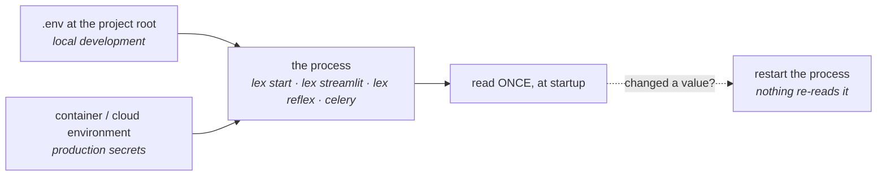

Lex App reads its runtime configuration from environment variables — usually loaded from the `.env` file `lex setup` generates at your project root. This page lists the variables the framework actively reads.

> [!note]
> This index covers the variables the framework reads directly. Your project's Django settings may layer additional ones on top. If a variable isn't listed here, check `lex_app/settings.py` in the installed package.

## Timezone

| Variable        | Purpose                                                                                                                                                                                                                             |
| --------------- | ----------------------------------------------------------------------------------------------------------------------------------------------------------------------------------------------------------------------------------- |
| `LEX_TIME_ZONE` | IANA timezone used as the display and naive-input zone (e.g. `Europe/Berlin`, `America/New_York`). Storage is always UTC — this controls how the server renders datetimes and interprets naive user input. Default `Europe/Berlin`. |

## Async / Celery

| Variable               | Purpose                                                                                                                                                                                                                                                                                                             |
| ---------------------- | ------------------------------------------------------------------------------------------------------------------------------------------------------------------------------------------------------------------------------------------------------------------------------------------------------------------- |
| `CELERY_ACTIVE`        | `true` to let the framework dispatch calculations to Celery workers when they're available. `@lex_shared_task` still works, but root `CalculationModel` runs no longer require it just to use Celery. Otherwise tasks run synchronously in the current process. See [[calculations/celery and async calculations]]. |
| `FLOWER_ADDRESS`       | Interface [Flower](https://flower.readthedocs.io/) binds to when you run `lex flower`. Default `127.0.0.1` — change it to `0.0.0.0` to reach the dashboard from outside the container.                                                                                                                              |
| `FLOWER_PORT`          | Port Flower listens on. Default `5555`.                                                                                                                                                                                                                                                                             |
| `FLOWER_URL_PREFIX`    | Sub-path Flower is served under, when it sits behind a reverse proxy rather than at the root. Empty by default.                                                                                                                                                                                                     |
| `IS_RUNNING_IN_CELERY` | Set to `true` inside Celery worker processes so the framework knows it's executing a queued task rather than a web request. `lex celery-workers` sets it for the workers it starts, and so does the generated **Celery Workers** run configuration. `lex celery` does not: export it yourself for a worker you start with `lex celery … worker`, and for a standalone recovery worker such as `lex-recovery-beat`. |

## Calculation threading

These control the thread pools that keep long-running calculations from blocking the web server. Defaults are sensible — only tune them if you have a specific throughput or responsiveness problem.

| Variable                  | Purpose                                                                                                                                                                      |
| ------------------------- | ---------------------------------------------------------------------------------------------------------------------------------------------------------------------------- |
| `LEX_CALCULATION_THREADS` | Size of the dedicated pool that runs in-process calculations off the request thread, so calculations never starve API calls, WebSocket auth, or health checks. Default `10`. |
| `ASGI_THREADS`            | Size of the ASGI sync executor used for regular sync work. Raising it gives the server more headroom for concurrent sync operations. Default `3`.                            |

## Scheduled jobs

The clock that runs [[calculations/scheduled jobs|scheduled jobs]]. It is a thread in the backend that `lex start` serves the app from.

| Variable | Default | Purpose |
|---|---|---|
| `LEX_SCHEDULER_ENABLED` | `true` | Whether the backend starts the clock. Only `true` (any case) turns it on; any other value, `1` and `yes` included, turns it off, and the backend logs a WARNING that no scheduled job will run. `lex run_scheduler` does not read it. |
| `LEX_SCHEDULER_TICK_SECONDS` | `30` | Seconds between checks for due jobs; a run starts up to this long after its slot. Whole number, minimum 1. Also the default `--interval` of `lex run_scheduler`. |
| `LEX_SCHEDULER_MISFIRE_GRACE_SECONDS` | `3600` | How late a slot may be and still run, after downtime or a restart. Missed slots within it collapse into one run; a slot later than this is recorded as missed and does not run. Whole number. |

## Worker recovery & shutdown

These govern how the framework recovers tasks from dead workers and how idle workers shut themselves down. Defaults are production-ready; the idle-shutdown knobs only take effect in a non-local `DEPLOYMENT_TARGET`. See [[calculations/celery and async calculations]] for the full picture.

| Variable                                | Purpose                                                                                                                                                                                                                  |
| --------------------------------------- | ------------------------------------------------------------------------------------------------------------------------------------------------------------------------------------------------------------------------ |
| `LEX_TASK_RECOVERY_ENABLED`             | Master switch for the heartbeat/dead-worker recovery system. Default `false` — turn it on only in deployments where you also run `lex-recovery-supervisor` or `lex-recovery-beat`.                                       |
| `LEX_TASK_HEARTBEAT_INTERVAL`           | How often (seconds) a running task emits a liveness heartbeat. Default `5`.                                                                                                                                              |
| `LEX_TASK_HB_TTL_MULTIPLIER`            | A task is considered dead after `HEARTBEAT_INTERVAL × TTL_MULTIPLIER` seconds without a heartbeat. Default `3`.                                                                                                          |
| `LEX_TASK_SUPERVISOR_SCAN_INTERVAL`     | How often (seconds) the supervisor sweeps for dead workers and requeues their tasks. Default `10`.                                                                                                                       |
| `LEX_TASK_MAX_RETRIES`                  | Max automatic requeues after a dead-worker event before the task is marked failed. Default `4`.                                                                                                                          |
| `LEX_WORKER_IDLE_SHUTDOWN_ENABLED`      | Master switch for all worker self-termination — idle watchdog, cancel fast-path, and post-task warm shutdown. Non-local `DEPLOYMENT_TARGET` only. Set `false` for long-lived `-B`/recovery-beat workers. Default `true`. |
| `LEX_WORKER_IDLE_SHUTDOWN_SECONDS`      | Seconds a worker may sit with no work before the idle watchdog shuts it down. Default `30`.                                                                                                                              |
| `LEX_CLUSTER_CANCEL_ENABLED`            | Whether cancelling a calculation cascades to descendant tasks on other worker pods via the Redis cancel index. Inert when `CELERY_ACTIVE` is off or no Redis is reachable. Default `true`.                               |
| `LEX_CLUSTER_CANCEL_TREE_TTL_SECONDS`   | TTL (seconds) for the Redis cancel-index tree mapping a calculation to its descendant task IDs. Default `14400` (4 h).                                                                                                   |
| `LEX_CLUSTER_CANCEL_MARKER_TTL_SECONDS` | TTL (seconds) for the cooperative cancel marker a task checks to self-abort. Default `3600` (1 h).                                                                                                                       |

## Streamlit

| Variable | Purpose |
| --- | --- |
| `IS_STREAMLIT_ENABLED` | `true` to enable the Streamlit toolbar icon in the frontend. See [[access-and-dashboards/streamlit/index\|Streamlit Dashboards]]. |
| `LEX_STREAMLIT_AUTH`                                         | How embedded dashboards sign in. `legacy` (default): the frontend hands the proxy the user's token, as before 2.5. `handoff`: the dashboard signs in through the app and holds no token; it stays signed in as long as the app does. `dual`: both, for a rollout. Set the **same value on the backend and on the Streamlit pod**; setting it back is the rollback. Any other value stops `lex streamlit` and the proxy. See [[access-and-dashboards/streamlit/sessions and authentication\|Sessions & Authentication]]. |
| `STREAMLIT_URL` / `BASE_URL`                                 | The dashboard's canonical public URL, used by the embedded dashboard proxy. When this is HTTPS, Lex App defaults to secure cross-site cookies for the iframe. On a hosted instance with a customer-owned domain attached, `LEX_STREAMLIT_HOSTS` below lists every hostname the dashboard also answers on.                                                                                                                                                                                                                                                                                                                                                                                                                                                        |
| `LEX_APP_HOSTS` / `LEX_STREAMLIT_HOSTS` / `LEX_REFLEX_HOSTS` | Every hostname the instance answers on for that role, comma separated, canonical first. Written by the hosting platform when a customer-owned domain is attached; absent otherwise, when `DOMAIN_HOSTED`, `STREAMLIT_URL` and `REFLEX_URL` are the whole truth. They reach `ALLOWED_HOSTS` and `CSRF_TRUSTED_ORIGINS`, the dashboard proxy's sign-in callback and renewal allow-list, and Reflex's websocket CORS — and decide which dashboard hostname a page frames, so that the iframe stays on the viewer's own registrable domain. See [[ship-and-operate/custom domains\|Custom domains]].                                                                                                                                                                 |
| `LEX_PROXY_PORT`                                             | Port exposed by the local Streamlit proxy when running `lex streamlit`. Default `8501`.                                                                                                                                                                                                                                                                                                                                                                                                                                                                                                                                                                                                                                                                          |
| `LEX_PROXY_INTERNAL_URL`                                     | Full base URL the dashboard uses to reach the proxy when it is not `http://127.0.0.1:$LEX_PROXY_PORT`.                                                                                                                                                                                                                                                                                                                                                                                                                                                                                                                                                                                                                                                           |
| `LEX_PROXY_DB_THREADS`                                       | With `LEX_STREAMLIT_AUTH` `handoff` or `dual`: the worker threads, each with its own database connection, through which the dashboard proxy reads sign-ins. Default `8`. |
| `UPSTREAM` / `STREAMLIT_UPSTREAM`                            | Internal Streamlit server URL behind the proxy. Default `http://localhost:8080`.                                                                                                                                                                                                                                                                                                                                                                                                                                                                                                                                                                                                                                                                                 |
| `UPSTREAM_TIMEOUT_SECONDS`                                   | Timeout for proxy requests to Streamlit. Default `30`.                                                                                                                                                                                                                                                                                                                                                                                                                                                                                                                                                                                                                                                                                                           |
| `SESSION_SECRET`                                             | Signing key for dashboard session cookies. Optional: when unset, the key is derived from `DJANGO_SECRET_KEY`, which every deployment already has and which is stable across restarts and identical on every replica. `SESSION_KEY` and `SESSION_SECRET_KEY` are accepted aliases.                                                                                                                                                                                                                                                                                                                                                                                                                                                                                |
| `SESSION_SAMESITE`                                           | Cookie SameSite mode for the dashboard proxy: `none`, `lax`, or `strict`. Defaults to `none` on HTTPS and `lax` otherwise.                                                                                                                                                                                                                                                                                                                                                                                                                                                                                                                                                                                                                                       |
| `SESSION_HTTPS_ONLY`                                         | Whether dashboard cookies are marked `Secure`. Defaults to `true` for HTTPS public URLs. Required when `SESSION_SAMESITE=none`.                                                                                                                                                                                                                                                                                                                                                                                                                                                                                                                                                                                                                                  |
| `TOKEN_REDIS_URL` / `REDIS_URL`                              | Shared token store for dashboard sessions. Use this when running more than one proxy replica, or when you want sessions to survive proxy restarts.                                                                                                                                                                                                                                                                                                                                                                                                                                                                                                                                                                                                               |
| `LEX_PROXY_REPLICAS`                                         | Number of Streamlit proxy replicas. When greater than `1`, Lex App requires a shared Redis token store instead of process-local memory.                                                                                                                                                                                                                                                                                                                                                                                                                                                                                                                                                                                                                          |
| `LEX_STREAMLIT_DISCONNECTED_SESSION_TTL`                     | How long Streamlit keeps a disconnected session around for reconnects. Default `600` seconds.                                                                                                                                                                                                                                                                                                                                                                                                                                                                                                                                                                                                                                                                    |
| `LEX_INTERNAL_AUTH_SECRET`                                   | Shared secret for the proxy-to-Streamlit token refresh channel. `lex streamlit` sets this automatically; set it yourself only when running the two processes separately.                                                                                                                                                                                                                                                                                                                                                                                                                                                                                                                                                                                         |
| `REACT_APP_URL` / `LEX_FRONTEND_URL` | Two roles. For the dashboard proxy: the origin allowed to hand it a renewed dashboard token, normally derived from `DOMAIN_HOSTED`, so set one only when the frontend is served from a different host. For `lex_view()` and `lex_widgets()`: a fallback for where their frames point, and so for the only origin whose events `lex_view()` accepts. The frame's base is, in order: the origin that the Lex App interface framing the dashboard names (`lex_app_origin`), once the instance confirms it is one of its own app origins; `REACT_APP_URL`; `LEX_FRONTEND_URL`; the application hostname on the same registrable domain as the dashboard — the platform hostname normally, the customer's once a domain is attached, since a frame across registrable domains is third-party and loses its cookies; and last `http://localhost:8000`. Only a shell on none of these hosts needs the variable; give a full origin with its scheme. See [[access-and-dashboards/streamlit/embedding app pages#Where the frame points\|Where the frame points]]. |
| `STRIP_AUTH_TOKEN_FROM_URL`                                  | `true` to redirect the dashboard's first request to the same URL without its `auth_token`. Default `true`.                                                                                                                                                                                                                                                                                                                                                                                                                                                                                                                                                                                                                                                       |
| `STATIC_ASSET_MAX_AGE`                                       | `max-age` for Streamlit package assets served by the proxy. Default one year.                                                                                                                                                                                                                                                                                                                                                                                                                                                                                                                                                                                                                                                                                    |
| `STATIC_GZIP_MIN_SIZE` / `STATIC_GZIP_LEVEL`                 | Compression floor and zlib level for Streamlit assets served by the proxy. Defaults `500` and `6`.                                                                                                                                                                                                                                                                                                                                                                                                                                                                                                                                                                                                                                                               |
| `JWKS_CACHE_TTL` / `JWKS_RETRY_BACKOFF_SECONDS`              | How long Keycloak signing keys are cached (default `3600`), and how long to wait before retrying a failed refresh while continuing to serve cached keys (default `30`).                                                                                                                                                                                                                                                                                                                                                                                                                                                                                                                                                                                          |
| `WEBSOCKETS_MAX_LINE_LENGTH`                                 | Longest HTTP header line the `websockets` library will parse on a WebSocket handshake. Lex App sets `65536` before the library loads; its own default is `8192`, which a long Keycloak access token or session cookie can exceed — and an over-long line leaves the handshake unanswered rather than refused, so the dashboard waits on an open socket and nothing is logged. Set it yourself only to raise it further. Read by `websockets` 13 and later; `lex streamlit` warns at startup when the installed release is older and parses at its own fixed limit. |
| `LEX_THEME_FOLLOW`                                           | Keep embedded Streamlit pages in the same light/dark mode as Lex App. Enabled by default; set to `0`, `false`, `no`, or `off` to let Streamlit control its own theme.                                                                                                                                                                                                                                                                                                                                                                                                                                                                                                                                                                                            |
| `LEX_THEME_DEBUG` | `1`, `true`, `yes` or `on` to draw a diagnostics box on each Streamlit page that follows Lex App's theme, listing every link of the light/dark sync in order, so you can see which one breaks. Only with `LEX_THEME_FOLLOW` on. Off by default; whoever opens the dashboard sees the box too. |

## Reflex

| Variable                                                                            | Purpose                                                                                                                                                                                                                                                                                                                                                                                                                                                                                                                                       |
| ----------------------------------------------------------------------------------- | --------------------------------------------------------------------------------------------------------------------------------------------------------------------------------------------------------------------------------------------------------------------------------------------------------------------------------------------------------------------------------------------------------------------------------------------------------------------------------------------------------------------------------------------- |
| `IS_REFLEX_ENABLED`                                                                 | `true` to add the **Reflex** entry to Lex App's sidebar, framing the project's Reflex dashboards. See [[access-and-dashboards/reflex/index\|Reflex Dashboards]].                                                                                                                                                                                                                                                                                                                                                                              |
| `REFLEX_URL`                                                                        | Where that entry finds the dashboards. Default `http://localhost:8502`.                                                                                                                                                                                                                                                                                                                                                                                                                                                                       |
| `REFLEX_FRONTEND_PORT` / `REFLEX_BACKEND_PORT`                                      | Reflex's own port settings. `lex reflex` supplies `8502` and `8503` only when neither these, the `--frontend-port`/`--backend-port` flags, nor `rxconfig.py` chose a port.                                                                                                                                                                                                                                                                                                                                                                    |
| `REFLEX_HOT_RELOAD_OVERRIDE_PATHS`                                                  | What the development server watches: `:`-separated paths, relative to the project root. Unset, `lex reflex` sets it to the project's own top-level entries.                                                                                                                                                                                                                                                                                                                                                                                   |
| `REFLEX_ACCESS_TOKEN`                                                               | A Reflex account token, for machines where nobody can run `lex reflex login`. Reflex Enterprise refuses to start on a machine that is not signed in, and production mode needs a paid tier.                                                                                                                                                                                                                                                                                                                                                   |
| `REFLEX_API_URL` / `REFLEX_DEPLOY_URL`                                              | The dashboards' public URL: where the browser reaches the backend, and where the frontend is served. Built into the frontend, so set them before `lex reflex run --env prod`. **Leave `REFLEX_API_URL` unset when the dashboards answer on more than one hostname.** Unset, Reflex keeps its localhost default and its frontend rewrites that to `window.location` before connecting, so one build serves every hostname; pinned, that one hostname is compiled in and every other opens a cross-origin websocket to it, carrying no cookies. |
| `REFLEX_CORS_ALLOWED_ORIGINS`                                                       | Which origins the backend accepts a websocket from. Unset, Lex App fills it from `LEX_REFLEX_HOSTS` — or leaves Reflex's own default alone when no public hostname is configured, which is every local run.                                                                                                                                                                                                                                                                                                                                   |
| `REFLEX_REDIS_URL`                                                                  | Shared page state, for more than one Reflex backend replica.                                                                                                                                                                                                                                                                                                                                                                                                                                                                                  |
| `LEX_KEYCLOAK_ISSUER_URI` / `LEX_KEYCLOAK_CLIENT_ID` / `LEX_KEYCLOAK_CLIENT_SECRET` | Override the issuer and client the dashboards sign in with. Unset, they come from `KEYCLOAK_URL` + `KEYCLOAK_REALM` and `OIDC_RP_CLIENT_ID` / `OIDC_RP_CLIENT_SECRET`. `KEYCLOAK_CLIENT_ID` is never used for this.                                                                                                                                                                                                                                                                                                                           |
| `OIDC_ISSUER_URI` / `OIDC_CLIENT_ID` / `OIDC_CLIENT_SECRET`                         | Reflex Enterprise's shared fallbacks for the same three; a `LEX_KEYCLOAK_*` value wins over them.                                                                                                                                                                                                                                                                                                                                                                                                                                             |
| `DJANGO_ALLOW_ASYNC_UNSAFE`                                                         | Django's switch that allows synchronous ORM calls on an event loop. Every such call then blocks every other user's events; see [[access-and-dashboards/reflex/the django orm\|The Django ORM]].                                                                                                                                                                                                                                                                                                                                               |

`OIDC_ISSUER` and `OIDC_VERIFY_SSL` apply to the Reflex sign-in too, with the same meaning as for the Streamlit proxy.

## Embedding

Which sites may show Lex App inside a frame: a Streamlit dashboard's [[access-and-dashboards/streamlit/embedding app pages|embedded pages]] and [[access-and-dashboards/streamlit/embedding app controls|app controls]], or any other page that embeds it.

| Variable | Default | Purpose |
|---|---|---|
| `LEX_EMBED_ALLOWED_ORIGINS` | unset | The sites allowed to embed Lex App, as a comma-separated list of origins: `https://dashboards.example.com,http://localhost:8501`. Only these sites can use an embedded table's filter channel — the `filter` event and the filters `lex_view` sends into the frame — and once it is set, no other site may frame Lex App at all. See [[access-and-dashboards/streamlit/embedding app pages#Allowed sites\|Allowed sites]]. |

How each entry is read:

- **An origin and nothing more.** `http` or `https`, a host, and a port only when it isn't the scheme's default. A path, a query, a fragment, a user name or a wildcard (`https://*.example.com`) refuses the entry; a single trailing `/` is accepted.
- **Written as the browser writes it.** Scheme and host are lower-cased, `:443` on `https` and `:80` on `http` are dropped, and a duplicate counts once, so `HTTPS://Dashboards.Example.com:443/` becomes `https://dashboards.example.com`. An international domain name is IDNA-encoded: `müller.example` becomes `xn--mller-kva.example`.
- **A strict host.** After encoding, the host may hold only letters, digits, hyphens and dots, as a hostname or an IPv4 address does. Two kinds of host are refused even though they look valid:
  - an IPv6 literal, such as `http://[::1]:8501`;
  - a host containing `ß`, `ς`, a zero-width joiner or a zero-width non-joiner. Python and the browser encode these differently, so the entry could name a different site from the one the browser reports.
- **Refused entries are dropped,** and a warning in the server log names them. A blank item from a stray comma is skipped.

What the setting changes:

| Value | Who may frame Lex App's pages | The `filter` channel |
|---|---|---|
| Unset or blank | Unchanged — no `frame-ancestors` directive is added | Off |
| At least one valid origin | Lex App itself and the listed sites: `Content-Security-Policy: frame-ancestors 'self' <origins>` | On, for the listed sites |
| Set, but no valid origin | Lex App itself only: `frame-ancestors 'self'`, with a warning in the server log | Off |

The last row fails closed: a list that is all typos never leaves Lex App open to framing by every site.

For a Streamlit dashboard, list the origin the browser shows for the dashboard page: on a deployment the origin of `STREAMLIT_URL` (or `BASE_URL`), and locally `http://localhost:8501`.

## Keycloak / OIDC

| Variable                         | Purpose                                                                                                                                                                                                                                                                      |
| -------------------------------- | ---------------------------------------------------------------------------------------------------------------------------------------------------------------------------------------------------------------------------------------------------------------------------- |
| `KEYCLOAK_REALM`                 | Name of the Keycloak realm the framework targets when syncing models, fields, and groups.                                                                                                                                                                                    |
| `KEYCLOAK_REALM_NAME`            | Display name of the realm (used during bootstrap). Falls back to `KEYCLOAK_REALM` if unset.                                                                                                                                                                                  |
| `OIDC_RP_CLIENT_ID`              | Your project's OIDC client ID — the identifier the browser logs in against.                                                                                                                                                                                                  |
| `KEYCLOAK_URL`                   | Base URL of the Keycloak server, e.g. `https://auth.excellence-cloud.de`. Read by the admin client, the dashboard proxy and the frontend config endpoint. Required — there is no default.                                                                                    |
| `OIDC_RP_CLIENT_SECRET`          | Client secret for the confidential OIDC client. Required for `lex init` to talk to the Keycloak admin API.                                                                                                                                                                   |
| `OIDC_RP_CLIENT_UUID`            | Keycloak's _internal_ UUID for that client — not the client ID. Used to address the client's authorization endpoints directly; `lex init --bootstrap` fills it in for you.                                                                                                   |
| `KEYCLOAK_CLIENT_ID`             | Client ID handed to the browser at runtime (served as `REACT_APP_KEYCLOAK_CLIENT_ID`). Usually the same value as `OIDC_RP_CLIENT_ID`.                                                                                                                                        |
| `KEYCLOAK_INTERNAL_CLIENT_ID`    | Client ID used for server-to-server calls to the platform API, as opposed to the one the browser logs in with.                                                                                                                                                               |
| `KEYCLOAK_AUTHZ_REQUEST_TIMEOUT` | Timeout, in seconds, for calls to Keycloak's authorization endpoints. Raise it if `lex init` times out against a slow or distant realm.                                                                                                                                      |
| `INSTANCE_CONTROLLER_BASE_URL`   | Base URL of the instance-controller service that `lex init --bootstrap` opens in the browser.                                                                                                                                                                                |
| `KEYCLOAK_SETUP_CALLBACK_URL`    | URL that bootstrap flow calls back with the credentials it obtained. Both of these have working defaults — set them only against a self-hosted controller.                                                                                                                   |
| `KEYCLOAK_INTERNAL_URL`          | In-cluster base URL of Keycloak, e.g. `http://keycloak-release-keycloakx-http.default.svc.cluster.local`, for the server's own calls: discovery, token exchange and refresh, signing keys. Tokens still name the public issuer from `KEYCLOAK_URL`, and the browser is still sent to the public URL. Keycloak must run with a full public hostname URL and dynamic back-channel URLs for this to work; `lex oidc_check` confirms it. A mismatch answers `503 auth_unavailable` and signs nobody out; unset the variable to go back. On the platform the Instance Controller sets it for instances on the in-cluster Keycloak. Unset: every call goes to `KEYCLOAK_URL`. |
| `KEYCLOAK_VERIFY_SSL`            | TLS verification of lex's own calls to Keycloak (permissions, admin API, management commands): `true`, `false`, or the path of a CA bundle. Default: `true` on a deployed instance (`DEPLOYMENT_ENVIRONMENT` set), `false` locally. |
| `OIDC_ISSUER`                    | Expected `iss` claim when the dashboard proxy validates a token. Defaults to the realm URL derived from `KEYCLOAK_URL` and `KEYCLOAK_REALM`; set it only when the issuer the tokens carry differs from the URL you reach Keycloak on (a split-horizon DNS setup, typically). |

`lex setup` writes a starting set of these into `.env` and `lex init --bootstrap`
fills in the ones the browser flow can discover. Start from that file rather
than constructing the list by hand.

> [!warning] Four of these are load-bearing together
> OIDC is enabled only when `KEYCLOAK_URL`, `KEYCLOAK_REALM`, `OIDC_RP_CLIENT_ID`
> **and** `OIDC_RP_CLIENT_SECRET` are all set. Miss one and authentication is
> switched off silently — the app starts, serves pages, and never asks anyone to
> log in. If a deployment is unexpectedly open, check all four before anything
> else.

## Sign-in sessions

Keycloak decides how long a sign-in lasts: the realm's SSO session idle and
maximum lifetimes (app realms on the platform: 30 days idle, 90 days at most).
The app must not end a sign-in earlier than Keycloak does. See
[[access-and-dashboards/sign-in and sessions|Sign-in & Sessions]].

| Variable | Default | Purpose |
|---|---|---|
| `LEX_SESSION_COOKIE_AGE_DAYS` | `31` | Lifetime of the app's session cookie, in days. The cookie is renewed while the user is active, so this is how long a sign-in survives *without activity* in this app. Keep it above the realm's idle timeout. A value below `2`, or one that is not a whole number, stops the app at startup. |
| `LEX_INSTANCE_HOSTS` | unset | Where the instance is reachable, as JSON with one entry per surface: `{"app": {"canonical": "acme.lex.example", "extra": ["app.acme.com"], "platform": "acme.lex.example"}, "streamlit": {...}, "reflex": {...}}`. `canonical` is the host users are sent to, `extra` the further hosts the surface answers on (custom domains), `platform` the host the platform generated. Every key is optional; a value is a host (`app.acme.com`, `localhost:8501`) or a URL. It feeds the CORS origins, the allowed sign-in redirect targets and the dashboard hand-off. The platform sets it. Unset, or for a surface it leaves out, the hosts come from `DOMAIN_HOSTED`, `STREAMLIT_URL` and `REFLEX_URL`. A malformed value is dropped with a warning, never a crash. |
| `OIDC_TOKEN_ENCRYPTION_KEYS` | unset | Comma-separated Fernet keys that encrypt the sign-ins' tokens in the database, newest first: the first encrypts, all decrypt. To rotate, put a new key first, run `lex oidc_rotate_keys`, and remove the old key later. Unset, the key is derived from `DJANGO_SECRET_KEY` (and `SECRET_KEY_FALLBACKS`). That works, but ties the two secrets together, and the system check says so (`oauth2_authcodeflow.W001`). Switching to a key of your own signs nobody out: tokens written with the derived key stay readable, and `lex oidc_rotate_keys` moves them onto your key. Generate a key with `python -c "from cryptography.fernet import Fernet; print(Fernet.generate_key().decode())"`. |
| `LEX_WS_AUTH` | `log` | What the app's live WebSockets (calculations, logs, record updates) do with a socket that has no sign-in. `off`: serve it, as before 2.5. `log`: serve it, and log one warning per socket naming the consumer and the close code it would get. `enforce`: accept it, then close it with `4401` (sign in again), `4403` (not allowed) or `4503` (sign-in cannot be checked; try again). Any other value stops the app at startup. `ws/health` is always public. |

## Mail

| Variable           | Purpose                                                                                                              |
| ------------------ | -------------------------------------------------------------------------------------------------------------------- |
| `SENDGRID_API_KEY` | API key used to send the PDF test report (`lex pytest --report-and-email`) and any project-level transactional mail. |

## Widget integrations

| Variable                  | Purpose                                                                                                                                                                                                                             |
| ------------------------- | ----------------------------------------------------------------------------------------------------------------------------------------------------------------------------------------------------------------------------------- |
| `QUACKBACK_WIDGET_SECRET` | Shared secret used to sign the short-lived HS256 SSO token the frontend mints at `POST /api/quackback-widget-token` to identify the logged-in user to the embedded Quackback feedback widget. Leave unset to disable token minting. |

## Logging & warnings

| Variable                        | Default | Purpose                                                                                                                                                                                                                                  |
| ------------------------------- | ------- | ---------------------------------------------------------------------------------------------------------------------------------------------------------------------------------------------------------------------------------------- |
| `LOG_LEVEL`                     | `INFO`  | Application-wide log level. Raising it to `DEBUG` turns on debug output everywhere — including third-party libraries — so the console gets noisy. Use it when you want _everything_.                                                     |
| `LEX_LOG_LEVEL`                 | `INFO`  | Log level for the **Lex framework only** (`lex.*` loggers). Set it to `DEBUG` to see the framework's own debug output without the third-party noise `LOG_LEVEL=DEBUG` would pull in.                                                     |
| `LEX_SUPPRESS_INSECURE_WARNING` | `True`  | Hides urllib3's `InsecureRequestWarning`, which otherwise prints on every request the framework makes to the auth host when TLS verification is off. Set it to `False` if you're debugging certificates and want the warning back.       |
| `LEX_SUPPRESS_WARNINGS`         | `True`  | Quiets Python's warning system at startup (e.g. Django's "Accessing the database during app initialization" `RuntimeWarning`) so local logs stay clean. Set it to `False` to restore Python's default warning behaviour while debugging. |

> [!tip]
> `LEX_LOG_LEVEL` and `LOG_LEVEL` are independent. For day-to-day debugging of your own app and the framework, reach for `LEX_LOG_LEVEL=DEBUG` first — it keeps the console readable. Drop down to `LOG_LEVEL=DEBUG` only when you suspect the issue is in a third-party library.

## Database

The app builds its `DATABASES["default"]` by picking one of several
preconfigured blocks. `DATABASE_DEPLOYMENT_TARGET` chooses the block; the rest
fill it in.

| Variable                     | Purpose                                                                                                                                                                                                                                                                                                                    |
| ---------------------------- | -------------------------------------------------------------------------------------------------------------------------------------------------------------------------------------------------------------------------------------------------------------------------------------------------------------------------- |
| `DATABASE_DEPLOYMENT_TARGET` | Which connection profile to use: `local` (SQLite file, for a machine with no PostgreSQL), `default` (PostgreSQL on `localhost`), `GCP`, `DOCKER-COMPOSE`, or `K8S`. Default `default`. The three deployed profiles are identical apart from `K8S`, which disables TLS on the connection because the sidecar terminates it. |
| `DATABASE_NAME`              | Database name. Read by the `GCP`, `DOCKER-COMPOSE` and `K8S` profiles; the `default` profile derives the name from your repository name instead.                                                                                                                                                                           |
| `DATABASE_DOMAIN`            | Database host for those same three profiles.                                                                                                                                                                                                                                                                               |
| `POSTGRES_USERNAME`          | Database user for those same three profiles. Default `django`.                                                                                                                                                                                                                                                             |
| `POSTGRES_PASSWORD`          | Database password for those same three profiles.                                                                                                                                                                                                                                                                           |

> [!note]
> If one of these is missing, the connection is built with the literal string
> `envvar_not_existing` in its place, and the failure surfaces as a connection
> error naming a host or database you have never heard of. That string in a
> stack trace means "an env var was not set", not "DNS is broken".

The `default` profile reads none of the variables above. It always connects to
`localhost:5432` as `django`, with the password `lundadminlocal`, to a database
named `db_` plus your project folder's name in lower case. The `local` profile
keeps its SQLite file at the project root, named after the project folder:
`TeamBudget.sqlite3` for the tutorial. Setting up either is covered in
[[start-here/installation#Choose a Database|Choose a Database]].

## Redis

| Variable | Purpose |
| --- | --- |
| `REDIS_HOST` | Host of the instance's Redis. It is the Celery broker (database `1`) and the channel layer that carries live updates between processes (database `2`), and it holds the calculation-log cache and the cluster cancel index. It is not the Celery result backend: results are stored in PostgreSQL — on a deployed instance in the database the `DATABASE_*` and `POSTGRES_*` variables name, locally in the `default` profile's database. |
| `REDIS_USERNAME` / `REDIS_PASSWORD` | Credentials for it. |

All three are read only on a deployed instance (`DEPLOYMENT_ENVIRONMENT` set).
There they are combined into `redis://` URLs — there is no separate URL
variable for the app itself — and the instance refuses to start if one of
them is missing. Locally they are ignored: the framework uses
`redis://127.0.0.1:6379`, and needs it once `CELERY_ACTIVE` is on. (The
dashboard proxy has its own `TOKEN_REDIS_URL` / `REDIS_URL`, listed under
Streamlit above, because it can run as a separate process against a
different instance.)

## Deployment identity

| Variable                       | Purpose                                                                                                                                                                                                                                                                                                                                                                                                    |
| ------------------------------ | ---------------------------------------------------------------------------------------------------------------------------------------------------------------------------------------------------------------------------------------------------------------------------------------------------------------------------------------------------------------------------------------------------------- |
| `DEPLOYMENT_ENVIRONMENT` | Presence flag: set it, to any non-empty value, on a deployed instance; leave it unset on a developer machine. Don't set it empty: the settings then count it as set, but `lex start`, `lex init`, the calculation-log cache and the platform-API calls count it as unset. Set, the instance refuses to start without `DOMAIN_HOSTED`, a private `DJANGO_SECRET_KEY` and the three `REDIS_*` variables (see below); Redis and the Celery result backend are reached through their variables instead of `localhost`; `lex start` runs `collectstatic` first; the calculation-log cache moves to Redis; and the framework is allowed to call the platform API. The value `PROD` also changes what a standalone Streamlit dashboard shows when its `main()` raises: the traceback, in an expander on the page. Any other value, or none, lets the error reach Streamlit. |
| `DOMAIN_HOSTED` | The instance's canonical hostname, bare: `acme.lex.example`, no scheme. It goes into `ALLOWED_HOSTS`, `CSRF_TRUSTED_ORIGINS` and the CORS origins, and it is the app host wherever `LEX_APP_HOSTS` and `LEX_INSTANCE_HOSTS` name none. **Required when `DEPLOYMENT_ENVIRONMENT` is set**: without it the instance refuses to start, because `ALLOWED_HOSTS` would match only `localhost` and every WebSocket and CSRF check would reject the real hostname. Locally it defaults to `localhost`. |
| `DJANGO_SECRET_KEY` | Django's `SECRET_KEY`. It signs sessions and tokens, and two further keys are derived from it: the dashboard proxy's cookie key, unless `SESSION_SECRET` is set, and the key that encrypts stored sign-ins, unless `OIDC_TOKEN_ENCRYPTION_KEYS` is set. Unset, a development key published with the package is used — and a deployed instance refuses to start on that key, or on none. |
| `LEX_ENVIRONMENT_TAG`          | Set to `dev` to turn Django's `DEBUG` on. Any other value — including unset — leaves it off. This is the only switch for `DEBUG`; there is no `DJANGO_DEBUG`.                                                                                                                                                                                                                                              |
| `KUBERNETES_ENGINE` | Anything other than `NONE` tells the framework it runs in a container cluster: with local file storage, uploaded files then go to `/app/storage/uploads` instead of the project root. See [File storage](#file-storage). Default `NONE`. |
| `K8S_NAMESPACE`                | Namespace, used to build storage paths for uploaded files.                                                                                                                                                                                                                                                                                                                                                 |
| `INSTANCE_RESOURCE_IDENTIFIER` | The name that distinguishes this instance from every other one sharing infrastructure. It becomes the Celery queue name, the cache-key prefix, the Redis key prefix for recovery and cancellation, and part of the upload path. Two instances that share a Redis or a broker **must** have different values here. Defaults vary by call site (`celery`, `local`) — set it explicitly on anything deployed. |
| `PROJECT_ROOT` | Absolute path to your project. Everything that resolves a project-relative path — `lex_config.py`, `initial_data`, migrations, local uploads — starts here. You rarely set it: the `lex` CLI works it out from the directory you run it in and sets it for every process it starts. It takes the nearest folder at or above that directory that holds `lex_config.py`; else the git top level; else the nearest folder holding `.git`, `pyproject.toml`, `setup.cfg`, `manage.py`, `requirements.txt`, `.idea` or `.vscode`; else the directory itself. The searches upward stop at your home directory. A value already in the environment wins. See [[reference/CLI Commands#Where the CLI looks for the project\|Where the CLI looks for the project]]. |
| `PROJECT_DISPLAY_NAME`         | Name shown in the frontend's title bar. Defaults to the repository name.                                                                                                                                                                                                                                                                                                                                   |
| `DOMAIN_BASE`                  | Hostname of the platform API the framework calls for transactional mail and client-role lookups.                                                                                                                                                                                                                                                                                                           |
| `PUBLIC_URL`                   | Fallback public URL for the dashboard when `STREAMLIT_PUBLIC_URL` is unset.                                                                                                                                                                                                                                                                                                                                |
| `LEX_API_KEY` | The instance's own API key, set by the platform. The framework sends it as `Authorization: Api-Key …` on its calls to the platform API. It is not needed to read the health check: `/health` and `/api/health` are public. With the key set, their answer also carries `runtime`: the lex-app version and the instance's commit, encrypted with a key derived from this one, so that only the platform can read them. A request carrying this key may also read `api/active-calculations`, as a signed-in user or a Django-admin API key may. See [[ship-and-operate/monitoring and health]]. |
| `LEX_EXTRA_ALLOWED_HOSTS`      | Further hostnames the instance answers on, comma separated, e.g. `sign.example.com,.example.org`. Each is added to `ALLOWED_HOSTS` and, as an `https://` origin, to `CSRF_TRUSTED_ORIGINS`. Bare hostnames, no scheme; a leading dot means every subdomain (`.example.org` becomes `https://*.example.org` as an origin). `*` is refused at startup on a deployed instance. Unset by default. Django judges the hostname the browser asked for, so a hostname missing here gets `400 Bad Request` whatever the ingress rewrites. |

> [!warning] What a deployed instance refuses to start without
> With `DEPLOYMENT_ENVIRONMENT` set, loading the settings stops every process
> — the web server, the workers, every management command — with
> `ImproperlyConfigured` when:
>
> - `DOMAIN_HOSTED` is unset or empty;
> - `LEX_EXTRA_ALLOWED_HOSTS` contains `*`;
> - `DJANGO_SECRET_KEY` is unset, blank, or the development key published with
>   the package;
> - `REDIS_HOST`, `REDIS_USERNAME` or `REDIS_PASSWORD` is unset or empty — a
>   deployed instance always uses Redis for its channel layer.
>
> The message names the variable. See
> [[ship-and-operate/configuration#What still refuses to start|Configuration]].

## File storage

| Variable                                | Purpose                                                                          |
| --------------------------------------- | -------------------------------------------------------------------------------- |
| `STORAGE_TYPE` | Where uploaded files go: `SHAREPOINT`, `GCS`, or `LEGACY`/unset for local disk. On local disk they go to the project root itself on a developer machine, and to `/app/storage/uploads` when `KUBERNETES_ENGINE` is not `NONE` — the volume to persist and back up. |
| `GS_BUCKET_NAME` | Bucket name when `STORAGE_TYPE=GCS`. The service-account key is a file, not a variable; see below. |
| `SHAREPOINT_URL`                        | Site URL when `STORAGE_TYPE=SHAREPOINT`. Default `local`.                        |
| `SHAREPOINT_APP_CLIENT_ID`              | Azure app registration client ID for SharePoint access.                          |
| `SHAREPOINT_API_TENANT_NAME`            | Azure tenant name.                                                               |
| `SHAREPOINT_API_CERTIFICATE_PATH`       | Path to the certificate used to authenticate as that app.                        |
| `SHAREPOINT_API_CERTIFICATE_THUMBPRINT` | Thumbprint of that certificate. Azure requires both the file and its thumbprint. |
| `FILE_PREVIEW_LINK_BASE`                | Base URL used to build the in-browser preview link for a stored document.        |

> [!warning] `STORAGE_TYPE=GCS` reads its key from a fixed path
> The service-account key is loaded from
> `<parent of the project root>/django-storages/gcpCredentials.json` while the
> settings load: the folder `django-storages` sits *beside* the project folder,
> not inside it. No variable names another path. Without the file, every
> process that loads the settings fails at startup.

## Celery tuning

Distinct from the recovery knobs above: these bound a task's own execution
rather than what happens when a worker dies.

| Variable                 | Default | Purpose                                                                                                                                                          |
| ------------------------ | ------- | ---------------------------------------------------------------------------------------------------------------------------------------------------------------- |
| `CELERY_TASK_TIMEOUT`    | `3600`  | Hard time limit, in seconds, for a single task.                                                                                                                  |
| `CELERY_MAX_RETRIES`     | `3`     | Retries for a task that raises.                                                                                                                                  |
| `CELERY_RETRY_DELAY`     | `60`    | Seconds between those retries.                                                                                                                                   |
| `CELERY_VALIDATE_CONFIG` | `True` | Whether the Celery app checks, as it is imported, that the broker and the result backend are Redis URLs. It only logs and never stops anything: the result backend is PostgreSQL, so the check reports that at DEBUG level and returns. Any value but `true` skips it. |

## Dashboard proxy: tokens and sessions

These govern how the [[access-and-dashboards/streamlit/index|dashboard proxy]]
handles the tokens it holds on a user's behalf. The defaults are correct for a
normal deployment.

| Variable                                                         | Default            | Purpose                                                                                                                                                                                                                                       |
| ---------------------------------------------------------------- | ------------------ | --------------------------------------------------------------------------------------------------------------------------------------------------------------------------------------------------------------------------------------------- |
| `TOKEN_IDLE_TTL_SECONDS`                                         | `28800` (8 h)      | How long a dashboard session survives with no activity before its tokens are dropped.                                                                                                                                                         |
| `TOKEN_EXPIRY_SKEW_SECONDS`                                      | `30`               | How far before real expiry a token is treated as expired, so a refresh happens before a request fails.                                                                                                                                        |
| `TOKEN_REDIS_PREFIX`                                             | `st_proxy_tokens:` | Key prefix for the token store. Change it when two deployments share one Redis.                                                                                                                                                               |
| `ST_ACCESS_COOKIE_MAX_AGE`                                       | `600`              | Lifetime of the proxy's access cookie.                                                                                                                                                                                                        |
| `JWT_ALG`                                                        | `RS256`            | Algorithm the proxy requires when validating tokens.                                                                                                                                                                                          |
| `JWT_LEEWAY_SECONDS`                                             | `2`                | Clock-skew tolerance for `exp` and `nbf`.                                                                                                                                                                                                     |
| `TRUSTED_PROXY_HOSTS`                                            | `*`                | Hosts the proxy accepts forwarded headers from. Narrow this if the proxy is reachable from outside your ingress.                                                                                                                              |
| `UPSTREAM_KEEPALIVE_EXPIRY_SECONDS`                              | `2`                | How long an idle upstream connection to Streamlit is kept open.                                                                                                                                                                               |
| `LEX_PROXY_SHUTDOWN_TIMEOUT`                                     | `5`                | Seconds `lex streamlit` waits for the proxy thread to stop before giving up on a clean shutdown.                                                                                                                                              |
| `STREAMLIT_PUBLIC_URL`                                           | —                  | Public URL of the dashboard. Falls back to `PUBLIC_URL`.                                                                                                                                                                                      |
| `LEX_STREAMLIT_BASE_URL_PATH` / `STREAMLIT_SERVER_BASE_URL_PATH` | —                  | Sub-path the dashboard is mounted under, when it is not at the root. The first wins if both are set.                                                                                                                                          |
| `LEX_STREAMLIT_QUACKBACK`                                        | on                 | The feedback launcher on dashboard pages. Opt **out** with `0`, `false`, `no`, or `off` — a deployment that already shows the widget in the main app normally wants it here too.                                                              |
| `SET_ST_ACCESS_COOKIE`                                           | `true`             | Whether the proxy sets its short-lived access cookie at all.                                                                                                                                                                                  |
| `PERSIST_JWT_AUTH_TO_SESSION`                                    | `true`             | Whether a validated token is written into the session, so later requests skip revalidation.                                                                                                                                                   |
| `JWT_VERIFY_ISSUER`                                              | `false`            | Whether the `iss` claim is checked against `OIDC_ISSUER`. Off by default because a mismatch between the internal and external Keycloak URL is common and non-fatal; turn it on once you have confirmed the issuer your tokens actually carry. |
| `OIDC_VERIFY_SSL`                                                | `true`             | TLS verification on calls to Keycloak. Only turn this off against a local server with a self-signed certificate.                                                                                                                              |
| `UPSTREAM_USE_SYSTEM_PROXY`                                      | `false`            | Whether HTTP calls to Streamlit honour the system proxy variables. Off by default: an `HTTP_PROXY` meant for outbound traffic will otherwise swallow a loopback connection.                                                                   |
| `WS_UPSTREAM_USE_SYSTEM_PROXY`                                   | `false`            | The same switch for WebSocket connections, which is separate because the two use different clients.                                                                                                                                           |
| `UPSTREAM_MAX_CONNECTIONS`                                       | `100`              | Connection-pool ceiling for the proxy's calls to Streamlit.                                                                                                                                                                                   |
| `UPSTREAM_MAX_KEEPALIVE`                                         | `20`               | How many of those may stay idle in the pool.                                                                                                                                                                                                  |
| `LEX_SERVE_STATIC_LOCALLY`                                       | `true`             | Whether the proxy serves Streamlit's static assets itself instead of passing them upstream.                                                                                                                                                   |
| `LEX_PROXY_ACCESS_LOG`                                           | `true`             | Access logging for the proxy.                                                                                                                                                                                                                 |
| `LEX_PROXY_ACCESS_LOG_STATIC`                                    | `false`            | Whether that log includes static-asset requests. Off by default — they dominate the volume and say nothing.                                                                                                                                   |

## Audit logging

| Variable                     | Default | Purpose                                                                                                                                                   |
| ---------------------------- | ------- | --------------------------------------------------------------------------------------------------------------------------------------------------------- |
| `INITIAL_DATA_AUDIT_LOGGING` | on      | Whether loading initial data writes audit-log entries. Accepts `true`/`1`/`yes`/`on`/`enabled` and their negatives. See [[history-and-audit/audit logs]]. |

> [!warning]
> A value this variable does not recognise — `maybe`, a stray quote, a typo —
> raises at startup rather than falling back to the default. That is deliberate:
> a misspelled switch that silently keeps auditing on is worse than one that
> stops and tells you. The error names the variable and lists the accepted
> values.

## Security

Every hardening below is **on by default**. The switches exist so a project can
migrate step by step; they are not meant to stay off.

| Variable                   | Default | Purpose                                                                                                                                                                                                                                            |
| -------------------------- | ------- | -------------------------------------------------------------------------------------------------------------------------------------------------------------------------------------------------------------------------------------------------- |
| `LEX_LEGACY_SECURITY`      | `false` | `true` switches every hardening off and restores the earlier behaviour. A migration aid; it logs a warning once.                                                                                                                                   |
| `LEX_SEC_<FLAG>` | unset | `true` or `false` (or `1`/`0`, `yes`/`no`, `on`/`off`) for one hardening, and wins over `LEX_LEGACY_SECURITY`. Flags: `FAIL_CLOSED`, `NOT_FOUND`, `READ_SURFACES`, `EDIT`, `FILTERS`, `TRACEBACKS`, `OIDC_REDIRECT`, `INTERNAL`, `HISTORY_WRITE`, `CREATE`, `CORS`. |
| `LEX_API_TRACEBACKS`       | unset   | `true` puts the server traceback into API error responses, `false` never does, not even with `DEBUG`. Unset: only with `DEBUG`.                                                                                                                    |
| `LEX_CORS_ALLOWED_ORIGINS` | unset | Comma-separated origins, e.g. `https://app.example.com,https://admin.example.com`, added to the instance's own origins (see `CORS` below): they too may make credentialed cross-origin requests, and they are accepted as sign-in redirect targets. An entry containing `*` or without a scheme is dropped. |

What each flag does:

- `FAIL_CLOSED` — a permission method that raises denies instead of allowing.
- `NOT_FOUND` — a record the caller may not read answers 404 on the record,
  history and bulk endpoints (it used to answer 200 with `{}`); a bulk read
  leaves unreadable ids out; `permission_list` returning false makes the list
  and its value lists 404; an unknown path under `api/` is a JSON 404, not the
  app's index page.
- `READ_SURFACES` — history, global search, export and file download apply read
  permission.
- `EDIT` — `permission_edit` runs on PATCH and PUT of a record and on every row
  of a bulk PATCH, and `permission_delete` on every row of a bulk DELETE. A
  refusal is a 400 with `{code, detail, error}`: `EDIT_NOT_ALLOWED` (with
  `fields` when only some fields are refused) or `DELETE_NOT_ALLOWED` (with the
  refused `ids`). A record whose `permission_edit` refuses everything refuses a
  calculate or cancel request too. Creating a record and deleting a single one
  are checked whatever this switch says; a refusal there is a 401 (not signed
  in) or a 403, with `{message, detail, code}` and `code` set to
  `not_authenticated` or `permission_denied`.
- `FILTERS` — list filters and ordering only on fields the caller can see; the
  primary key is always allowed. Otherwise 400 `FILTER_NOT_ALLOWED`. A column the
  caller may not filter by has no value list either.
- `TRACEBACKS` — no server traceback in error responses unless `DEBUG` or
  `LEX_API_TRACEBACKS=true`.
- `OIDC_REDIRECT` — `next` and `fail` on `/oidc/*` (sign-in, logout,
  `total_logout`) must be relative, the site's own host, or an origin in
  `CSRF_TRUSTED_ORIGINS` or `LEX_CORS_ALLOWED_ORIGINS`; anything else answers
  400 `REDIRECT_NOT_ALLOWED`. A frontend served from a different origin in
  development needs its origin in one of the two lists.
- `INTERNAL` — deleting unused files only for superusers and members of the
  Django group named `admin` (the user's groups in Django, not a Keycloak role;
  an API key is never one); writing to the server log and changing Django users
  and groups only for superusers; the calculation-log tree and its PDF show
  only logs of records the caller may read.
- `HISTORY_WRITE` — history rows can be changed or deleted only by superusers
  (400 `EDIT_NOT_ALLOWED` otherwise); their `lex_reserved_scopes` say so to the
  client.
- `CREATE` — `permission_create` is asked a second time, on the record as the
  request fills it: its validated values set, foreign keys included,
  many-to-many not. That happens before `pre_validation` and before anything is
  saved. The first check, on a blank record, runs whatever this switch says. A
  refusal at either answers 401 or 403 with `{message, detail, code}`.
- `CORS` — credentialed cross-origin requests are accepted only from the
  instance's own origins: `https://<DOMAIN_HOSTED>`, every host in
  `LEX_INSTANCE_HOSTS` and `LEX_APP_HOSTS`, and `LEX_CORS_ALLOWED_ORIGINS`;
  locally also the dev servers on `localhost` and `127.0.0.1`, ports 3000 and
  8000. Never `*`: with credentials it would let any site act as the signed-in
  user. Off, any origin is accepted again, as before 2.5.

## Behaviour switches

Knobs that change how the framework behaves rather than what it connects to.

| Variable                                  | Default | Purpose                                                                                                                                                                                                                                                                                         |
| ----------------------------------------- | ------- | ----------------------------------------------------------------------------------------------------------------------------------------------------------------------------------------------------------------------------------------------------------------------------------------------- |
| `LEX_METADATA_CACHE_SECONDS` | `30` | **No effect in 2.5.0.** It was meant to set how long a browser may reuse the model-structure response, but only a model-structure view that no route serves reads it; the endpoint the interface calls ignores it. |
| `LEX_SYNC_STREAMING_EXPANSION`            | `true`  | Whether synchronous batch expansion streams combinations one at a time (the memory-safe path) or materialises them all first. Set `false` for a one-line rollback to the old behaviour without a redeploy. See [[calculations/batch calculations]].                                             |
| `LEX_ACTIVATION_APPLIER_LIVENESS_SECONDS` | `300`   | How recent the in-database activation applier's heartbeat must be before lex-app treats it as alive and stops arming its own timers for future-dated history rows. pg_cron fires every minute, so five minutes absorbs a slow tick or a failover. See [[history-and-audit/bitemporal history]]. |

## Used only by the history backfill script

`lex/backfill_history_sql.py` is a standalone script that connects on its own
rather than through Django, so it reads a different set of names. These have no
effect on the application.

| Variable      | Default                                            |
| ------------- | -------------------------------------------------- |
| `DB_HOST`     | `localhost`                                        |
| `DB_USER`     | `postgres`                                         |
| `DB_PASSWORD` | `postgres`                                         |
| `DB_NAME`     | a hard-coded name — always set this one explicitly |

## Where these get set

| Place                  | When it's used                                                                                               |
| ---------------------- | ------------------------------------------------------------------------------------------------------------ |
| `.env` at project root | Local development. Every `lex` command loads it before it does anything else, and so do a plain `pytest` run in a Lex project and the Reflex backend; the PyCharm and VS Code run configurations `lex setup` generates load it too. A variable already set in the environment wins over the file. |
| Container / cloud env  | Production. Whatever your platform's secret manager exposes (Docker `--env-file`, Kubernetes Secrets, etc.). |

> [!warning] Do not `source .env`
> Every `lex` command reads the file itself, so exporting it into your shell
> first gains nothing, and it goes stale: a variable exported once wins over
> the file from then on, and later edits to `.env` seem to be ignored until you
> `unset` it or open a new shell.

Write the file as plain `NAME=value` lines. Blank lines and lines that start
with `#` are skipped, spaces around the name and the value are dropped, and one
pair of matching quotes around a value is removed. Nothing else is
interpreted: an `export` prefix and `${…}` are not understood, and a `#` after
a value is part of the value.

> [!tip]
> If you change anything in `.env`, restart your `lex start` / `lex streamlit` / `lex reflex` processes (and your Celery workers if you have them) — the variables are read once at startup.

## See also

- [[reference/CLI Commands]] — every command that reads these variables.
- [[reference/lex_config|lex_config.py]] — the Python-side configuration that complements these env vars.
- [[start-here/installation]] — how `.env` is generated by `lex setup`.
