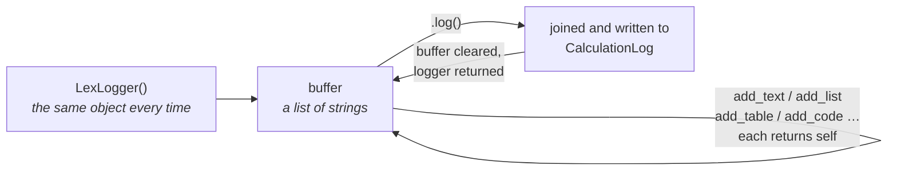

`LexLogger` uses a builder pattern — chain methods together and call `.log()` at the end. Every method returns the logger instance, so you can chain as many as you need.

Every `add_*` method appends to an in-memory buffer and returns the logger, so
calls chain. Nothing reaches the database until `.log()` flushes that buffer:



## One Logger per Process

`LexLogger` is a singleton: every `LexLogger()` in a process returns the same
object, with the same buffer. Calling it again does not start a fresh entry.
Two things follow:

- **Lines you never flush are not discarded.** They stay in the buffer, and the
  next `.log()` in the process writes them — wherever it is called, into the
  log of whatever is running then.
- **Calculations running at the same time in one process share the buffer.**
  The app server runs calculations on a pool of threads
  (`LEX_CALCULATION_THREADS`, 10 by default), and a Celery worker started with
  `--pool=threads` runs its tasks on threads too. If two runs both have lines
  in the buffer, the first `.log()` writes the other run's lines into its own
  log and empties the buffer.

So build each entry in one chain that ends with `.log()`:

```python
LexLogger().add_heading("Totals", level=2).add_table(headers, rows).log()
```

rather than adding lines across a loop, a query or a child calculation and
flushing at the end. That keeps the window in which another run can slip its
lines in short; it does not close it.

## Core Methods

Every `add_*` method ends its block with a blank line, so consecutive blocks
stay apart.

### `add_text(text: str)`

Adds a plain text paragraph.

```python
LexLogger().add_text("Processing complete.").log()
```

### `add_heading(heading: str, level: int = 1)`

Adds a Markdown heading (levels 1–6).

```python
LexLogger().add_heading("Summary", level=2) \
           .add_text("All items processed.") \
           .log()
```

### `add_table(headers: list, rows: list)`

Adds a Markdown table. Every header and cell must be a string: the method joins
them as they are, and a number raises `TypeError`, so convert with `str()`.

```python
LexLogger().add_table(
    ["Name", "Amount"],
    [["Alice", "500"], ["Bob", "750"]]
).log()
```

### `add_dataframe(df: pd.DataFrame)`

Renders a Pandas DataFrame as a Markdown table, without its index.

```python
import pandas as pd
df = pd.DataFrame({"Q": ["Q1", "Q2"], "Revenue": [100000, 120000]})
LexLogger().add_dataframe(df).log()
```

### `add_code(code: str, language: str = "")`

Adds a fenced code block.

```python
import json
config = {"rate": 0.19}
LexLogger().add_code(json.dumps(config, indent=2), language="json").log()
```

### `add_list(items: list, ordered: bool = False)`

Adds a list, one item per line: bullets, or numbers from 1 with `ordered=True`.

```python
LexLogger().add_list(["Schemas OK", "No missing funds"]).log()
LexLogger().add_list(["Load", "Validate", "Aggregate"], ordered=True).log()
```

### `add_quote(quote: str)`

Adds a blockquote.

```python
LexLogger().add_quote("Figures are preliminary until sign-off.").log()
```

### `add_link(text: str, url: str)`

Adds a link, as a paragraph of its own.

```python
LexLogger().add_link("Fund handbook", "https://example.com/handbook").log()
```

### `add_image(alt_text: str, url: str)`

Adds an image by its URL.

```python
LexLogger().add_image("NAV trend", "https://example.com/charts/nav.png").log()
```

### `add_horizontal_rule()`

Adds a horizontal rule (`---`), to separate parts of an entry.

```python
LexLogger().add_text("Inputs loaded.").add_horizontal_rule().add_text("Results:").log()
```

### `add_raw_markdown(markdown: str)`

Adds Markdown as it is, line by line, for anything the other methods don't
cover.

```python
LexLogger().add_raw_markdown("**Done.** 1,240 positions, *no* errors.").log()
```

### `log()`

Joins the buffer into one entry, writes it to the log of whatever is running,
empties the buffer and returns the logger. **Always call this last.** When the
entry is stored, and when it isn't, is in
[[calculations/logging#When the Log Is Stored|When the Log Is Stored]].

> [!warning]
> If you forget to call `.log()`, nothing is written then — and the lines wait
> in the buffer for the next `.log()` in the process, which writes them
> wherever it is called. This is the most common mistake.

## Context-Aware Logging

LexLogger automatically resolves:

| Context | How |
|---|---|
| **Calculation ID** | Links to the current `CalculationLog` entry |
| **Model Instance** | Identifies which model is executing |
| **Parent/Child** | Links nested calculations hierarchically |

You never need to pass context manually.

## Nested Calculations

A child calculation's log nests under its parent on its own. That covers a `CalculationModel` saved as `IN_PROGRESS` (in-process or on Celery) and every row a `create()` generates. You don't need to wrap the child in anything:

```python
class ParentCalculation(CalculationModel):
    def calculate(self):
        LexLogger().add_text("Starting parent").log()

        child = CalculateNAV.objects.filter(quarter=self.quarter).first()
        child.is_calculated = "IN_PROGRESS"
        child.save()

        LexLogger().add_text("Child finished.").log()
```

`model_logging_context(child)` still works if you pass it a model instance, but since lex-app 2.5.0 the framework does this for you. A model already on top is not pushed again, so an existing wrap does no harm.

Pass a plain string to `model_logging_context` to create a labeled section node in the log tree:

```python
from lex.audit_logging.utils.ModelContext import model_logging_context

with model_logging_context("Data preparation"):
    LexLogger().add_text("Loading source data...").log()

with model_logging_context("Processing"):
    LexLogger().add_text("Running calculations...").log()
```

Strings and model instances nest freely with each other.

See [[calculations/logging]] for more examples and usage patterns.
