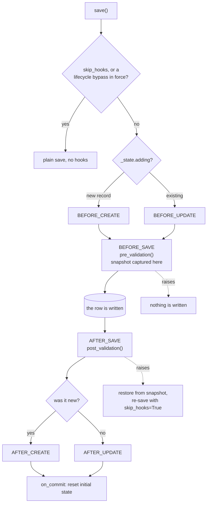

`LexModel` is the base class for every data model in Lex App. It extends [django-lifecycle](https://rsinger86.github.io/django-lifecycle/)'s `LifecycleModel` with automatic history tracking, permission hooks, validation hooks, and [Streamlit](https://docs.streamlit.io/) integration.

> [!tip]
> Browse the full source on [GitHub](https://github.com/ExcellenceCloudGmbH/lex-app/blob/lex-app-v2/lex/core/models/LexModel.py).

```python
from lex.core.models.LexModel import LexModel, UserContext, PermissionResult
```

## Auto-Provided Fields

Every `LexModel` subclass automatically gets these fields — you never need to declare them:

| Field | Type | Description |
|---|---|---|
| `id` | `AutoField` | Primary key (inherited from [Django](https://docs.djangoproject.com/)) |
| `created_at` | `DateTimeField` | When the record was first saved (set automatically) |
| `edited_at` | `DateTimeField` | When the record was last edited (set automatically on every later save, except those of a calculation) |
| `created_by` | `TextField` | Who created the record — a name, not a reference to a user. See [[#The Audit Stamps\|The Audit Stamps]] |
| `edited_by` | `TextField` | Who last edited it, as a name (set automatically for normal user edits; calculation-triggered framework saves don't overwrite it) |

History fields (via [django-simple-history](https://django-simple-history.readthedocs.io/)) are added transparently — you don't interact with them directly.

> [!note] Timestamps are stored and served in UTC
> `created_at` and `edited_at` are stored in UTC and served by the API with an explicit
> `Z` designator (e.g. `2026-07-14T11:43:00Z`). Parse them as UTC and convert to local
> time for display — the application already does this for you. This is the same contract
> the [[history-and-audit/bitemporal history#The REST API|as_of history queries]] follow.

### The Audit Stamps

`created_at` and `created_by` are set when a record is first saved; `edited_at` and `edited_by` on every later save that runs hooks — `save(skip_hooks=True)` leaves all four alone. The two `_by` fields hold a name:

| The save came from | Name stored |
|---|---|
| A signed-in user, in the interface or over the API | The user's first and last name — Lex App makes that `str(user)` for Django's `User` |
| An [[reference/REST API#API keys\|API key]] | `Technical User` |
| No request at all — initial data, `lex shell`, a management command, a script, a calculation running on a Celery worker | `Initial Data Upload` |

A signed-in user with neither a first nor a last name is stored as `Initial Data Upload` too.

- **A calculation leaves `edited_*` alone.** A save made while a calculation runs — its trigger, `calculate()` itself, the status writes — never changes `edited_at` or `edited_by`, on any record. Records created during a run do get `created_at` and `created_by`.
- **Timestamps you pass are kept.** `Model(created_at=…)` keeps that creation time, and a new value assigned to `edited_at` before a save is stored instead of the current time. `created_by` and `edited_by` are always set by the framework.
- **Untracked saves get no stamps.** `untrack()` and `save_without_historical_record()` skip all four — see [[#History Tracking Control]].

## Reserved Names

The startup stops with an error naming the model when a model of your project uses a name the framework needs:

- **Class names** `LexModel`, `LexManager`, `CalculationModel`, `History`, `MetaHistory`, `StandardHistory`, `HTMLReport`, `PermissionResult` and `UserContext`, and any class name that starts with `Historical` or `Meta` — which catches `Metadata` and `MetalPrice` as well.
- **Field names** `created_at`, `created_by`, `edited_at`, `edited_by` and `is_calculated`, on every model.
- On a model that gets history, the history fields as well: `history_id`, `history_type`, `history_user`, `history_change_reason`, `valid_from`, `valid_to`, `history_object`, `meta_history_id`, `meta_history_type`, `meta_history_change_reason`, `sys_from`, `sys_to`, `meta_task_name` and `meta_task_status`. An [[model-your-data/model structure#Untracked Models|untracked]] model may use these.

Only fields a class declares itself are checked; the ones it inherits from `LexModel` or `CalculationModel` are expected. [[model-your-data/HTML reports|HTML reports]] are not checked.

## Lifecycle Hooks

`save()` runs the hooks in a fixed order inside one transaction. The two you
override are `pre_validation` and `post_validation`; the create/update pairs
around them fire too, and are available through django-lifecycle's decorators
if you need them.



> [!note] Why `post_validation` needs a snapshot and `pre_validation` does not
> `pre_validation` runs before the write, so raising there simply means no row
> is written. `post_validation` runs after it, so the framework captures every
> field before the write and, on failure, restores those values and re-saves
> with `skip_hooks=True` — the flag exists to stop the rollback from
> re-entering the hooks that triggered it.

### `pre_validation(self)`

Called **before** every save that runs hooks (create or update). Raise any exception to cancel the save — the record will not be written to the database.

```python
def pre_validation(self):
    if self.amount <= 0:
        raise ValueError("Amount must be positive.")
```

### `post_validation(self)`

Called **after** the save completes. Raise any exception to trigger an automatic rollback — the framework restores the record to its pre-save state.

```python
def post_validation(self):
    if self.team.budget - self.amount < 0:
        raise ValueError("This would exceed the team budget.")
```

Whatever either method raises, `save()` raises `lex.core.exceptions.ValidationError`, with your exception as `.original_exception` and the model's class name as `.model_class`. See [[model-your-data/lifecycle hooks]] for the saves that skip both — a calculation's in-process result among them.

> [!important]
> Both hooks are wired via [django-lifecycle](https://rsinger86.github.io/django-lifecycle/)'s `@hook(BEFORE_SAVE)` and `@hook(AFTER_SAVE)` decorators internally. You just override the method — no decorator needed on your side.

## Permission Methods

Lex App checks permissions automatically on every API request and frontend interaction. Override these methods on your model to customize access control.

### Field-Level Methods (return `PermissionResult`)

| Method | Default Behavior | When It's Called |
|---|---|---|
| `permission_read(user_context)` | Allow if Keycloak `read` scope | Every GET / list request |
| `permission_edit(user_context)` | Allow if Keycloak `edit` scope | Every PATCH / PUT request |
| `permission_export(user_context)` | Allow if Keycloak `export` scope | CSV / Excel export |

These return a `PermissionResult` which can grant access to all fields, specific fields, or deny access entirely.

### Action-Level Methods (return `bool`)

| Method | Default Behavior | When It's Called |
|---|---|---|
| `permission_create(user_context)` | Allow if Keycloak `create` scope | POST request |
| `permission_delete(user_context)` | Allow if Keycloak `delete` scope | DELETE request |
| `permission_list(user_context)` | Allow if Keycloak `list` scope | List / table view |

### Which Record a Method Is Asked On

`self` is not always a saved row. Questions about the model as a whole are asked on a blank record, `Model()`, whose fields hold their defaults and whose foreign keys are empty:

| Method | Asked on |
|---|---|
| `permission_read`, `permission_edit`, `permission_export`, `permission_delete` | The record in question |
| `permission_create` | A blank record first: may this caller create one at all? Then — with the `CREATE` security switch, on by default — the record filled from the request: its validated values set, foreign keys included, many-to-many not. That second check runs before the audit entry is written and before `pre_validation`; a refusal at either check answers 401 or 403, and nothing is stored |
| `permission_list` | A blank record: for the sidebar, and for the list endpoint |
| `permission_read`, for the fields a list may be filtered or ordered by | A blank record: fields it withholds there cannot be filtered on; a denial there limits nothing |

The interface asks blank-record questions too — whether it offers **Create**, for one, comes from `permission_create` on a blank record. So a `permission_create` that reads field values sees empty ones first, and one that refuses on an empty value refuses everyone. Let the blank record through and decide on the filled one; with `LEX_SEC_CREATE=false`, only the blank check runs. See [[access-and-dashboards/permissions|Permissions]] for an example, and [[reference/Environment Variables#Security|Security]] for the switches.

## `UserContext`

A frozen dataclass passed to every permission method. It contains everything you need to make authorization decisions.

```python
@dataclass(frozen=True)
class UserContext:
    user: Any                          # Django User instance
    email: str
    is_authenticated: bool
    is_superuser: bool
    groups: Set[str]                   # names of the user's Django groups
    keycloak_scopes: Set[str]          # Keycloak UMA scopes for this resource
    user_permissions: tuple[...]       # Raw Keycloak UMA permissions
    client_roles: FrozenSet[str]       # Keycloak client roles
```

Constructed automatically from the Django request via `UserContext.from_request(request, instance)`.

`groups` are the user's **Django** groups (`user.groups`); nothing copies Keycloak roles into them — roles are in `client_roles`. Create the groups, and put users in them, with Django; see [[reference/lex_config|lex_config.py]]. An API-key caller has no groups, `client_roles={"api_key"}`, and is never a superuser.

## `PermissionResult`

A frozen dataclass returned by field-level permission methods. Use the factory methods:

| Factory | What It Does |
|---|---|
| `PermissionResult.allow_all()` | Grant access to every field |
| `PermissionResult.allow_fields({"name", "email"})` | Grant access to specific fields only |
| `PermissionResult.allow_all_except({"salary"})` | Grant access to all fields except listed ones |
| `PermissionResult.deny("reason")` | Deny access entirely |
| `PermissionResult.deny_all()` | Explicit alias for `deny()` |

## Convenience Helpers

`LexModel` includes helper methods you can call inside your permission methods to reduce boilerplate:

```python
from django.conf import settings
from django.db import models


class Expense(LexModel):
    owner = models.ForeignKey(settings.AUTH_USER_MODEL, null=True, on_delete=models.SET_NULL)
    amount = models.DecimalField(max_digits=10, decimal_places=2)
    internal_notes = models.TextField(blank=True)

    def permission_read(self, user_context):
        # Check superuser first
        result = self.allow_all_if_superuser(user_context)
        if result:
            return result

        # Check group membership
        result = self.allow_all_if_in_groups(user_context, {"admin", "manager"})
        if result:
            return result

        # Check record ownership: `owner` is a foreign key to the user
        result = self.allow_fields_if_owner(
            user_context,
            owner_field="owner",
            excluded_fields={"internal_notes"},
        )
        if result:
            return result

        # Fall back to Keycloak
        return self.keycloak_fallback(user_context, "read")
```

Every helper takes the `user_context` first, and all but `keycloak_fallback` an optional `reason=`:

| Helper | Returns |
|---|---|
| `allow_all_if_superuser(user_context)` | `PermissionResult.allow_all()` if superuser, else `None` |
| `allow_all_if_in_groups(user_context, groups)` | `PermissionResult.allow_all()` if the user is in any of `groups` (one name or a set), else `None` |
| `allow_fields_if_owner(user_context, owner_field="owner", fields=None, excluded_fields=None)` | For the record's owner: `allow_fields(fields)` when `fields` is given, else `allow_all_except(excluded_fields)` when that is, else `allow_all()`. `None` for anyone else, and for a caller who is not signed in |
| `keycloak_fallback(user_context, scope)` | `allow_all()` if `scope` is in `user_context.keycloak_scopes`, else `deny()` |
| `allow_all_except_sensitive(user_context, sensitive_fields=None)` | `allow_all_except(sensitive_fields)`; left out, `{"password", "social_security", "ssn", "credit_card", "bank_account"}` |
| `allow_public_fields(user_context)` | `allow_fields({"id", "name", "title", "description", "created_at", "edited_at", "updated_at"})` |
| `allow_basic_fields(user_context)` | `allow_fields({"id", "name", "email", "created_at"})` |

`allow_fields_if_owner` compares the value of `owner_field` with `user_context.user`, the signed-in Django user, so that field must be a foreign key to the user model — `owner` unless you pass `owner_field=`. `created_by` will not do: it holds the user's name as text, which never equals a user, so the helper never grants. An API-key caller owns nothing.

The last three never look at the user: they choose the fields and grant them to whoever is asking. A field name the model does not have is ignored.

## Streamlit Methods

| Method | Level | Description |
|---|---|---|
| `streamlit_main(self, user=None)` | Record-level | Override for per-record [Streamlit](https://docs.streamlit.io/) dashboard |
| `streamlit_class_main(cls)` | Table-level (`@classmethod`) | Override for model-wide dashboard |

> [!warning]
> Always import `streamlit` **inside** these methods, not at the top of the file. See [[start-here/tutorial/Part 5 — Streamlit Dashboards]] for details.

## History Tracking Control

| Method | What It Does |
|---|---|
| `track()` | Re-enable history tracking for this instance |
| `untrack()` | Disable history tracking for this instance **until `track()` is called** — not just for the next save. For a single save use `save_without_historical_record()` |
| `save_without_historical_record()` | Save once without creating a history entry |

Both ways of skipping history skip the [[#The Audit Stamps|audit stamps]] too: a record created untracked has no `created_at` or `created_by`, and an untracked update leaves `edited_at` and `edited_by` as they were. Hooks and `pre_validation` still run.

### `bulk_create`

`Model.objects.bulk_create(objs)` does not do a bulk insert by default. It saves the objects one by one, each in its own transaction, so hooks, `pre_validation`, the audit stamps and history all run as for any `save()`. It returns the saved objects, and it ignores `batch_size`, `ignore_conflicts`, `update_conflicts`, `update_fields` and `unique_fields`.

`bulk_create(objs, skip_history=True)` is Django's raw bulk insert, with those options honoured. Nothing of the model runs: no hooks, no `pre_validation`, no `created_at` or `created_by`, and no history rows. Use it for large loads of data that needs none of these.

`QuerySet.update()` and `bulk_update()` are Django's own and also run nothing of the model: no hooks, no `pre_validation`, no `edited_*` stamps, no history.

## Change Detection & Lean Initial State

django-lifecycle powers change detection — `has_changed('field')`, `initial_value('field')`, and the conditional `@hook(when=..., has_changed=True)` forms — by keeping a snapshot of the instance's field values from when it was loaded. By default Lex App keeps a **lean** snapshot rather than a full copy of every field, which materially cuts per-row memory on large `calculate`-all runs (where every live row would otherwise carry a second full copy of itself).

The lean snapshot retains only the fields the framework can prove are needed: `edited_at`, every field named in this class's hook clauses (the `when=` / `when_any=` / `condition=` conditions, including chained `&`/`|` forms), and anything you list in `lex_initial_state_extra_fields`. Tracked values stay byte-for-byte identical to the full snapshot — the narrowing is transparent for the vast majority of models.

| Attribute | Default | What It Does |
|---|---|---|
| `lex_lean_initial_state` | `True` | When `True`, narrow the change-detection snapshot to the tracked fields above. Set `False` to restore the full per-field snapshot. |
| `lex_initial_state_extra_fields` | `()` | Field names to keep in the lean snapshot beyond what's auto-discovered. The escape hatch for models that call `has_changed` / `initial_value` imperatively. |

> [!warning] If you query change detection on a field outside a hook clause
> Calling `has_changed('x')` or `initial_value('x')` on a field that isn't tracked by a `@hook` clause won't be auto-discovered. Either declare it:
> ```python
> class MyModel(LexModel):
>     lex_initial_state_extra_fields = ("x",)
> ```
> or opt the whole model out with `lex_lean_initial_state = False` to restore the full snapshot.

## DateTimeField Timezone Awareness

When `USE_TZ = True`, every `DateTimeField` on a `LexModel` subclass is made timezone-aware the moment you assign a value — not only when it comes back from the database. If you assign a naive datetime, the framework automatically converts it to the project's default timezone (the `TIME_ZONE` setting), which is the same interpretation Django applies when it saves the value.

```python
from datetime import datetime

obj = MyReport()
obj.report_date = datetime(2026, 1, 15, 9, 0)  # naive in → aware out
# obj.report_date is now tz-aware (e.g. UTC+01:00 for Europe/Berlin in winter)
```

Already-aware datetimes pass through unchanged — the framework never re-zones a value you've already pinned to a timezone.

This keeps in-memory instances consistent with fetched querysets. Mixing the two — say, a freshly-created object alongside rows loaded from the database — won't produce a `TypeError: Cannot compare tz-naive and tz-aware timestamps` in pandas sorts or financial calculations.

> [!note]
> This behaviour only applies under `USE_TZ = True`. With `USE_TZ = False`, naive datetimes are stored and returned as-is and no conversion takes place.
