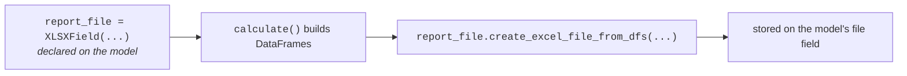

Use `XLSXField` and `PDFField` for files generated by a report model.

The field is declared on the model, filled during `calculate()`, and the
workbook it produces is stored on that same field:




```python
from lex.core.fields import PDFField, XLSXField
from lex.core.models.CalculationModel import CalculationModel


class LiabilityReport(CalculationModel):
    report_file = XLSXField(upload_to="reports/")
    summary_pdf = PDFField(upload_to="reports/")

    def calculate(self):
        self.report_file.create_excel_file_from_dfs(
            "liability.xlsx",
            [self.build_dataframe()],
            sheet_names=["Liability"],
        )
```

The Excel helpers are available directly on the field value, so
`self.report_file.create_excel_file_from_dfs(...)` is the usual form. Existing
code that calls the helper through `XLSXField` continues to work too.

The helper writes the file to storage and points the field at it, but it does
not save the record: it calls the file's `save()` with `save=False`. Inside
`calculate()`, the save that follows the run stores the field, so the example
needs no `self.save()` — except in a `@lex_shared_task` `calculate()` on
Celery, which must save the record itself (see
[[reference/CalculationModel Internals#Saving the Result|Saving the Result]]).
Outside a calculation, save the record yourself.

Both fields default to a `max_length` of `300`, which leaves room for nested
report paths and generated filenames. Pass `max_length=` when you need a
different database column length.

## `create_excel_file_from_dfs()`

```python
create_excel_file_from_dfs(
    path,
    data_frames,
    sheet_names=None,
    merge_cells=False,
    formats={},
    comments={},
    index=True,
    ranges_of_pivot_concatenation={"default": None},
)
```

| Argument | Meaning |
|---|---|
| `path` | The file name, stored under the field's `upload_to`. |
| `data_frames` | A list of DataFrames, one sheet each. `None` entries are skipped. |
| `sheet_names` | One name per DataFrame. Default `["Sheet"]`. DataFrames are paired with names in order, and one without a name is left out — with the default, only the first DataFrame is written. |
| `merge_cells` | Passed to pandas' `to_excel()`: write a `MultiIndex` as merged cells. Default `False`. |
| `formats` | `{column: Excel number format}`, for example `{"amount": "#,##0.00"}`, applied to that column in every sheet. A column not named gets `#,##0.00` with negatives in red and zero as a dash, unless it holds datetimes. |
| `comments` | `{sheet name: {column: comment}}`. Each comment is attached to that column's header cell. |
| `index` | Whether to write the DataFrame's index as the first columns. Default `True`. |
| `ranges_of_pivot_concatenation` | Accepted, and ignored. |

Every sheet also gets a frozen header row (and frozen index columns), column
widths fitted to their content, and an autofilter. An empty DataFrame is written
as one empty row.

Excel has no time zones. Timezone-aware datetimes — in columns, in the index
and in column headers — are written as wall-clock time in the project's
`TIME_ZONE` (set with `LEX_TIME_ZONE`, `Europe/Berlin` by default), without the
offset. Naive datetimes and dates are written as they are.
