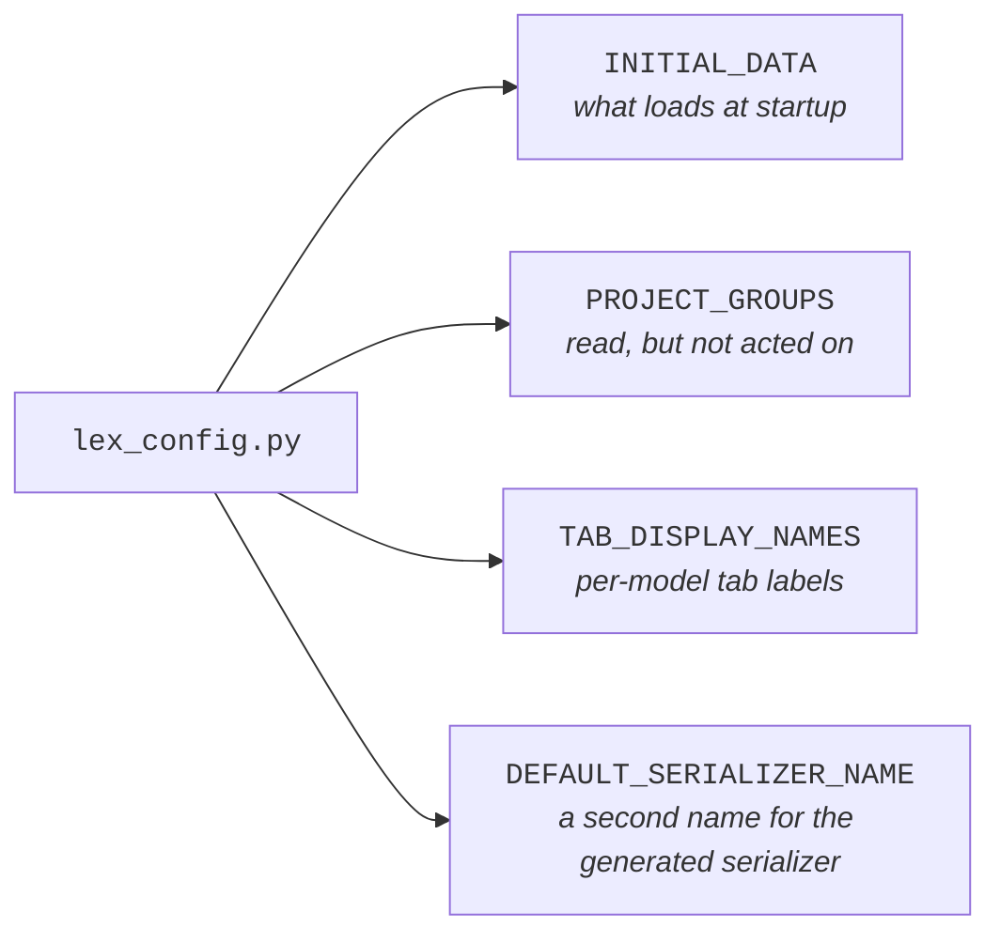

`lex_config.py` lives at your project root and holds project-wide settings the framework reads at boot. It's a plain Python module — the framework imports it once and pulls the keys it cares about. Most projects only set two or three of these.

> [!warning] A broken file stops startup
> If `lex_config.py` fails to import, or one of the keys below has the wrong type (`INITIAL_DATA` and `DEFAULT_SERIALIZER_NAME` strings, `PROJECT_GROUPS` a list of strings, `TAB_DISPLAY_NAMES` a dict of dicts), the app refuses to start with `ImproperlyConfigured` naming the problem. It used to fall back to the defaults silently.

> [!note]
> This page is a one-stop index. The individual feature pages linked from each section are the place to go for examples and edge cases.

## Keys at a glance




| Key                       | Purpose                                                                              | Documented in                                                                  |
| ------------------------- | ------------------------------------------------------------------------------------ | ------------------------------------------------------------------------------ |
| `INITIAL_DATA`            | Path to the JSON file the framework loads on **server start** to seed your database  | [[model-your-data/initial data]]                                        |
| `PROJECT_GROUPS`          | A list of group names the framework reads but does not act on — see [below](#project_groups) | [[start-here/tutorial/Part 4 — Validation & Permissions]], [[access-and-dashboards/permissions]] |
| `TAB_DISPLAY_NAMES`       | Friendly labels for the tabs in the record-detail view                               | [[using-the-app/record-detail/index]]                                              |
| `DEFAULT_SERIALIZER_NAME` | A second name for the framework's generated serializer, on models whose own serializer takes `"default"` | [[model-your-data/serializers]]                                         |

## `INITIAL_DATA`

```python title="lex_config.py"
INITIAL_DATA = "Tests/test_data.json"
```

The path (relative to the project root) of the JSON fixture loaded **on server start** — `lex start`, and only when every model it references is empty. Neither `lex init` nor `lex create_db` touches it; the loader is gated on the app running under uvicorn. Use it to seed reference data — categories, lookup tables, demo records — so a fresh database isn't empty. See [[model-your-data/initial data]] for the file format and the bulk-load behaviour.

## `PROJECT_GROUPS`

```python title="lex_config.py"
PROJECT_GROUPS = ["team_budget", "finance", "hr_manager"]
```

A flat list of group names. The framework reads it, but nothing acts on it:
`lex init` creates no groups from it, in Keycloak or anywhere else, and no
permission check consults it.

The groups your permission methods see in `user_context.groups` are the
signed-in user's **Django** groups. Create them, and put users in them, with
Django — [[start-here/tutorial/Part 4 — Validation & Permissions#Try It Yourself|Part 4 of the tutorial]]
shows how from `lex shell`.

## `TAB_DISPLAY_NAMES`

```python title="lex_config.py"
TAB_DISPLAY_NAMES = {
    "__default__": {"history_tab": "Change history"},
    "expensereport": {"history_tab": "Revisions", "audit_log_tab": "Who touched this"},
}
```

Keyed by **model name** (lowercase), not by tab. Each value is a dict that may
carry `history_tab` and `audit_log_tab` — those two are the only overridable
labels. `"__default__"` applies to every model without an entry of its own.

> [!warning] A flat `{tab: label}` dict stops startup
> Every value must itself be a dict of strings, so the tab-keyed shape —
> `TAB_DISPLAY_NAMES = {"history_tab": "Revisions"}` — fails the check, and the
> app refuses to start with an `ImproperlyConfigured` that reads:
> `lex_config.TAB_DISPLAY_NAMES must map model names to {tab: label} dicts of strings`.
> Wrap the labels in `"__default__"` to apply them to every model.

## `DEFAULT_SERIALIZER_NAME`

```python title="lex_config.py"
DEFAULT_SERIALIZER_NAME = "framework"
```

It matters only on a model whose `api_serializers` overrides `"default"`. Your
serializer then owns the name `"default"`, and the one the framework generates
for the model can no longer be asked for by name. With this key set, the
generated serializer is registered under this second name as well, on that
model and on its history tables.

What that changes:

- `?serializer=framework` reaches the generated serializer.
- The model-structure response gives `framework` as the model's
  `default_serializer_name`. The interface asks for that serializer where it
  needs the generated shape — foreign-key lookups and the create and edit
  forms, among others.

What it does not change: a request with no `?serializer=` still gets your
`"default"`, and so do the record history endpoint and the fields endpoint.
Models that do not override `"default"` are not affected.

The second name is not registered when it is `"default"`, or when the model
already has a serializer of that name. In the second case
`default_serializer_name` names yours, and the interface uses your serializer
in those places; nothing says so. See [[model-your-data/serializers]] for the
selection mechanic.

## Where it fits in the project

`lex_config.py` is a file you create at the project root, beside `.env`, `model_structure.yaml`, `migrations/` and your `Upload/` · `Input/` · `Reports/` folders. `lex setup` does not generate it — that command writes `.env`, the IDE run configurations and `migrations/`, and nothing else. See [[start-here/project structure|Project structure]] for the full layout.

