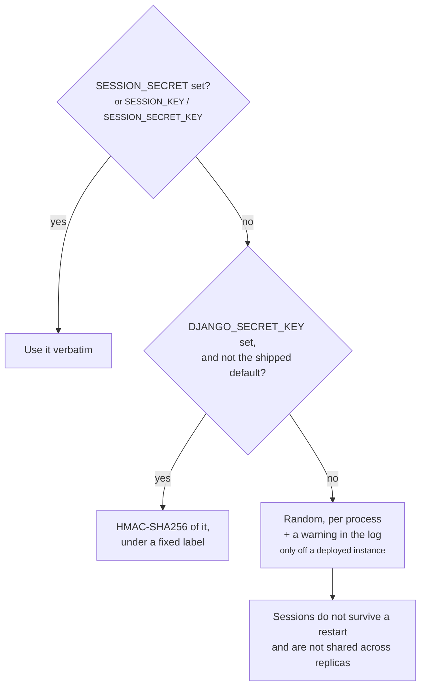

Lex App is configured by environment variables. [[reference/Environment Variables|Environment Variables]] is the exhaustive list; this page is about the handful that decide whether an installation starts at all, and what the framework does when one is missing.

## The rule the framework follows

**Derive before demanding.** Where a value can be worked out from something every deployment already has, the framework works it out rather than making you set another variable. Where it genuinely cannot, it says so and refuses to start.

That principle was learned the hard way: an earlier release added a required `SESSION_SECRET` and stopped running instances from booting. Degrading is right for a *degraded* configuration; refusing is right only for a *broken* one.

## What must be set

| Variable | Why it cannot be derived |
|---|---|
| `DATABASE_*` | Where your data is |
| Keycloak client settings | Who is allowed in. `lex init` synchronises models and permissions against it |
| `DJANGO_SECRET_KEY` | The root of every derived secret below. A deployed instance will not start without a private one |
| `DOMAIN_HOSTED` | Deployed: the instance's own hostname, which Django's host and CSRF checks are built from |
| `REDIS_HOST`, `REDIS_USERNAME`, `REDIS_PASSWORD` | Deployed: the Redis that carries the live channels between processes |

## What is derived, and from what

**Session signing.** The dashboard proxy's session cookie — which keeps a dashboard signed in under `LEX_STREAMLIT_AUTH=legacy` (the default) or `dual` — is signed with a key resolved in this order:

1. `SESSION_SECRET`, if you set it — an explicit choice always wins.
2. Otherwise, **derived from `DJANGO_SECRET_KEY`** (HMAC-SHA256 under a fixed label). Terraform already generates that key, keeps it in state and ships it to every replica, so it is stable across restarts and identical on each one — exactly what session cookies need, with nothing new to configure.
3. Otherwise a random per-process value, with a warning: dashboard sessions do not survive a restart of `lex streamlit`. This happens only off a deployed instance — `lex streamlit` on a developer's machine. With `DEPLOYMENT_ENVIRONMENT` set, `lex streamlit` loads the same settings as the web process and refuses to start without a private `DJANGO_SECRET_KEY` (see below).

`SESSION_KEY` and `SESSION_SECRET_KEY` are accepted as aliases of
`SESSION_SECRET`; any one of the three counts as an explicit choice.

Derived rather than reused verbatim, so that a leaked cookie-signing key does not hand over Django's secret, or the other way round.

> [!warning] The published fallback secret is excluded on purpose
> If `DJANGO_SECRET_KEY` is still the example value from the shipped
> `settings.py`, it is **not** used for derivation. Deriving from it would
> give every Lex App installation in the world the same signing key, which is
> worse than a random one rather than better. A deployed instance does not
> start on it at all.

## What still refuses to start

Some configurations are broken rather than degraded, and the framework will not pretend otherwise.

**On a deployed instance** — `DEPLOYMENT_ENVIRONMENT` set — every process that loads lex-app's settings (the web process, workers, `lex streamlit`, management commands) stops at startup with `ImproperlyConfigured` when:

- **`DOMAIN_HOSTED` is unset.** Django would accept only `localhost`, and every WebSocket and CSRF check would reject the instance's real hostname.
- **`LEX_EXTRA_ALLOWED_HOSTS` contains `*`.** An instance that accepts any `Host` header builds password-reset and other absolute links from whatever the caller sent. Name each host, or use a leading dot (`.example.com`) for one domain's subdomains.
- **`DJANGO_SECRET_KEY` is unset, or still the example value published in lex-app's `settings.py`.** That key is public, so anything signed with it could be forged. New in 2.5.
- **`REDIS_HOST`, `REDIS_USERNAME` or `REDIS_PASSWORD` is missing.** Deployed, the live channels always go through Redis.

**The dashboard proxy** — `lex streamlit` — refuses three more:

- **Multiple replicas with no shared token store.** Sessions would work or not depending on which replica answered. It refuses when `LEX_PROXY_REPLICAS` is above 1 and neither `TOKEN_REDIS_URL` nor `REDIS_URL` is set, unless dashboards sign in with `handoff`, which keeps no tokens.
- **A `SameSite=None` cookie that browsers will discard.** The session would be created and then silently dropped on the next request.
- **A dashboard hand-off with no dashboard host.** With `LEX_STREAMLIT_AUTH=handoff` or `dual` on a deployed instance, when neither `LEX_INSTANCE_HOSTS` nor `STREAMLIT_URL` names the dashboard's host, the app would refuse every hand-off to it.

A value outside the accepted set stops startup too, deployed or not: `LEX_WS_AUTH`, and a `LEX_SESSION_COOKIE_AGE_DAYS` that is not a whole number of at least 2, stop every process; `LEX_STREAMLIT_AUTH` and `SESSION_SAMESITE` stop `lex streamlit`.

## Local versus deployed

`lex setup` writes a `.env` for local development. It is not a deployment mechanism — a deployed installation gets its environment from your platform's secret store, and the `.env` file should not travel with the image. If it does, every `lex` command loads it and fills in whatever the platform left unset; what the platform did set always wins.

## Related

- [[reference/Environment Variables|Environment Variables]] — every variable, with defaults
- [[reference/lex_config|lex_config.py]] — the per-project settings module
- [[ship-and-operate/deploying|Deploying]] — which processes read which of these
