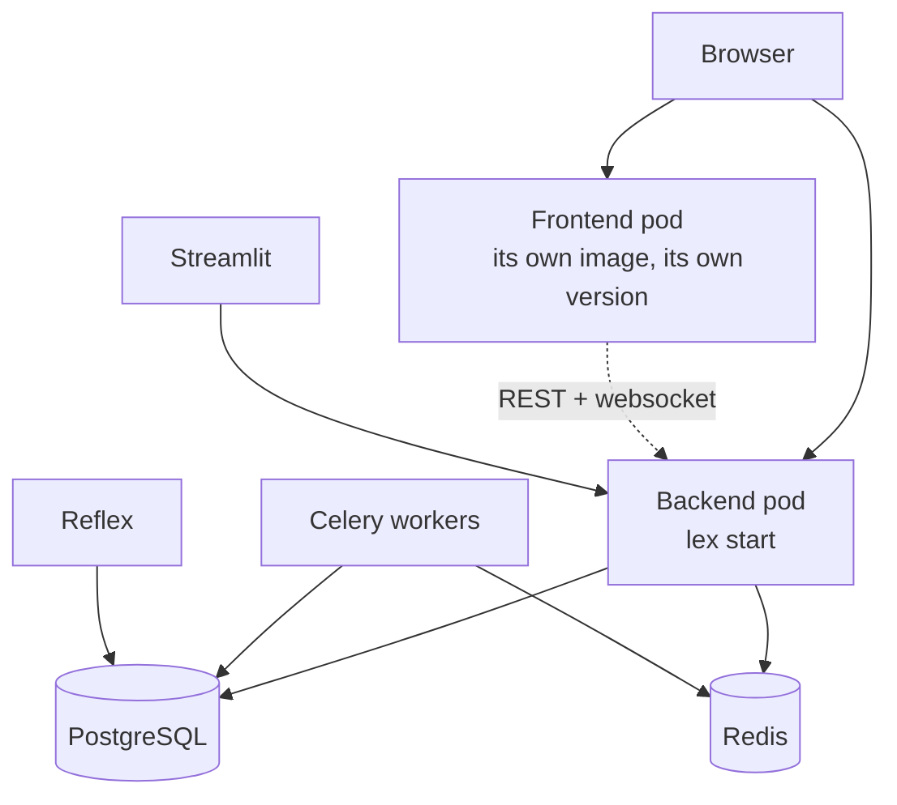

What a Lex App installation runs, and what each process needs. How you schedule these — containers, a cluster, plain systemd units — is your platform's business; this is what the framework expects either way.

## The processes

| Process | Command | Needed when |
|---|---|---|
| **Web** | `lex start --loop asyncio --host 0.0.0.0 --port 8000 lex_app.asgi:application` | Always |
| **Celery workers** | `lex celery-workers N` | The application has calculations that dispatch asynchronously |
| **Streamlit** | `lex streamlit` | The application has dashboards |
| **Reflex** | `lex reflex run --env prod` | The application has [[access-and-dashboards/reflex/index\|Reflex dashboards]] — see [[access-and-dashboards/reflex/running and deploying\|Running & Deploying]] for what production mode needs |
| **Recovery supervisor** | `lex-recovery-supervisor` | Long-running calculations that must survive a worker dying. Needs `CELERY_ACTIVE=true` and `LEX_TASK_RECOVERY_ENABLED=true`, on it and on the workers |
| **Recovery beat** | `lex-recovery-beat` | Instead of the supervisor, not beside it: the same sweep, scheduled by an embedded Celery beat. One of the two is enough — see [[calculations/celery and async calculations#Running the recovery driver\|Running the recovery driver]] |
| **Flower** | `lex flower` | Optional; a web view of the Celery queues |

Drop `--reload` for anything that is not a developer's laptop.

`lex celery-workers N` starts `N` worker processes, each running one task at a time. Arguments after the count go to every worker, and when one worker exits, the others are stopped too.

Keep `lex_app.asgi:application` the **last** argument of the web command. The web process loads initial data and starts the [[calculations/scheduled jobs|scheduled-jobs]] clock only when it is; with flags after it, neither happens. There is no separate scheduler process to deploy. `lex run_scheduler` exists for setups that need one.

`lex celery` passes its arguments straight through to Celery, for the cases the wrapper does not cover.

## Migrations at deploy time

`lex lex_migrate` runs `makemigrations`, then — when anything is left to apply — `migrate` and `createcachetable`. Generating migrations at deploy time is deliberate: an application's models live in its own repository, and a framework upgrade can require a migration in *your* app that nobody wrote by hand.

```bash
lex lex_migrate                     # makemigrations + migrate + createcachetable
lex lex_migrate --no-makemigrations # only migrate + createcachetable
```

> [!warning] `--no-makemigrations` is not a safe default
> If you manage migrations yourself, a framework upgrade that widens a column
> leaves Django believing the new width against an unchanged database. The
> symptom is not a clear error at deploy — it is a `DataError` later, on the
> first row that needs the extra width. [[ship-and-operate/upgrading|Upgrading]]
> has a worked example of exactly this.

> [!warning] Read the output, not the exit code
> `lex lex_migrate` catches every error, prints `✗ Migration failed: …` and
> `✗ Migration step failed. See logs for details.`, and exits `0`. `lex create_db`
> does the same with an `Operational Error`. A deploy script that checks `$?` —
> or a container command such as `lex lex_migrate && lex start …` — carries on
> after a failed migration. Look for `✓ Migration step completed successfully.`
> (`lex init`, by contrast, stops with an error.)

## Startup probes

The web process runs no migrations. Before it answers, `lex start` runs `collectstatic` (on a deployed instance) and then uvicorn, which sets Django up and registers every model; the initial-data load and the scheduled-jobs clock run in the background and do not hold it up. Migrations run wherever your deployment runs `lex lex_migrate` or `lex init` — and when that is the same pod, before `lex start`, the pod cannot answer until they have finished. On a large database that is minutes, not seconds.

Size the **startup** probe against everything that runs before the web process answers — with migrations in the pod, the slowest migration you expect — not against a healthy boot. A startup probe that expires mid-migration kills the pod, the next one starts the same migration from the beginning, and the deployment fails in a way that reads like a crash loop rather than a timeout. Measured on one instance: a 340-second migration against a 600-second budget — comfortable until the database grew.

Liveness and readiness are a different question and can be tight; see [[ship-and-operate/monitoring and health|Monitoring & health]].

## The interface

The web interface is a separate Python package, `lex-app-frontend`, built from its own repository. Each `lex-app` release pins the interface it ships with — 2.5.0 requires `lex-app-frontend~=2.3.0` — so installing `lex-app` installs that interface too, and `lex start` serves it; `pip show lex-app-frontend` says which one an environment has. With neither the package nor a bundle from a source checkout, the web process prints `No frontend bundle found…` on stderr as it boots, and every page answers `404`.

A hosted installation serves the interface from a **separate pod** instead — the interface's own image, on the version the platform deploys. That has one consequence worth internalising:

**Upgrading `lex-app` does not upgrade the interface there.** The two are versioned and deployed independently, and an older interface serving a newer backend is a supported, common state. A feature that spans both — a new control that calls a new endpoint — arrives only when both sides have moved.



The dotted line is the one to remember: the interface talks to the backend
over the API, and the two are upgraded independently.

The frontend pod does not have to serve the standard interface: your application
can ship its own Vite app in a folder of its repository, built and released with
the backend, and an instance can serve that instead, on the same host and
against the same API. See [[ship-and-operate/custom frontend|Custom frontend]].

An interface on a host of its own, rather than the instance's, is named to the
dashboards with `REACT_APP_URL` or `LEX_FRONTEND_URL`; see
[[reference/Environment Variables#Streamlit|Environment Variables]].

## Live updates and sign-in

The live channels — `ws/calculations`, `ws/calculation_status_update`, `ws/calculation_logs/…`,
`ws/model_data_update` and `ws/logs` — carry calculation results, log lines and record changes;
[[reference/REST API#WebSockets|REST API → WebSockets]] has what each one sends.
From 2.5 they can be limited to signed-in users, with `LEX_WS_AUTH`:

| Value | A socket without a sign-in |
|---|---|
| `off` | is served, as before 2.5 |
| `log` (default) | is served, and the log names it once: `WebSocket <consumer> on <path> would be closed with <code> (<reason>); LEX_WS_AUTH=log serves it as before.` |
| `enforce` | is accepted and closed: `4401` sign in again, `4403` not allowed, `4503` the sign-in cannot be checked right now |

Roll it out in two steps. Deploy with the default `log`, and watch for `would be closed with`
lines. When they show only what you expect, set `LEX_WS_AUTH=enforce`.

A socket is signed in by the browser's session cookie and nothing else. An API key or a bearer
token does not sign a socket in, so under `enforce` a script that connects with one is closed
with `4401`.

Under `log` the check never breaks a socket: when it cannot be made — the database connection
dropped, say — the socket is served and the log says so; under `enforce` that is `4503`. A
signed-in socket follows its sign-in: it is closed with `4401` when the sign-in ends, and it is
checked again every 5 minutes, which also closes it when the user's Keycloak session has run
out, the user's session was ended another way (an admin logout, a deleted session) or the user
was deactivated. It never renews a token itself. `ws/health` is always public.

## Related

- [[ship-and-operate/configuration|Configuration]] — what these processes read
- [[ship-and-operate/custom frontend|Custom frontend]] — your own interface in the frontend pod
- [[calculations/celery and async calculations|Celery & async calculations]] — what the workers are for
- [[reference/CLI Commands|CLI Commands]] — every command and flag
- [[access-and-dashboards/sign-in and sessions|Sign-in & Sessions]] — how long a sign-in lasts, and what ends it
