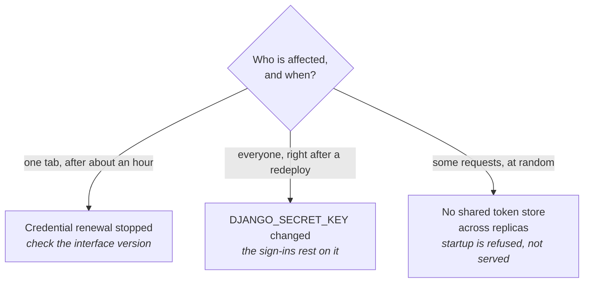

Symptoms that have actually happened on real installations, and what each one turned out to be. Ordered roughly by how often they come up.

Three of the entries below are sign-in problems with different causes, and the
symptom alone tells you which:

## The deployment fails, and the logs look like a crash loop

**Check the startup probe budget before anything else.** The web process runs no migrations itself, but a deployment that runs `lex lex_migrate` in the same pod before `lex start` cannot answer a request until the migration is done. If the startup probe expires mid-migration the pod is killed, the replacement starts the same migration from the beginning, and it repeats.

Nothing in the log says "timeout" — you see a partial migration and a restart, which reads like a crash. Measured on one instance: a 340-second migration against a 600-second budget, comfortable until the data grew.

Fix the probe, not the migration.

If the log instead ends in `ImproperlyConfigured`, it is not a timeout: a deployed instance refuses to start without `DOMAIN_HOSTED`, a private `DJANGO_SECRET_KEY` and the Redis settings, or with `*` in `LEX_EXTRA_ALLOWED_HOSTS`. The message says which, and [[ship-and-operate/configuration#What still refuses to start|Configuration]] lists every case.

## An embedded dashboard stops working after it has been open a while

The dashboard's credentials are renewed in the background. If that stops, the session expires on the access token's own lifetime and the symptom is a tab that worked for an hour and then did not.

Fixed across 2.1.10 and 2.1.11. If you are seeing it on a current version, the thing to check is whether the **interface** is also current — the renewal has a browser-side half, and an installation running an older interface pod against a newer backend gets only the server side. See [[ship-and-operate/upgrading|Upgrading]].

## A document or asset fails to download, with no error anywhere

If the log shows nothing at all for the failed request, that is itself the finding: access logging for the proxy is at WARNING for 4xx and 5xx, so a request that produced *no* line produced no response either — the connection was dropped rather than answered.

The known cause is a pooled upstream connection the Streamlit server had already closed, which surfaced as an unhandled exception rather than a status. Answered as a 502 since 2.1.10, with one retry for requests that had not yet sent a byte.

## A large file fails to upload with "Failed to fetch"

The request never reached the backend, so the log shows nothing. Cloudflare, the Ingress and the web application firewall each stop a request body above about 100 MB, and no setting lifts all three.

From 2.5 the interface sends a file of 32 MiB or more in pieces instead (see [[ship-and-operate/custom frontend#Large files|Custom frontend → Large files]]). That needs both halves: the 2.5 backend and an interface release that does the chunking. An instance with only one of them still fails. Check the interface version first.

The backend joins the pieces into one temporary file before it saves the record, so its pod needs local disk space for the whole file. If the save itself takes longer than 100 seconds, Cloudflare answers `524` even though the backend finishes the job.

## `lex init` fails against Keycloak

`lex init` synchronises models and permissions with Keycloak, so it needs the client configuration to exist and to be reachable.

- Missing credentials — `lex init --bootstrap` opens the browser bootstrap flow.
- You are managing the client yourself and the preflight is in the way — `lex init --skip-client-preflight`.

## Everyone is signed out after a redeploy

The sign-ins rest on `DJANGO_SECRET_KEY`: Django keys each session's authentication hash to it, the dashboard proxy derives its cookie key from it, and — unless `OIDC_TOKEN_ENCRYPTION_KEYS` is set — the stored sign-in tokens are encrypted with a key derived from it. A key that changed between two deploys invalidates all of them, and everyone has to sign in again.

Set `DJANGO_SECRET_KEY` to a stable, per-installation value. See [[ship-and-operate/configuration|Configuration]].

A key that is missing, or still the published example value, no longer gets this far on a deployed instance. Before 2.5 the dashboard proxy fell back to a random key per process, which every restart discarded; from 2.5 a process with `DEPLOYMENT_ENVIRONMENT` set refuses to start instead. The random key is left only to `lex streamlit` on a developer's machine.

## Sessions work intermittently across replicas

Two dashboard proxy replicas with no shared token store will each accept only the sessions they created. `lex streamlit` refuses to start in this configuration rather than serving it — when `LEX_PROXY_REPLICAS` says there is more than one and neither `TOKEN_REDIS_URL` nor `REDIS_URL` is set — because "works about half the time" is harder to diagnose than a startup failure. With `LEX_STREAMLIT_AUTH=handoff` the proxy keeps no tokens, and any replica serves any dashboard.

## A report is saved under a name nobody chose

`XLSXField` and `PDFField` advertise a 300-character limit that did not apply before 2.1.11 — every plain declaration was `varchar(100)`, and an over-length name was truncated silently rather than rejected.

On 2.1.11 or later, ensure the widening migration was actually generated and applied. If you deploy with `--no-makemigrations` it was not, and the silent truncation becomes a `DataError` instead. [[ship-and-operate/upgrading|Upgrading]] has the detail.

## `lex --help` does not list the command I was told to run

It only lists the eleven commands the CLI implements itself, and the `ai-*` commands of `lex-mcp-local` when that package is installed. Django management commands — `init`, `migrate`, `create_db`, `sync_keycloak`, `lex_migrate` and the rest — work but do not appear, because listing them would mean starting Django just to print help.

[[reference/CLI Commands|CLI Commands]] is the complete list.

## Still stuck

Collect these before asking, because they are what the first three questions will be:

- The exact `lex-app` version (`lex --version`), and the interface version if they differ.
- Whether the deployment ran `lex lex_migrate` with or without `--no-makemigrations`, and what it printed — it exits `0` even when a migration failed.
- The pod log around the failure — including the absence of lines, which is evidence.
