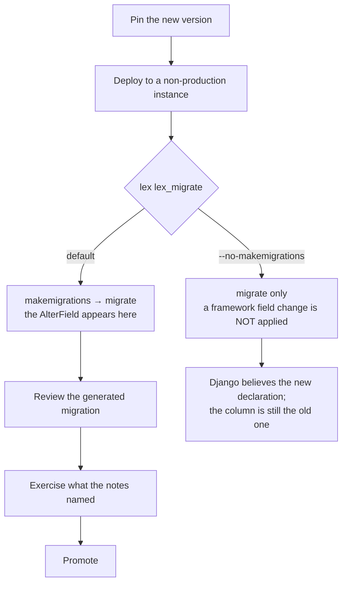

Moving an application to a newer `lex-app`. Most upgrades are a version bump and a deploy. The two that are not — migrations your app has to generate, and the separately-deployed interface — are what this page is about.

## Pin the version

```
lex-app==2.5.0
```

Not `>=`. A framework upgrade can require a migration in your application (see below), so it should happen when you decide, not when a rebuild happens to pick up a newer release.

## Read the release notes first

Every release publishes notes on [GitHub](https://github.com/ExcellenceCloudGmbH/lex-app/releases) and on the changelog. Two things there are worth more than the feature list:

- The **Upgrade note** at the bottom. When there is nothing to do it says so; when there is, that is where it is.
- Whether anything was **withdrawn**. Interface work shipped in 2.1.3 was rolled back in 2.1.4 and returned in 2.2.0 — a feature list read in isolation would have been wrong twice.

## Migrations your application has to generate

A framework change can alter a field your models use, and the migration then belongs to *your* app, not to `lex-app`.

**A worked example, from 2.1.11.** `XLSXField` and `PDFField` had always advertised `max_length=300`, and it had never applied — every plain declaration was silently `varchar(100)`, and an over-length report name was quietly truncated rather than rejected. Fixing it means every application using either field gets one `AlterField` per report column on its next `makemigrations`.

- Deploying with `lex lex_migrate` (the default) — the migration is generated and applied. Nothing to do.
- Deploying with `--no-makemigrations` — **not safe for this upgrade.** Django believes 300 against an unchanged `varchar(100)` column, and the old silent truncation becomes a `DataError` on the first long filename.

The pattern generalises: if a release note mentions a field's width, type or constraint, either let `lex lex_migrate` generate the migration or generate it yourself before deploying.

## The interface upgrades separately

The web interface is a package of its own, `lex-app-frontend`, and every `lex-app` release pins the interface it was built against: 2.5.0 requires `lex-app-frontend~=2.3.0`, that is 2.3.0 or any later 2.3.x. Installing `lex-app` installs that interface with it, and the web process serves it; `pip show lex-app-frontend` says which one an environment resolved.

The pin is `~=` rather than `==` so that a project can take an interface patch without waiting for a `lex-app` release: a `lex-app-frontend` pin of your own within 2.3 is allowed. One outside it is not — pip must satisfy both, so a project that still pins `lex-app-frontend` to 2.2.x cannot install `lex-app` 2.5 at all. Drop that pin, or move it to 2.3.

A hosted installation serves the interface from its **own pod**, on the version the platform deploys, whatever pip installed beside the backend. So:

> **Upgrading `lex-app` on its own does not give you the new interface.** You can run the newest backend behind an older interface — that is a supported state, and often the desired one.

This matters when a feature spans both halves. The 2.2.0 Streamlit widgets need the interface that renders them; upgrading only the backend gives you the API and none of the controls. When a release says a feature needs the latest interface image, that is what it means.

## Upgrading to 2.5: runtime and operations

Besides sign-in, 2.5 changes these things an application, an operator or an integration may notice:

- **A deployed instance needs a `DJANGO_SECRET_KEY` of its own.** With `DEPLOYMENT_ENVIRONMENT` set, every process now refuses to start when the key is unset or still the example value published in lex-app's `settings.py` — `ImproperlyConfigured: DJANGO_SECRET_KEY must be set to a private value…` — instead of signing with a key anyone can read. Hosted instances get theirs from the platform; give a self-hosted one a stable value before you upgrade it. [[ship-and-operate/configuration#What still refuses to start|Configuration]] lists everything else a deployed instance will not start without.
- **The interface is 2.3.** 2.5.0 installs `lex-app-frontend` 2.3.x, and a project's own pin on 2.2.x now stops the install; see [The interface upgrades separately](#the-interface-upgrades-separately). The value lists and the `lex_view` filters below come with it; on a hosted instance they arrive when its interface pod runs 2.3.
- **Two framework migrations.** `authentication.0002_dashboard_handoff` adds the tables of the dashboard hand-off, `scheduling.0001_initial` the `ScheduledJob` table. `lex lex_migrate` and `lex init` apply them with the rest.
- **Scheduled jobs.** The new `scheduling` app's clock runs inside the web process, on by default (`LEX_SCHEDULER_ENABLED=true`): a schedule declared with `@lex_job(schedule=...)` starts running as soon as the version that declares it is deployed, with no process to add. `LEX_SCHEDULER_ENABLED=false` keeps an instance's clock off, and the web process then logs a warning that no scheduled job will run. `ScheduledJob` appears in the sidebar; grant access to it as [[calculations/scheduled jobs#Upgrading|Scheduled Jobs]] describes.
- **Column filters list their values.** In interface 2.3 a column's filter offers a value list, each value with its row count, beside the conditions it had. Saved views keep working: when one opens, its filters are converted to the column's new filter, and a filter that cannot be converted is dropped rather than half-applied. See [[using-the-app/the-grid/filtering and sorting#Value Lists|Filtering & Sorting]].
- **`__exact` and `__in` read their values as the column's type.** On `GET api/model_entries/<model>/list`, a value that cannot be read that way now matches no rows, and `__exact=null` no longer means *is empty* — ask `__isnull=true`. The new `__blank=true` finds what a value list's *(Blank)* finds. Integrations that build these queries should check theirs; [[reference/Grid Filter API#Value-list lookups on the list GET|Grid Filter API]] has the rules.
- **`LEX_EMBED_ALLOWED_ORIGINS` is new, and unset by default.** Framing then stays unrestricted, as before, and the channel that carries filter changes into an embedded table stays off. `lex_view(filters=…)` needs interface 2.3.0 or later — an older one ignores the filters — and `on_filter`, like filters changed after the table's first load, also needs the dashboard's origin in `LEX_EMBED_ALLOWED_ORIGINS`. Once it is set, only Lex App itself and the sites it lists may show Lex App's pages in a frame. See [[access-and-dashboards/streamlit/embedding app pages#Allowed sites|Allowed sites]].
- **`lex init` makes migrations for your app only**, unless `--makemigrations-args` names another one. It no longer writes migration files into installed packages whose models have drifted from the migrations they ship.
- **Lex App no longer applies `nest_asyncio`.** Earlier releases applied it in every process: the web server, Celery workers, Streamlit and management commands. It could make the second `async_to_sync` in a thread wait forever, and it stopped `lex start` under uvloop. Code that relied on it without applying it itself now fails: a nested `run_until_complete` inside a running loop, or `asyncio.get_event_loop()` creating a loop in a worker thread. Rewrite such code, or call `nest_asyncio.apply()` yourself and accept the hang above. The package is still installed.
- **`websockets` 13 or later is required.** Older releases ignore `WEBSOCKETS_MAX_LINE_LENGTH`, and a long access token can then hang a dashboard's WebSocket handshake. `lex streamlit` warns at startup if an older release is installed. Remove any pin of your own below 13.
- **The initial-data load survives restarts and a second server process**, and records how it ended. A database left half-loaded before 2.5 has no record, so it is still skipped without an error; empty it once. See [[model-your-data/initial data#Restarts and More Than One Server Process|Initial Data]].
- **Files of 32 MiB and more are uploaded in pieces**, which lifts the 100 MB limit in front of every instance. It needs the 2.5 backend and an interface that sends the pieces, as 2.3 does. See [[ship-and-operate/troubleshooting|Troubleshooting]].
- **An instance can answer on more than one hostname.** List each further hostname in `LEX_EXTRA_ALLOWED_HOSTS`; without it, Django answers `400 Bad Request` on that hostname. See [[reference/Environment Variables#Deployment identity|Environment Variables]]. The instance's other pods may now also reach the backend by its Kubernetes Service name (`lex-backend-<instance>:7000`); that needs no setting.

## Order of operations

1. Read the release notes, including the upgrade note.
2. Pin the new version.
3. Deploy to a non-production instance and let `lex lex_migrate` run. Read what it printed: it exits `0` even when a migration failed (see [[ship-and-operate/deploying#Migrations at deploy time|Deploying]]).
4. Check the migration it generated — this is where an unexpected `AlterField` shows up.
5. Exercise the parts of your application that touch whatever the notes mentioned.
6. Promote.

Step 3 is the one with a fork in it. `lex lex_migrate` generates migrations and
applies them; `--no-makemigrations` applies only what already exists:



The right-hand branch is the one to be careful with, and only on upgrades that
change a field: the schema and Django's idea of it drift apart silently, and the
first over-length value turns what used to be quiet truncation into a
`DataError`.

## Upgrading to 2.5: long sign-ins

2.5 moves sign-in onto django-oauth2-codeflow 3. Users stay signed in for as long as Keycloak's
session lives, and an outage no longer signs anyone out (see
[[access-and-dashboards/sign-in and sessions|Sign-in & Sessions]]). What it asks of you:

- **Nobody is signed out by the upgrade.** `lex lex_migrate` adds the table that holds sign-ins.
  An existing session moves into it on its first request after the deploy.
- **Schedule the daily clean-up:** `lex oidc_cleanup`, `lex clearsessions` and
  `lex prune_dashboard_sessions`, once a day. The platform runs them for hosted instances.
- **CORS is strict.** Only the instance's own origins (`DOMAIN_HOSTED`, the hosts in
  `LEX_INSTANCE_HOSTS`) may send credentialed requests. Add a frontend on any other origin to
  `LEX_CORS_ALLOWED_ORIGINS`.
- **Tokens are no longer in the session.** Code that read `request.session["oidc_access_token"]`,
  `"oidc_id_token"` or `"oidc_userinfo"` now gets nothing. Read them from the sign-in instead:

  | You need | Use |
  | --- | --- |
  | an access token for a call to Keycloak | `oauth2_authcodeflow.tokens.get_access_token(request)` |
  | the user's client roles | `UserContext.client_roles` in a permission method, else `request.oidc.client_roles()` |
  | the profile claims | `request.oidc.claims` |
  | to react to a sign-in or a token refresh | the signals `oidc_session_started` and `oidc_session_refreshed` in `oauth2_authcodeflow.signals` |

  React on refresh as well as on sign-in: a sign-in now lasts weeks, so anything copied from
  Keycloak only at sign-in (a superuser flag, say) would stay stale for that long.
- **Tests that hand-crafted session keys now grant nothing.** Sign in with the shipped helper:

  ```python
  from lex.lex_app.tests.auth import sign_in

  sign_in(self, client, user, client_roles=["fund-admin"])
  ```

  It gives the test client an OIDC sign-in with those roles. It also answers Keycloak's
  permission lookup itself, since a signed-in write asks Keycloak before the view runs and a
  test must not send its tokens to a real Keycloak. Both are undone when the test ends.
  `uma_permissions=` is what that lookup answers, in Keycloak's shape — a list of
  `{"rsname": …, "resource_set_id": …, "scopes": […]}` — and grants nothing by default. The
  parts `sign_in` is made of are in the same module, for a test that needs only one of them:
  `oidc_test_settings()` (the settings a sign-in needs, for `override_settings`),
  `create_sign_in(client, user, **kwargs)` (the sign-in alone) and
  `stub_keycloak_uma(permissions)` (the stubbed lookup, as a context manager or with
  `start()` and `stop()`).
- **Roles must be in the tokens.** They are read from the access token's `resource_access`
  (Keycloak's default `roles` client scope), else from a `client_roles` claim in the ID or access
  token. On a client with neither, every user appears to have no roles.
- **Streamlit dashboards keep signing in the old way** until you set `LEX_STREAMLIT_AUTH`. Set
  `handoff` (or `dual` first, while old frontends are still around) on the backend and on the
  Streamlit pod alike, and list the dashboard's host in `LEX_INSTANCE_HOSTS`. Dashboard code that
  read a refresh token gets none with `handoff`; the access token and the identity are unchanged.
- **WebSockets log before they refuse.** `LEX_WS_AUTH` defaults to `log`: every socket is served
  as before, and each one without a sign-in is logged with the close code it would get. Set
  `enforce` once those lines show only what you expect (see
  [[ship-and-operate/deploying#Live updates and sign-in|Deploying]]).

## Downgrading

Reinstall the older pin and redeploy. The caveat is migrations: a migration your app generated during the upgrade is not reversed by reinstalling the old package. If step 4 produced one, plan the reverse before you need it.

From 2.5 back to a 2.4 release with the sign-in fix, the table of sign-ins stays where it is. A
sign-in made on 2.5 is signed in once more, without a prompt while Keycloak's session lives.

## Related

- [[ship-and-operate/deploying|Deploying]] — `lex lex_migrate` and startup probes
- [[migrating-from-v1/index|Migrating from V1]] — the different, larger job of moving off `generic_app`
