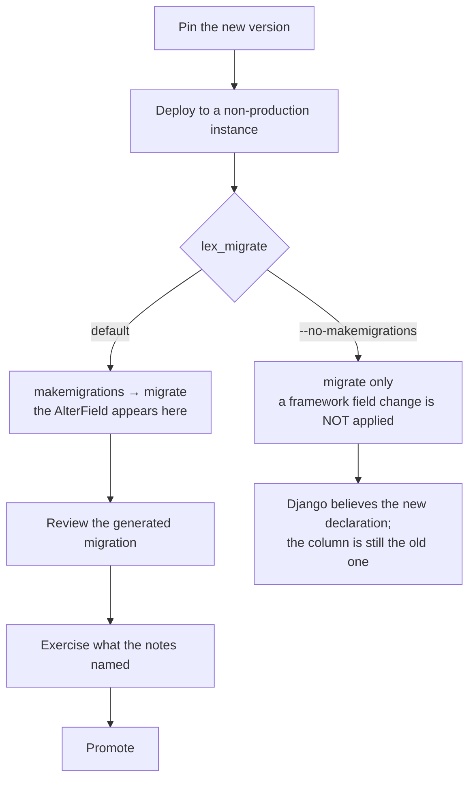

Moving an application to a newer `lex-app`. Most upgrades are a version bump and a deploy. The two that are not — migrations your app has to generate, and the separately-deployed interface — are what this page is about.

## Pin the version

```
lex-app==2.2.0
```

Not `>=`. A framework upgrade can require a migration in your application (see below), so it should happen when you decide, not when a rebuild happens to pick up a newer release.

## Read the release notes first

Every release publishes notes on [GitHub](https://github.com/ExcellenceCloudGmbH/lex-app/releases) and on the changelog. Two things there are worth more than the feature list:

- The **Upgrade note** at the bottom. When there is nothing to do it says so; when there is, that is where it is.
- Whether anything was **withdrawn**. Interface work shipped in 2.1.3 was rolled back in 2.1.4 and returned in 2.2.0 — a feature list read in isolation would have been wrong twice.

## Migrations your application has to generate

A framework change can alter a field your models use, and the migration then belongs to *your* app, not to `lex-app`.

**A worked example, from 2.1.11.** `XLSXField` and `PDFField` had always advertised `max_length=300`, and it had never applied — every plain declaration was silently `varchar(100)`, and an over-length report name was quietly truncated rather than rejected. Fixing it means every application using either field gets one `AlterField` per report column on its next `makemigrations`.

- Deploying with `lex_migrate` (the default) — the migration is generated and applied. Nothing to do.
- Deploying with `--no-makemigrations` — **not safe for this upgrade.** Django believes 300 against an unchanged `varchar(100)` column, and the old silent truncation becomes a `DataError` on the first long filename.

The pattern generalises: if a release note mentions a field's width, type or constraint, either let `lex_migrate` generate the migration or generate it yourself before deploying.

## The interface upgrades separately

The web interface is a built bundle vendored into the package, but a hosted installation serves it from its **own pod** on its own version. So:

> **Upgrading `lex-app` on its own does not give you the new interface.** You can run the newest backend behind an older interface — that is a supported state, and often the desired one.

This matters when a feature spans both halves. The 2.2.0 Streamlit widgets need the interface that renders them; upgrading only the backend gives you the API and none of the controls. When a release says a feature needs the latest interface image, that is what it means.

## Upgrading to 2.5: runtime and operations

Besides sign-in, 2.5 changes a few things an application or an operator may notice:

- **lex no longer applies `nest_asyncio`.** Earlier releases applied it in every process: the web server, Celery workers, Streamlit and management commands. It could make the second `async_to_sync` in a thread wait forever, and it stopped `lex start` under uvloop. Code that relied on it without applying it itself now fails: a nested `run_until_complete` inside a running loop, or `asyncio.get_event_loop()` creating a loop in a worker thread. Rewrite such code, or call `nest_asyncio.apply()` yourself and accept the hang above. The package is still installed.
- **`websockets` 13 or later is required.** Older releases ignore `WEBSOCKETS_MAX_LINE_LENGTH`, and a long access token can then hang a dashboard's WebSocket handshake. `lex streamlit` warns at startup if an older release is installed. Remove any pin of your own below 13.
- **The initial-data load survives restarts and a second server process**, and records how it ended. A database left half-loaded before 2.5 has no record, so it is still skipped without an error; empty it once. See [[model-your-data/initial data#Restarts and More Than One Server Process|Initial Data]].
- **Files of 32 MiB and more are uploaded in pieces**, which lifts the 100 MB limit in front of every instance. It needs the 2.5 backend and an interface release that sends the pieces. See [[ship-and-operate/troubleshooting|Troubleshooting]].
- **An instance can answer on more than one hostname.** List each further hostname in `LEX_EXTRA_ALLOWED_HOSTS`; without it, Django answers `400 Bad Request` on that hostname. See [[reference/Environment Variables#Deployment identity|Environment Variables]]. The instance's other pods may now also reach the backend by its Kubernetes Service name (`lex-backend-<instance>:7000`); that needs no setting.

## Order of operations

1. Read the release notes, including the upgrade note.
2. Pin the new version.
3. Deploy to a non-production instance and let `lex_migrate` run.
4. Check the migration it generated — this is where an unexpected `AlterField` shows up.
5. Exercise the parts of your application that touch whatever the notes mentioned.
6. Promote.

Step 3 is the one with a fork in it. `lex_migrate` generates migrations and
applies them; `--no-makemigrations` applies only what already exists:



The right-hand branch is the one to be careful with, and only on upgrades that
change a field: the schema and Django's idea of it drift apart silently, and the
first over-length value turns what used to be quiet truncation into a
`DataError`.

## Downgrading

Reinstall the older pin and redeploy. The caveat is migrations: a migration your app generated during the upgrade is not reversed by reinstalling the old package. If step 4 produced one, plan the reverse before you need it.

## Related

- [[ship-and-operate/deploying|Deploying]] — `lex_migrate` and startup probes
- [[migrating-from-v1/index|Migrating from V1]] — the different, larger job of moving off `generic_app`
