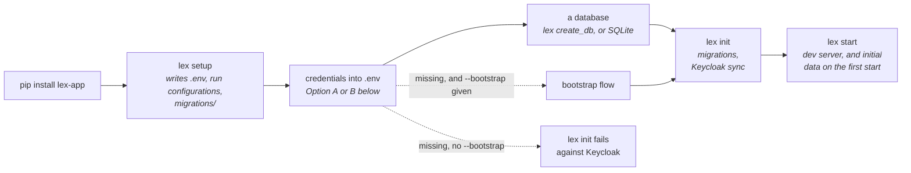

Install the `lex-app` package. This gives you the `lex` CLI tool and all framework dependencies, the web interface included, most of them pinned exactly to the versions the release was tested with — see [[start-here/project structure#Key Dependencies|Key Dependencies]].

```bash
pip install lex-app
```

Verify it worked:

```bash
lex --version
```

It prints the installed version, `lex, version 2.5.0`, from any folder and without starting the app. `pip show lex-app` prints the version too, and where the package was installed from — which is what you actually want when two checkouts are in play.

The two agree on an install from PyPI. An image built from a git commit stamps its own version after installing: there `lex --version` prints the stamped one — the version the instance reports to the platform — while `pip show` keeps the one recorded at install.

> [!tip]
> lex-app installs on **Python 3.12** only — pip refuses it on 3.11 and 3.13. Check with `python3.12 --version`.

## Run `lex setup`

Navigate to your project directory and run:

```bash
lex setup
```

This generates a few things for you:

- `.env` — Environment configuration template, for the Keycloak settings below. Written only when the project has none: an existing `.env` is never overwritten.
- Run configurations (Init, Start, Streamlit, Reflex, and the rest) for the IDE whose terminal you ran it in: `.run/` from a PyCharm terminal, `.vscode/launch.json` from a VS Code terminal, and both when it cannot tell. An existing `launch.json` is merged — the `LEX: …` entries are replaced, your own are kept.
- `migrations/` — Django migrations folder

`lex setup` works on the project it finds from the current folder (see [[reference/CLI Commands#Where the CLI looks for the project|Where the CLI looks for the project]]); `lex setup -p <folder>` points it somewhere else.

## Configure Your Environment

The `.env` file at the project root holds your runtime configuration. Every `lex` command loads it by itself — PyCharm, VS Code or a plain terminal, there is nothing to `source` first.

> [!warning] A variable already set wins over `.env`
> The file never overrides the environment: a value your shell, an IDE run
> configuration or a container already set is kept. So if you exported `.env`
> into a shell earlier (`set -a; source .env; set +a`, say), edits to the file
> have no effect in that shell until you `unset` the variable or open a new one.

The whole first run is a handful of commands, and only `lex init` needs
credentials in place:



### Option A: Let `lex init` bootstrap the credentials

`lex setup` does not prompt for anything — it writes the files listed above and
exits. The flow that can fetch credentials for you is a flag on `lex init`:

```bash
lex init --bootstrap
```

With `--bootstrap`, `lex init` starts the bootstrap flow **when the Keycloak
environment variables are missing**. Without it (the default) `lex init` fails
against Keycloak instead, because it needs the client configuration to exist
and be reachable.

### Option B: Manual

1. Log in to [Excellence Cloud](https://excellence-cloud.de)
2. Go to Clients and Click Create a new Client
3. Select client type → **development**
4. Enable **confidential**
5. Copy the credentials into your `.env`:

```env
KEYCLOAK_URL=keycloak_url
KEYCLOAK_REALM=keycloak_realm
OIDC_RP_CLIENT_ID=your_client_id
OIDC_RP_CLIENT_SECRET=your_client_secret
OIDC_RP_CLIENT_UUID=your_client_uuid
```

## Choose a Database

`lex init` creates your tables, so it needs a database it can reach. Out of the
box that is PostgreSQL on your own machine, with these fixed settings — none of
them come from `.env`:

| Setting | Value |
|---|---|
| Host and port | `localhost:5432` |
| User | `django` |
| Password | `lundadminlocal` |
| Database | `db_` followed by your project folder's name in lower case — `db_teambudget` for the tutorial |

Create that user once — in `psql`, as a PostgreSQL superuser — with the right
to create databases:

```sql
CREATE USER django WITH PASSWORD 'lundadminlocal' CREATEDB;
```

Then let the framework create the database itself — it does nothing if the
database already exists:

```bash
lex create_db
```

No PostgreSQL on this machine? Use SQLite instead, with one line in `.env`:

```env
DATABASE_DEPLOYMENT_TARGET=local
```

The database is then a file at your project root, named after the project
folder (`TeamBudget.sqlite3` for the tutorial), created the first time
migrations run. `lex create_db` has nothing to do and says so. The other
connection profiles, for deployed instances, are listed under
[[reference/Environment Variables#Database|Environment Variables]].

## Initialize the Application

`lex init` is the primary initialization command. It does three things:

1. **Applies migrations** — creates/updates database tables from your models
2. **Syncs to Keycloak** — registers your project models as "Resources" and permissions as "Scopes"
3. **Enables access management** — you can now manage permissions on [Excellence Cloud](https://excellence-cloud.de)

### Via PyCharm (easiest)

1. Open the **Run Configuration** dropdown (top-right toolbar)
2. Select **"Init"**
3. Click the green ▶️ Run button (or press `Shift+F10`)

PyCharm automatically loads your `.env` file.

### Via Terminal

From the project folder — on Windows too, PowerShell included:

```bash
lex init
```

> [!tip]
> If your Keycloak credentials are still missing, run `lex init --bootstrap` instead. It opens the browser-based setup flow and then continues with the normal init steps.

> [!important]
> **When to run `lex init` again:** Whenever you add a new model, new field, or change permission methods — any change that creates a new migration file.

## Start the Dev Server

### Via PyCharm

Select **"Start"** from the Run Configuration dropdown → click ▶️.

### Via Terminal

```bash
lex start --reload --loop asyncio lex_app.asgi:application
```

Your application is now running at `http://localhost:8000`. Opening it sends
you to Keycloak to sign in: use your Excellence Cloud account — the one you set
the client up with — and you land back in the app.

## Troubleshooting

> [!warning]- Database connection errors
>
> - `connection refused` on `localhost:5432`, or `password authentication failed for user "django"`: the default profile cannot reach PostgreSQL with the fixed settings in [[start-here/installation#Choose a Database|Choose a Database]]
> - No PostgreSQL to point it at: set `DATABASE_DEPLOYMENT_TARGET=local` in `.env` to use SQLite

> [!warning]- "Environment variable not set" errors
>
> - Make sure `.env` is in your project root, and run `lex` from that folder or one below it — [[reference/CLI Commands#Where the CLI looks for the project|Where the CLI looks for the project]] says how it finds the root
> - A value you edited in `.env` but that still seems old is set in your shell already, and the shell wins: `unset` it, or open a new terminal

> [!warning]- "ModuleNotFoundError: lex" errors
>
> - Make sure `lex-app` is installed: `pip install lex-app`
> - Verify you're using Python 3.12
> - Check that your virtual environment is activated

> [!warning]- Keycloak connection errors
>
> - Verify `KEYCLOAK_URL` in your `.env`
> - Check that `OIDC_RP_CLIENT_ID` and `OIDC_RP_CLIENT_SECRET` are correct
> - Confirm your client exists on [Excellence Cloud](https://excellence-cloud.de)

> [!warning]- "`lex init` refuses to sync this client"
>
> - In local development, `lex init` expects a **confidential** Keycloak client with a `localhost` redirect URI
> - If you're intentionally using a different setup, rerun with `lex init --skip-client-preflight`

Got everything set up? Learn about the [[start-here/project structure]] or jump straight to [[start-here/running your app]].
