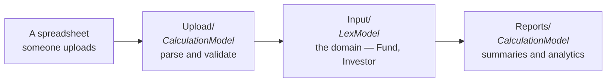

Lex App uses a flat project structure — no `manage.py`, no nested [Django](https://docs.djangoproject.com/) app folders, no `admin.py` or `views.py`. Your project follows the **ETL pattern**: Upload models for ingestion, Input models for domain logic, and Report models for output.

```
YourProject/
├── .env                        ← environment config, loaded by every lex command
├── .run/                       ← PyCharm run configurations (eleven, from lex setup)
├── migrations/                 ← Django migrations
├── tests/
│   └── test_suite.py
├── model_structure.yaml        ← frontend sidebar layout (optional)
├── lex_config.py               ← project settings (initial data, tab names, …)
├── requirements.txt
│
├── Upload/                     ← Extract: data ingestion models
│   ├── __init__.py
│   ├── UploadBalanceSheet.py
│   ├── UploadCashflow.py
│   └── serializers.py
│
├── Input/                      ← Transform: core business entities
│   ├── __init__.py
│   ├── Fund.py
│   ├── Quarter.py
│   └── Investment.py
│
└── Reports/                    ← Load: calculations & analytics
    ├── __init__.py
    ├── CalculateNAV.py
    └── InvestorTrackRecord.py
```

## The ETL Convention

| Folder | Purpose | Base Class | Example |
|---|---|---|---|
| `Upload/` | Ingest raw data (CSV, Excel) | `CalculationModel` | `UploadBalanceSheet` |
| `Input/` | Core business entities and domain logic | `LexModel` | `Fund`, `Investor` |
| `Reports/` | Compute summaries, analytics | `CalculationModel` | `CalculateNAV` |

The three are a direction, not just three folders:



`Upload/` turns a file into records, `Input/` is what those records mean, and
`Reports/` computes over them. The base classes follow from that: the two ends
do work and are `CalculationModel`s; the middle holds state and is a `LexModel`.

This isn't enforced by the framework — you can organize however you like — but following this convention makes projects immediately understandable to anyone familiar with Lex App.

> [!tip]
> Larger projects often create additional subfolders within `Input/` for domain areas, like `Input/InvestmentStructure/`, `Input/Cashflows/`, or `Input/Valuation/`. The key is that imports always follow the folder structure: `from Input.Fund import Fund`.

## Imports Follow the Folder Structure

Each folder is a Python package. Import paths mirror the directory layout:

```python
from Input.Fund import Fund
from Upload.UploadBalanceSheet import UploadBalanceSheet
from Reports.CalculateNAV import CalculateNAV
```

## The `.env` File

The `.env` file holds your runtime configuration for local development. Every `lex` command loads it from the project root by itself, whether an IDE run configuration or a terminal starts it — there is nothing to source. A variable that is already set in the environment wins over the file.

See [[start-here/installation#Configure Your Environment|Installation]] for how to configure it.

## Model Files

Each model is a standalone Python file. The framework discovers them automatically — you don't need to register them anywhere.

```python title="Input/Fund.py"
from lex.core.models.LexModel import LexModel
from django.db import models


class Fund(LexModel):
    name = models.CharField(max_length=200)
    department = models.CharField(max_length=200)
    budget = models.DecimalField(max_digits=12, decimal_places=2)
```

> [!tip]
> To organize models in the frontend sidebar, use a `model_structure.yaml` file. See [[model-your-data/model structure]] for details.

## Key Dependencies

Lex App brings along a specific set of dependencies, pinned to exact versions. Your models, calculations and dashboards run on these — in 2.5.0:

| Dependency | Version |
|---|---|
| Python | 3.12 only |
| Django | 6.0.9 |
| pandas | 3.0.6 (it brings numpy with it) |
| openpyxl | 3.1.5 |
| Streamlit | 1.66.1 |
| Reflex | 0.9.13, with reflex-enterprise 0.9.7 |
| Celery | 5.6.3 |
| The web interface, `lex-app-frontend` | 2.3.x |

So your `requirements.txt` needs:

- `lex-app`, pinned exactly (`lex-app==2.5.0`) — see [[ship-and-operate/upgrading#Pin the version|Upgrading]]
- Any additional libraries your project needs

> [!warning] Do not pin these yourself
> pip has to satisfy every requirement at once, so with lex-app pinned, a
> version of your own that differs from its — `pandas==2.2.*`, `django<6` —
> makes the install fail. Leave them out of your `requirements.txt` and take
> the versions lex-app brings. Code written against older releases of them, Django 5 or
> pandas 2, may need changes when you upgrade. The interface is the one
> exception: [[ship-and-operate/upgrading#The interface upgrades separately|its pin]]
> leaves room for a later 2.3.x of your own.
