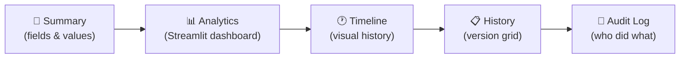

Open a record from the grid, and you're taken to its full story. The record detail page is where a single entry goes from a line of data to a living document — with its current state, embedded analytics, visual history, and a complete audit trail.

> [!tip] Getting here from the grid
> Clicking a row doesn't open it. The eye icon (**Show**) in a row's **Actions** column
> opens the record in a side panel first, with its files and fields; **Open full view**
> in that panel brings you to this page. To open this page directly, ⌘-click or
> Ctrl-click the eye icon. See
> [[using-the-app/the-grid/index#Viewing a Record|Viewing a Record]].

## The Five Tabs

Every record detail page has up to five tabs, each offering a different perspective on the same data:



### [[using-the-app/record-detail/summary tab|Summary]]
The record's current values, one field per row. Choose how many columns to show, switch between view presets for different field sets, and export a one-page PDF snapshot.

### [[using-the-app/record-detail/analytics tab|Analytics]]
An embedded [Streamlit](https://docs.streamlit.io/) dashboard scoped to this specific record. Charts, KPIs, custom visualizations — all computed live and displayed without leaving the page.

### [[using-the-app/record-detail/timeline tab|Timeline]]
Every version of this record as a bar on a time axis. Click one to see who changed what, and how it differs from the version before. The **As Of** control time-travels: it shows the timeline as the system knew it at any moment in the past.

### [[using-the-app/record-detail/history tab|History]]
The full history of all versions of this record, displayed in a grid you can filter and sort.

### [[using-the-app/record-detail/audit log tab|Audit Log]]
All operations (create, update, delete) that have been performed on this record, with the author, timestamp, and full payload for each event.

Tabs appear only where they apply. Timeline and History need history tracking on the
model; Analytics and Audit Log are left out on legacy tables. A past version's page —
opened from the History tab, or from **Full history** on the table — has no History tab;
it has a **Live Data** tab instead, whose **Go to Live Data** takes you to the record as
it is now.

## The Toolbar

Above the tabs, a toolbar gives you quick access to:

| Control | What It Does |
|---|---|
| **View Preset** | Switch between serializer presets (like different zoom levels on the same record) |
| **Column Layout** (1 · 2 · 3) | How many fields sit side by side on the Summary tab. Shown on the Summary tab only |
| **Edit** | Opens the full-page edit form for this record |
| **Export Summary** | Saves a one-page PDF snapshot of the Summary tab. Shown on the Summary tab only |


## Customizing Tab Labels

By default the **History** and **Audit Log** tabs use their built-in names. You can rename them per model — or across all models at once — in `lex_config.py`:

```python title="lex_config.py"
TAB_DISPLAY_NAMES = {
    # Override for every model that doesn't have its own entry
    "__default__": {
        "history_tab": "Versions",
        "audit_log_tab": "Activity",
    },
    # Override for a specific model (takes precedence over __default__)
    "expensereport": {
        "history_tab": "Expense History",
    },
}
```

Both keys are optional — omit one to keep the built-in label for that tab. Model names must be lowercase (the lowercased Python class name). The `__default__` entry applies to all models that don't have their own explicit override.

## Navigating Between Records

Use the breadcrumbs at the top to navigate back to the grid. On a record page the trail
names the model by its internal, lower-case name, followed by `show`:

```
⌂ › expense › show
```

Click **expense** to return to the grid. It opens with its saved view: filters, sorting
or grouping you changed and didn't save are gone, and you start at the top again. To
keep your place in the grid, look at records in the side panel the eye icon opens
instead — the grid stays as it was underneath.
