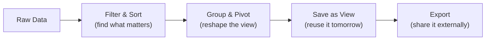

The grid is where you'll spend most of your time. It's an enterprise-grade datagrid powered by [AG Grid](https://www.ag-grid.com/) — think Excel, but connected to your live data, with real-time collaboration, and none of the versioning chaos.

Every model in your project gets a grid automatically. Open a model, and you'll see your data laid out in rows and columns with a full toolbar of capabilities above it.

If the same model is open in another tab or window, ordinary record changes show up automatically. Create, edit, or delete a row elsewhere — including bulk edits and deletes — and open lists refresh on their own once the change is committed, without a manual reload.

## What You Can Do

### [[using-the-app/the-grid/filtering and sorting|Filtering & Sorting]]
Start broad, then narrow down. Tick the values you want in a column's list, or add conditions on text, numbers and dates. Multi-column sorting arranges data in the order that makes sense for your analysis.

### [[using-the-app/the-grid/grouping and pivoting|Grouping & Pivoting]]
Reshape your data without changing it. Group rows by any column to create collapsible hierarchies. Turn on pivot mode for cross-tabulation — expenses by team per quarter, for example — with automatic aggregation.

### [[using-the-app/the-grid/saved views|Saved Views]]
Once you've set up the perfect combination of filters, sorting, grouping, and column layout, save it. Switch between multiple views instantly — your "Q1 Travel Expenses" view or the "Manager Summary" view — without rebuilding each time.

### [[using-the-app/the-grid/table settings|Table Settings]]

Tune the table to how you work — row density, pinned columns, and how numbers are
formatted. Kept in this browser, for that table.

### [[using-the-app/the-grid/density and display|Density & Display]]
Adjust how tightly data is packed. **Compact** shows maximum rows for scanning large datasets. **Comfortable** gives each row breathing room for detailed review. Choose what fits your task.

### [[using-the-app/the-grid/exporting data|Exporting Data]]
Take your data out of Lex App when you need to. Export respects your current view — filters, grouping, pivot state, and selected rows are all preserved. What you see is what you get.

### [[using-the-app/the-grid/calculations|Running Calculations]]
For tables whose records calculate: start a run from a row, follow its status, and read
its log.

## The Toolbar

Above every grid is a toolbar that gives you quick access to key actions:

From left to right:

| Control | What It Does |
|---|---|
| **Current** | Chooses which data the table shows: the live records, the table as it was at a date, or every version of every record — see [[#Current, As of and Full history]] |
| **Analytics** | Shows the table's dashboard in place of the rows. The button then reads **Back to Records**. Not there in Full history |
| **Clear all changes** (the curved arrow) | Goes back to the saved view, dropping the filters, sorting, grouping and column changes made since. Greyed out when there is nothing to clear |
| **Save changes to current view** (the disk) | Saves the table as it is now into the open view. Greyed out on a system view — see [[using-the-app/the-grid/saved views\|Saved Views]] |
| **View selector** | Switches between saved views, or creates one when you type a name and press Enter |
| **Select rows** (the checklist) | Shows checkboxes so you can tick rows — see [[#Selecting and Deleting Rows]] |
| **Export** (the download arrow) | Downloads an Excel file (`.xlsx`) of the ticked rows, or of the whole table as it is shown — see [[using-the-app/the-grid/exporting data\|Exporting Data]] |
| **Auto-fit columns** | Sizes every column to its content |
| **Settings** (the gear) | Density, display and column options, and per-column number formats — see [[using-the-app/the-grid/table settings\|Table Settings]] |
| **Create new record** (**+**) | Opens a panel for a new record. Greyed out when the table is read-only (*This resource is read-only.*), in Full history (*Creation is unavailable in history view.*), or when you may not create records (*You do not have permission to create records.*) |

Calculations are started per row, not from the toolbar: ▶ in a row's **Actions**
column runs that record's calculation. See
[[using-the-app/the-grid/calculations|Running Calculations]].

## Current, As of and Full history

The first button in the toolbar chooses which data the table shows. It reads **Current**
until you pick something else:

- **Current** — the records as they are now.
- **As of date…** — the table as it was at a moment you pick. A date-and-time picker
  opens; once you choose, the button reads *As of* and the date. **Reset to Latest** in
  the same picker goes back to the live records.
- **Full history** — every version of every record, one row per version. The button
  reads **History**.

While the button shows anything other than **Current**, it is tinted, so you can tell at
a glance that you are not looking at today's data. **Export** exports what is shown,
past dates included.

Full history is for reading. In it, a row's **Edit** and **Delete** are greyed out,
and so are ▶ and **+**. By default only a superuser can change a past version, by editing
its cells in place — **Valid From** and **Valid To** included — as in [[#Inline Editing]].
A version's record
page — **Open full view** in the eye icon's panel, or ⌘/Ctrl-click the eye icon — has a
**Live Data** tab, whose **Go to Live Data** takes you to the record as it is now.

For one record's history, use its [[using-the-app/record-detail/timeline tab|Timeline]]
and [[using-the-app/record-detail/history tab|History]] tabs.

## Inline Editing

Double-click any editable cell to modify it directly in the grid. Changes are validated in real-time — if a [[model-your-data/serializers|serializer]] rejects the value, you'll see the error immediately. No separate edit form needed for quick corrections.

The grid stays live: when a record changes — whether you edited it, a colleague did, or a calculation produced it — the open grid updates on its own, so you're always looking at current data without pressing **Refresh**.

Fields you don't have [[access-and-dashboards/permissions|permission]] to edit appear as read-only — the grid respects your access level down to individual cells.

Choice fields use a picker instead of free text, required fields are marked
before you submit, and numeric model fields are treated as numbers for editing
and filtering.

Those edits also refresh other open lists for the same model, so you don't need to ask teammates to reload before they see the updated row.

## Creating a Record

**+** (*Create new record*) at the right end of the toolbar opens a panel over the list,
on the same layout editing uses, so you keep your place, your filters and your scroll
position instead of navigating away and back. The full-page create route still exists
and is still reachable — deep links and links from a failed create both point at it —
so nothing that relied on it has changed.

## Viewing a Record

Clicking a row doesn't open it. Each row's **Actions** column, pinned to the right
edge, holds the eye icon (**Show**), the pencil (**Edit**) and the bin (**Delete**) —
with ▶ in front of them on tables that calculate.

The eye icon opens the record in a panel on the right, the same panel **Edit** uses.
The grid stays where it was, with your filters and your scroll position.

The panel shows the record's **Files** first: each file field with its file name and a
download. The record's other fields follow below. At the bottom of the panel:

- **Open full view** takes you to the [[using-the-app/record-detail/index|record page]],
  with its Analytics, Timeline, History and Audit Log tabs.
- **Edit** switches the panel to the edit form. It is there only when you may edit the
  record.

Only one panel is open at a time. Opening **Edit** closes the view, and the other way
round. On a wide screen, the icon in the panel's header widens it to the full window;
the panel remembers that choice the next time you open it.

To go straight to the record page, hold ⌘ (Mac) or Ctrl (Windows) while you click
the eye icon, or click it with the middle mouse button. The page opens in a new tab.

## Selecting and Deleting Rows

**To delete one record**, click the bin in its row. A dialog asks you to confirm. The
bin is greyed out when you may not delete that record, and in Full history. The edit
form — the panel and the full page alike — also has **Delete** at the bottom, with the
same confirmation; afterwards you are back at the table.

**To work with several rows**, click **Select rows** in the toolbar. Checkboxes appear
in front of the rows, and the button's tooltip turns to *Done — exit selection*. Click
it again to hide the checkboxes; that also unticks every row.

As soon as a row is ticked, a bar above the grid counts them — *3 items selected* — with:

- **Delete**, which deletes every ticked row after you confirm. It is there only when
  you may delete records in this table, and then a row you may not delete can't be
  ticked.
- **Clear**, which unticks everything and keeps the checkboxes.

The checkbox in the header ticks the rows on the page. When the table has more rows than
the page shows, a **Select Records** dialog asks how far to go: **Visible Page** or
**All Records** (or **Cancel**).

**Export** in the toolbar follows the ticks: its tooltip reads *Export 3 selected rows*
while rows are ticked, and *Export the whole table* when none are.

While a change is being saved — an inline edit, a delete — the grid is covered by
*Applying changes. The table will refresh when the operation is complete.*

## Columns, Copying and Pasting

Two tabs sit on the grid's right edge. **Columns** lists every column: tick one to show
or hide it, drag it to change the order, and drag columns into the panel's row-group,
value and pivot areas — see [[using-the-app/the-grid/grouping and pivoting|Grouping & Pivoting]].
**Filters** holds every column's filter — see
[[using-the-app/the-grid/filtering and sorting|Filtering & Sorting]].

**Auto-fit columns** in the toolbar sizes every column to its content. The new widths
are a change to the view: save them, or drop them with **Clear all changes**.

Drag across cells to select a range, as in a spreadsheet; the status bar under the grid
shows its sum, average and count. Press Ctrl+C (⌘C on a Mac) to copy it.

Right-click a cell for **Copy**, **Copy with Headers**, **Copy with Group Headers**,
**Paste** and **Export to Excel**. **Paste** puts the clipboard into the selected cells;
the grid saves each changed cell the way it saves an inline edit, so only cells you may
edit change.

## What Cells Show

- **A link to another record** shows that record's name as a chip. Point at it for a
  moment and a card opens with a few of its fields and **Open record**, which takes you
  to its page. The card's **Filter by this value** button is always greyed out — filter
  the column from its header instead.
- **A list of linked records** (many-to-many) shows a button, *View 3 items*; click it
  to see their names. With nothing linked it reads *No … to view* and is greyed out.
- **A file** shows its name and a download. On SharePoint storage, a spreadsheet,
  document or slide deck gets **Download**, **Preview** and — when you may edit the
  field — **Edit**, which opens the file in SharePoint in a new tab. Editing a file this
  way resets the record's calculation to `NOT_CALCULATED`. Most other files get
  **Download / Preview**. An empty file field reads *No File*.

## Pages of Rows

The grid shows its rows a page at a time. How many fit a page depends on the row height:
100 at Compact, 25 at Standard and 12 at Comfortable. The bar at the bottom of the grid
shows which rows you are looking at and how many there are — *1 to 5 of 5*, *Page 1 of
1* — with arrows to move between pages and a **Page Size** selector.

## Empty Tables and Errors

When the grid has no rows to show, it says why:

- *Nothing here yet* — the table has no records.
- *No rows match the current filters* — there are records, but your filters exclude
  them all. **Clear filters** removes every filter at once.
- *This table could not be loaded* — with the error, or *The request failed. Refresh to
  try again.*

When the server refuses a change, a message says why. If the server sent a traceback
with it — usually only in development — the message has a **Show Traceback** button that
opens it.

## The ID Column

The grid sizes its columns to their content, but it no longer lets the ID column grow
wider than about 160 pixels on its own. A long ID is cut off with `…`, so the columns
you came to read stay on screen.

- **Copy an ID.** Point at an ID cell, or move to it with the keyboard, and a copy icon
  appears. Click it to copy the whole ID, not just the part you can see. A tick and
  *Copied* confirm it. Copying does not select the row or start an edit.
- **See more of it.** Drag the column's edge to make it wider. A width saved in a
  [[using-the-app/the-grid/saved views|view]] is kept.
- **Hide it.** Turn on **Hide ID column** in the
  [[using-the-app/the-grid/table settings|table settings]]. It applies to this table in
  this browser and stays hidden after a reload.

Your team can also set a different default width for a table, or hide the column for
everyone. See [[model-your-data/serializers|Serializers]].
